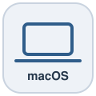
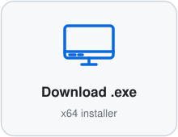
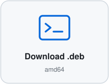

# Lionsville Architect

An architecture modelling tool. It draws an **application landscape in Layer-7
bands** and the **C4 container diagrams underneath it**, edits both, and saves
them to a file. This build has no account, no backend and no telemetry: your
design lives on your own machine and goes no further than you send it.

It runs as a desktop app on macOS, Windows and Linux, and in a browser: the
newest release is always at **[app.architecture.lionsville.nl](https://app.architecture.lionsville.nl/)**,
or run it from source.


*The shipped example, `Acme Logistics` — a fictional landscape you can open,
copy and take apart.*


*Its business architecture — the journey with a key account's lane and a
marketplace partner's beside the common path, and the areas that serve it.*

## Download

<p align="center">
<a href="https://architecture.lionsville.nl/download"><picture><source media="(prefers-color-scheme: dark)" srcset="docs/download/macos-dark.svg"></picture></a>
&nbsp;
<a href="https://architecture.lionsville.nl/download"><picture><source media="(prefers-color-scheme: dark)" srcset="docs/download/windows-dark.svg"></picture></a>
&nbsp;
<a href="https://architecture.lionsville.nl/download"><picture><source media="(prefers-color-scheme: dark)" srcset="docs/download/linux-dark.svg"></picture></a>
</p>

<p align="center"><b><a href="https://architecture.lionsville.nl/download">architecture.lionsville.nl/download →</a></b><br>
<sub>macOS, Windows and Linux, from one page.</sub></p>

The desktop app is downloaded from that page, and it asks before it updates
itself: it offers a new version, downloads it only once you say so, and then
asks you to restart. **Check for Updates…** in the Help menu asks on request.

The source is here, under the [AGPL-3.0](LICENSE), and anyone may build the
app from it — see [Running from source](#running-from-source) and
[`docs/release.md`](docs/release.md). The releases on this repository carry the
source and the web build, not installers.

New here? The **[user manual](docs/manual.en.md)** (also in
[Dutch](docs/manual.nl.md) and [German](docs/manual.de.md)) is the place to start.

Prefer a browser? [app.architecture.lionsville.nl](https://app.architecture.lionsville.nl/)
is the newest release, with nothing installed — your work stays in that browser,
or in a folder it opens for you. Want to change something? See
[Running from source](#running-from-source).

## What it does

### Two levels of diagram

- **The Layer-7 landscape.** Five bands — actors, input channels, external
  systems, the application landscape, the management layer — with elements
  placed in them and **domain groups** boxing the ones that belong together.
  The board is drawn neutral, so that colour answers one question at a time
  (*Colour* over the board), and it reads at three distances: far off a name,
  closer what an element does, close up what it is made of. Bands and groups
  resize; groups can be tidied on their own.
- **C4 container diagrams.** Double-click an application, or pick it and press ⌘↓, to open
  the container view underneath it; *Create container diagram* in its menu or
  its panel makes one. The application becomes the boundary of that view and
  its containers sit inside. Each landscape keeps a list of the
  container views under it, and you can step back up from any of them.

### Elements

On a landscape you add applications, actors, platforms and building blocks, and
the domain groups that hold them; on a container diagram, containers. The band an
element is placed in says how it is drawn: a card among the external systems,
the input channels or the management layer is drawn as one of those. Each carries a name,
category, vendor, technology, a markdown description, an accent colour drawn
as a thin rail, an icon and a **lifecycle** — planned, live, retiring, retired — which shows as a badge
on the card (retired elements are dimmed, and the badges can be switched off for
a clean export). Elements also carry **operational aspects** — managed, partial,
at risk — for the parts of a landscape that are about who runs what, and can
be marked **confirmed** or **assumed**, which draws them dashed: an element and a
connection alike.

Elements are model-level: an element exists whether or not it is placed on a
diagram, one element can appear on more than one, and removing it from a diagram
is a different action from deleting it from the model.

### Connections

Draw one by dragging between elements or from the right-click menu's *Start
connection to…*. A connection carries a label, a protocol (EDI, Kafka, REST —
whatever you type), a direction that sets the arrowheads, a colour and a line
style.

Lines are routed orthogonally by a real router — libavoid compiled to
WebAssembly, running off the main thread — so they route around elements rather
than through them, and re-route when you move something. When automatic is not
what you want, take over: drag a segment, add or remove bend points, **pin** a
route so nothing moves it again, choose which **side** of an element each end
attaches to, and drag the label off its default position. All of that survives a
re-layout, a reload, and a round trip through the working file.

### Layout you can hand off or keep

**Tidy layout** runs an ELK pass over the diagram with a direction (across,
down, or hybrid: groups across and the applications inside each one down), a
density, and pins for the things you have already placed by hand — anchor
points, group placements, group contents, the container boundary. There is also
a **route-only** pass that leaves every element where it is and just redraws the
lines.

Tidy runs off the main thread, so the window stays alive while it works and the
button that started it becomes a **Cancel** you can actually press. Past four
hundred boxes on one diagram it declines with a message rather than thinking for
several minutes: the layered algorithm's cost climbs far faster than the board
does.

By hand: align and distribute a selection, a grid with optional snapping, nudge
with the arrow keys (finer with Shift), a minimap, and fit-view.

### Icons and logos

Around a hundred built-in marks, sorted into data, integration, applications,
platform, security and operations, rail and vendors — searchable, and settable
for a whole selection at once. You can upload your own SVG or PNG, which joins
an "uploaded" category in the picker.

### Decisions, written down where the architecture is

Every landscape, every application and every group keeps its own **architecture
decision records** — MADR markdown with a title, a status, a date and the people
it was put to. The status is a state machine (proposed → reviewing → accepted or
rejected, and accepted → superseded by a named successor), and the three end
states lock the record rather than trusting anybody to leave it alone. Numbers
run per list and are never reused.

### Observations, and what lies behind them

Every scope keeps a register of **observations** — what a team saw, where,
how often and how much it matters — and works them through as a chain:
**Seen**, **Why**, **Solve** and **Did it work**. *Why* asks its way down from
an observation to **causes** and causes of causes until a **root cause** stands
at the end — one the team says is one, `RC-` on the cause's own number, and
what a solution addresses. Each stage is a quiet list with a large preview of
the record picked, and a map that opens readable, with the weight of each line
saying how firmly one explains the other. Two observations that turn out to be
the same are merged with the history kept, one that was fixed is archived
rather than deleted, and one that needs nothing done leaves the waiting list as
**Noted**, with its reason kept. Every scope reads the analysis of every scope below it, with nothing
shared first: local there, global here, each scope below in a boundary of its
own, and a cause above may explain a cause below (`docs/decisions/0021`,
`0032`).

### One search over all of it

**⌘K** searches everything the organisation holds at once — elements and the
prose written about them, views, relations, decision records, plans and their
milestones, observations, causes, solutions and experiments, and the people in
the organisation's register (one forgotten by pseudonym only) — in the scope you
are in, the scopes above it and the rest of the tree. Each hit says what it is
and which scope holds it, and opens where it lives: the box on the canvas, that
element's page, the record on its page, in its own scope
(`docs/decisions/0029`). **⌘F** is the narrower one on the canvas: find a box by name, category,
vendor or technology, including boxes not on the diagram you are looking at.

### Editing, in general

Right-click menus on everything — element, connection, canvas, domain group,
selection, diagram tab — each offering what that thing can actually do.
Multi-select with a rubber band or Shift-click, then edit lifecycle, colour,
icon or domain group for all of it in one undo step. Over a board, the View bar
says the rest in words: **Add** and connect where you are looking, **Arrange**,
**Show**, **Colour**, **Day** to look at another day (read-only, one press back),
**Find** and **Export**.

**One undo stack over everything**: a node dragged, a diagram renamed, a
decision accepted and a project setting cleared are the same kind of change and
come back in the order you made them. Typing a name is one step, not eleven; a
drag and the routing that follows it are one step. An **Activity** panel beside
the work lists what has happened since you opened the project, with names and
times, and leads to the whole history. Every
change an agent made in one session can be taken back as one step while its
steps are the newest.

Rename in place with F2. Copy, cut, paste, duplicate. One panel beside
the board for whatever is picked — an element, a line, a group or several — whose
rows are pressed to edit, and a record opened whole as a document. A keyboard-shortcut overlay that is generated from
the same table that dispatches the keys, so it cannot drift.

There is a **read-only** mode that hides every mutating control rather than
disabling it.

### The organisation, and the scopes in it

Every screen sits in one frame of two rows: the first says where you are and
whether your work is safe, in one word that opens **Your work**, with ⌘K to find
anything or run any command; the second lists the places in the scope you are
in. Pages are places with an address, so Back, Forward and a link reach them.


The app opens on the **organisation**, the root of everything you keep.
Everything in it is a **scope**: one document with a name, its boards, decisions, plans and
business architecture — and scopes nest, the organisation at the top, a
**domain** or a **team** under it, a **landscape scope** under that, as deep as
the work needs. The first screen is the organisation's home: its name and
links, the views here and what is kept here one line each, the tree of scopes
docked beside it, and *Continue* to the places you last worked in. An
organisation nobody has started opens on a first page instead: name yours, look
around the example, or carry on with what you have. A scope's name, its kind and where it is filed
can all be changed afterwards.

An example is **a place you visit**: anything can be tried there, nothing is
kept, and your own work is untouched. **Keep this as my start** copies it in —
into an empty, unnamed organisation as the organisation itself, otherwise under
a scope of its own.

### Saving, exporting, sharing

Three ways out, for three different purposes:

- **A saved copy (`.lvarch`)** — everything: every scope, topology,
  geometry, styling, pictures, uploaded logos, pinned routes and attach sides,
  sealed under a password. This is the file to hand to someone who will edit
  it, and the way to move your work between the desktop and a browser.
- **The interchange document** — topology and semantics only, no geometry and no
  styling. This is the form for review and for version control: a diff shows
  what changed about the architecture rather than what moved on the canvas.
- **PNG export**, from a dialog with a preview: light or dark, with or without
  line labels, a title block along the bottom carrying client, title, author
  and date, and a legend of the badge colours. A container diagram names itself
  in its bar and on the sheet, and its key, generated from what is drawn, goes with it.

Reading is broad and writing is narrow: a key this tool does not understand
survives a round trip untouched, and files written by older builds keep opening
— a file is recognised by what is in it rather than by what it is called.

### Large landscapes

The tool is measured against a generated landscape of two thousand elements,
five thousand connections and thirty diagrams, with two kilobytes of markdown on
every element. Those budgets run in the gate before every release
(`docs/decisions/0004`); on that landscape, opening a project takes 16 ms, a
keystroke in an inspector 0.25 ms, a keystroke in search a third of a
millisecond, and five hundred undo steps 0.02 MB of memory.

Two things decline rather than freeze, and say so: **Tidy** past four hundred
boxes, and **automatic routing** past a hundred and fifty connectors competing
for one channel — where it leaves your stored routes exactly as they are. A very
large **PNG export** asks first, with the size of the image, before it starts
drawing.

### Three languages, three themes, five text sizes

Dutch, German and English, switchable at any moment, covering menus,
dialogs, band names, errors and the export title block — not a partial
translation. Light, dark and system themes, in one design system with Source
Sans 3 and Source Code Pro bundled. The text size is set in the top row, from
90 to 150 percent, and a browser's own text size reaches the same sizes.

## Where your work is kept

In one of three places, and the app always says which:

- **In a folder, on the desktop**, as text files you can read
  (`docs/decisions/0003`). Nothing is hidden inside the app: the folder syncs,
  backs up and commits like anything else you own. A moved element rewrites
  one small file, and a rewritten paragraph one markdown file.
- **In the browser**, in that browser's own storage for the site, where it
  stays across restarts. Chromium can also open a folder for a tab, and then
  the tab works in it the way the desktop does.
- **Nowhere**, where the browser's storage will not open. Everything works,
  and the app says plainly that nothing outlives the tab.

A private window usually does open the browser's storage, and then keeps your
work only as long as the browser does: the app cannot tell the window is
private, so save a working file there to keep your work.

```
<your folder>/scope.json · model.json           the organisation
              <scope>/scope.json · model.json   a scope under it, and so on down
                      diagrams/<id>.json · <id>.geometry.json
                      docs/<element>.md · decisions/NNNN-<slug>.md
                      transitions/ · observations/ · images/ · logos/
```

Everything is written three seconds after you stop editing, when you leave the
window and when you close it. On the desktop, closing with unsaved work saves
it first and asks only if that did not work; in a browser tab it always asks.
If the work changes underneath you (a colleague, a sync client, another tab),
the app says so. It never overwrites the other version without asking.

**Every place keeps a history.** **Snapshot…** records the work under a
message drafted from what you actually did. **History…** shows what has
changed since any snapshot, as architecture rather than as lines, restores a
diagram, a page or the whole scope, and labels a version. A folder keeps its
history in git on your machine, and a browser keeps it in the browser.
Pictures in a description are fetched only when they scroll into view.

**A saved copy (`.lvarch`)** is the whole organisation in one file, under a
password. It opens in any of the three places, so it is how work moves
from a browser to the desktop and back. A file saved from one opens byte for
byte the same in another, pictures included. Files written by older builds
keep opening, and a browser's work from older builds is brought along.

Opened with no address, the app lands on the organisation's home, where
*Continue* leads back to the places you last worked in.

## Running from source

Node 26, the version CI builds with (22.12 or newer works). Internet is needed
once, for `npm install`; everything after that is local.

```bash
npm run setup && npm run dev
```

Then open http://127.0.0.1:5200. One tree, one `node_modules`, one of every
config; `npm run setup` is `npm install` and exists so the instruction does not
have to change again.

For the desktop app: `npm run dev:desktop` runs it against the Vite dev server,
`npm run smoke:desktop` builds it and drives the real production bundle through
its checks in a real window, and `npm run dist:desktop` packages it (unsigned,
locally).

## The loop

```bash
npm run check
```

A few seconds: typecheck and lint of everything, plus every test. Run it
after every change; it is fast on purpose.

```bash
npm run check:all
```

Adds a production build. Run it once before handing work back.

```bash
npm run verify
```

~2 minutes: everything `check:all` does, plus the perf budgets, the desktop build
and the desktop smoke run — every step run to the end, one table, one exit code.
The gate before a push, made so an agent can run it without deciding anything.
`npm run smoke` is the last two steps on their own; `npm run test:perf` is the
perf step alone.

The perf step times a generated landscape of a few thousand elements against a
written-down budget per operation (`src/model/testing/`, `docs/decisions/0004`).
It is deliberately not in `npm run check`: building those landscapes and timing
work over them is tens of seconds, and a fast loop you batch up is not a fast
loop.

Other commands: `npm run test:watch`, `npm run build`, `npm run preview`. The dev
server is also declared in `.claude/launch.json` as `editor-dev`.

## How it is put together

One codebase, in modules. Each has an `index.ts` that is its public surface,
pure files at its root, and a `ui/` folder for its React side where it has one.

```
src/model/          the model, the commands that change it, interchange, keys
                    testing/ — the generated landscape, and the perf budgets
src/layout/         tidy, ELK, libavoid on WebAssembly, the router worker
src/editor/         the canvas: nodes, edges, palette, inspectors, PNG export
src/documentation/  descriptions as documents, and the page that reads them
src/decisions/      architecture decision records, and the page that reads them
src/search/         one search over elements, documentation and decisions
src/i18n/           the registry; each module keeps its own strings/ slice
src/projects/       what a scope is, where it is filed, the tree and its index
src/platform/       a refusal, a diagnostic, the log's name, the window's chrome
src/widgets/        the kit (one design system: tokens, fonts and the components
                    every screen is composed from) and presentation with no opinions
src/business/ · src/technology/ · src/roadmap/ · src/observations/
src/operating/ · src/people/ · src/principles/ · src/blocks/ · src/comments/
                    the pages for each kind of record, pure at the root, React in ui/
src/agent/          the agent's tools, and the app as a screen it can move
src/ports/          the seams: ScopeRepository · OrganisationIndex
                    HistoryRepository · ImageRepository · SettingsRepository
                    Interchange · CommandChannel · PreferencesStore
                    DocumentGateway · Diagnostics · HostControls · AgentGateway
src/adapters/       the outside world: the folder and its format, this
                    browser's database, memory, the desktop's channel
src/providers/      each place work is kept, whole: its way in and its chrome
src/app/            the shell: the frame, the organisation's home, the workspace, dialogs
electron/           the desktop main process and preload
```

Who may import whom is a **matrix**, declared as data at the top of
`eslint.config.js` and generated into one rule per module, each with its own
sentence. `model` is the bottom of the tree and knows nobody; `app` is the top
and knows everyone; nobody imports `app`. `model`, `layout`, `platform`,
`ports`, `projects`, `i18n` and `agent` may not import React, MUI, Emotion or
React Flow at all — nor a `ui/` file, nor the barrel of a module that
re-exports one; those modules name the file they want. `platform/node/` is the
only folder in `src/` that may say `node:`, and no module may import it, `app`
included. `localStorage`, `sessionStorage` and IndexedDB are an error outside
`src/adapters/`, along with the file pickers on `window`. Nothing outside the
adapters, the providers and the composition root may import an
implementation or name a storage mechanism (`build/storageLine.ts`). Every source file
carries its SPDX licence header, which is a rule here too. If a rule blocks
you, the design is telling you something — move the code, do not route around
it.

Until September 2026 the editor was a separate package under
`vendor/solution-design`, with its own toolchain and a string table carrying 177
keys for screens it could not render. `docs/decisions/0001` records why that
boundary went and what replaced it.

Adding a different place to keep things is its five repositories under
`src/adapters/`, the five contract suites (`src/ports/*.contract.ts`) run over
them, a provider under `src/providers/`, and one `registerSourceProvider` in
`composition.ts`. Nothing above the seam changes.

`CLAUDE.md` carries the full map, including a "where does my change go" table
and the names that are settled.

**There is no customer in this codebase** — an organisation is a *scope*, which
is data a user creates, not a name compiled into the code. If you find one in an
identifier, a storage key or a default filename, that is a bug.

## Scopes, and their addresses

A scope is addressed by its **path** in the tree, the organisation's being
empty, and has an identity a move does not change:

```
acme
acme/rail/rolling-stock
```

A rename edits the scope and leaves its address alone. A move changes the
address of the scope and of everything under it, and carries every reference
pointing into it.

## The user manual

In three languages, one file each: [docs/manual.en.md](docs/manual.en.md),
[docs/manual.nl.md](docs/manual.nl.md) and [docs/manual.de.md](docs/manual.de.md). It covers the organisation and its
scopes, the workspace, drawing, elements, connections, layout, the
documentation page, decisions, the roadmap, the business architecture and the
map, diagram settings, saving and sharing, and the shortcuts worth knowing.

## Files worth knowing

| Path | What it is |
|---|---|
| `CLAUDE.md` | How to work in this repo: the layer map, the loop, the conventions, the settled names |
| `docs/release.md` | Cutting a release: the procedure, the five variables, what has gone wrong before |
| `docs/decisions/` | The architecture decision records for this repository |
| `eslint.config.js` | The import matrix: who may know about whom, and why |
| `src/app/main.tsx` | The composition root; its header states the pattern |
| `src/app/composition.ts` | Which providers the shell registers, and which icon packs |
| `src/projects/scope.ts` | What a scope is, and the arithmetic over a tree of them |
| `src/ports/*.contract.ts` | The behaviour every place that keeps work must show |
| `electron/main/index.ts` | The desktop main process; its header states what is load-bearing |
| `build/libavoidWasm.ts` | Publishes the router's wasm; fails a build, not a shipped app |
| `docs/manual.{en,nl,de}.md` | The user manual, in English, Dutch and German |
| `LICENSE` | The licence |

## Licence

**GNU Affero General Public License v3.0** — see `LICENSE`. Copyright ©
2024–2026 Lionsville Group BV.

The Affero clause is the one to read before deploying: if you run a modified
version of this tool where other people can reach it over a network, those
people are entitled to its source. Running it unmodified, or modifying it for
yourself, carries no such obligation.

The router is `libavoid-js`, which is LGPL-2.1-**or-later** and therefore
usable here under LGPL-3.0. Its wasm is published beside the app under its own
unhashed name so that a self-built replacement can be dropped in, which is what
that licence asks for; see `build/libavoidWasm.ts`. Other dependencies
installed through npm are under their own licences.

Contributions are welcome; [`CONTRIBUTING.md`](CONTRIBUTING.md) says how, and
under what terms a contribution is accepted (AGPL-3.0-only, copyright assigned).
