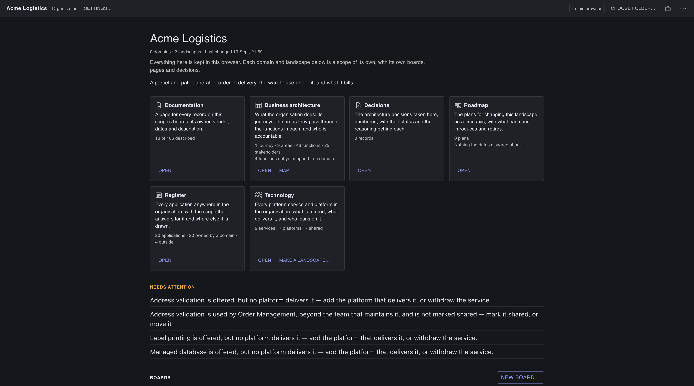
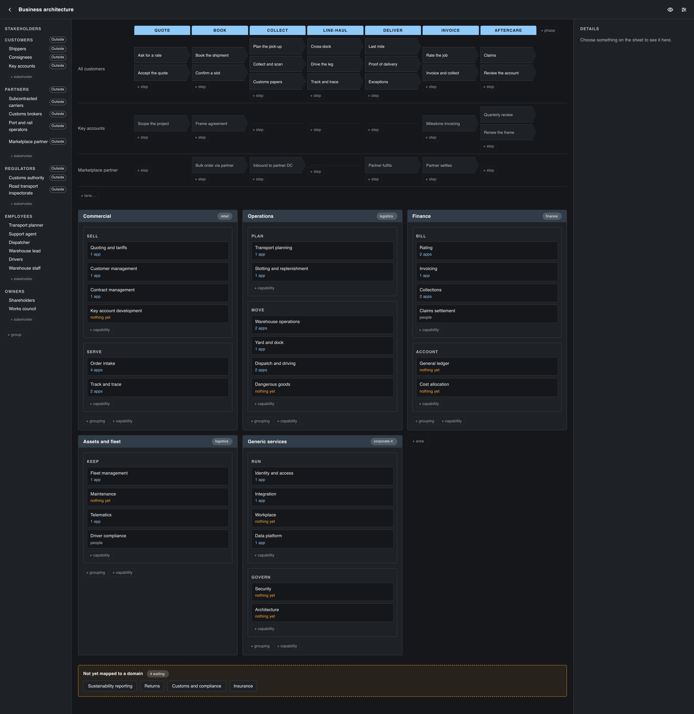

# Gebruikershandleiding

Lionsville Architect tekent een applicatielandschap in Layer 7-banden en de
C4-containerdiagrammen eronder. Dit is de handleiding voor het gebruik. Wat het is en waarom het bestaat staat in de
[README](../README.md); deze handleiding is er ook in het
[Engels](manual.en.md) en het [Duits](manual.de.md).

## Beginnen

**Desktop.** Download de app voor je platform van
[architecture.lionsville.nl/download](https://architecture.lionsville.nl/download).
De app kijkt op de achtergrond of er een nieuwere versie is en vraagt eerst
voordat hij er iets mee doet — **Download and Install** haalt hem op
terwijl je doorwerkt, **Skip This Version** zegt deze niet, en het vinkje in
dat venster zet de automatische controle uit. Is de download klaar, dan vraagt
de app je opnieuw te starten; **Later** installeert hem de volgende keer dat je
de app afsluit. Waar de app zichzelf niet kan vervangen — rechtstreeks gestart
vanaf de schijfkopie, of vanuit Downloads zonder naar Programma's verplaatst te
zijn — zegt hij dat en opent hij in plaats daarvan de downloadpagina.
**Check for Updates…** in het Help-menu vraagt het op verzoek.

**De menu's** op de desktop zijn voorlopig Engels. **File** bevat de map, het
werkbestand, momentopnamen en geschiedenis; de items over het geopende
onderdeel — Save — is grijs zolang er niets open is; Open… en Save a Copy of
the Working File… gaan over de hele organisatie en werken vanaf elk scherm. **Edit** bevat Undo, Redo, Delete en Select All, die werken
op de eigen ongedaan-maak-stapel van de app en op het canvas, naast Cut, Copy
en Paste. **Help** bevat deze handleiding, in de taal van de app, de
sneltoetsen en de updatecontrole.

**Browser.** [app.architecture.lionsville.nl](https://app.architecture.lionsville.nl/)
is de nieuwste release, zonder iets te installeren. Je kunt hem ook draaien
vanuit een kloon van de repository: eenmalig `npm run setup`, daarna
`npm run dev`, en open <http://127.0.0.1:5200>. Waar de browser het aanbiedt
(Chromium doet dat), kan een tabblad net als de desktop in een map werken.
Anders wordt je werk in die browser bewaard; een privévenster houdt het maar
zo lang als de browser dat doet. *Waar je werk wordt bewaard* zegt meer.

In beide gevallen verlaat niets je computer. Er is geen account, geen backend
en geen telemetrie.

## Het organisatiescherm

De app opent op de **organisatie**: een onderdeel als elk ander, en het
onderdeel waaronder al het andere valt dat je bewaart. Een **onderdeel** is één document:
een naam, een landschap, de containerdiagrammen eronder, de besluiten, de
plannen, de bedrijfsarchitectuur en alles wat erop staat. Onderdelen
**nestelen**, en ze zijn allemaal hetzelfde document — de organisatie bovenaan,
een **domein** of een **team** eronder, een **landschapsscope** daar weer
onder, zo diep als je werk vraagt. Een landschapsscope is een onderdeel; een
landschap is ook een soort bord, en dat is een tekening binnen een onderdeel.



Het scherm is het thuis van de organisatie en geen lijst met documenten. Een
regel onder de naam zegt wat het is en waar alles staat: als bestanden in de
map, in deze browser, of nog nergens. Daarna bestaat het uit vijf delen.

**Wie het is**, bovenaan: de naam, de klant als de tekeningen voor iemand anders
gemaakt zijn, hoeveel scopes eronder vallen naar wat elk zegt te zijn
(*2 domeinen · 1 team*, in de woorden van de labels op hun regels), wanneer er voor
het laatst iets veranderde, de omschrijving en de koppelingen. Een organisatie
die nog geen naam heeft vraagt er hier om in plaats van een lege kop te tonen;
een map heet zoals de map zelf tot je haar een naam geeft.

**De eigen pagina's**, als kaarten. Elke kaart zegt in één zin wat er achter
**Openen** zit, en telt dan: **Bedrijfsarchitectuur** de klantreizen, gebieden,
functies en belanghebbenden die de organisatie zelf heeft, en hoeveel functies
nog aan geen enkel domein zijn toegewezen; **Besluiten** de vastleggingen per
status, met de nieuwste erbij; **Roadmap** de plannen, en het eerste waarover
hun datums het oneens zijn; **Register** elke applicatie in de hele map,
hoeveel er door een domein worden beheerd en hoeveel van iemand anders zijn;
**Technologie** elke platformdienst en elk platform, en hoeveel er gedeeld
zijn; **Besturingsmodel** de eenheidstypen, rollen en verantwoordelijkheden, en
of elke verantwoordelijkheid haar ene eindverantwoordelijke rol heeft. Een
onderdeel dat tekent heeft ook een kaart **Documentatie**. Elke kaart
opent wat hij telt; als je de pagina sluit ben je weer hier.

**Bediend door**, onder de kaarten, overal waar de organisatie eenheden heeft
— maar niet op de eigen startpagina van de organisatie, want de organisatie
is geen domein en geen eenheid bedient haar: de eenheden die deze scope
bedienen, in de volgorde van hun types, elk met wie
vandaag haar aansturende rol vervult en waar ze is ingedeeld als dat ergens
anders is. Een eenheid bedient de domeinen die haar **Bedient** noemt, of de
scope waarin ze is ingedeeld als ze er geen noemt — tenzij dat de organisatie
is: daar bedient een eenheid niets tot ze een domein krijgt — en een eenheid onder een
die een scope bedient, bedient die via haar — die worden geteld in plaats van
opgesomd. **+ Eenheid** kiest er een uit de hele organisatie: de lijst is
gegroepeerd per eenheidstype, zegt waar elke eenheid is ingedeeld en wordt
korter terwijl je typt; een eenheid waarvan het type één domein bedient, of
die wordt bijgehouden waar je alleen mag lezen, staat erin en zegt waarom je
haar niet kunt kiezen. Een eenheid toevoegen, of **✕** ernaast, verandert wat
die eenheid bedient: één stap in de scope die de eenheid bijhoudt, en daarom
alleen aan jou waar je die scope mag wijzigen — een rol die mensen aanstuurt
reikt daar niet. Onder de eenheden de **domeineigenaar**: wie de rol vervult
die de regel *domeineigenaar* van de organisatie noemt, in de bedienende
eenheid die het hoogst in deze scope is ingedeeld. Die wordt op de dag
uitgerekend en nooit bewaard. Een klik op de naam van een eenheid opent haar
waar ze wordt bijgehouden — op het organogram van die scope, gekozen, waar die
er een heeft — en haar paneel zegt hetzelfde van de andere kant, waar elk
domein weer de startpagina van dat domein opent.

**Controles**, een kaart op elke startpagina, opent de **pagina Controles**:
elke controle die de app doet, naar waar ze over gaat, met waarom elke
controle ertoe doet, hoe je het oplost en waar ze iets vindt in of onder deze
startpagina (*De pagina Controles*, hieronder).

**Vraagt aandacht**, boven de kaarten, zodra de controles iets vinden:
hoeveel, per gewicht — zoveel **te herstellen**, zoveel **om na te kijken**,
zoveel **notities** — elk een link naar de pagina Controles, op de eerste
controle van dat gewicht die iets vindt. Een bevinding die als bedoeld is
gemarkeerd telt niet mee. Wat de controles vinden is waarin de organisatie
zichzelf tegenspreekt — een naam die twee onderdelen allebei definiëren, een
verouderde kopie, een applicatie waarvan niemand heeft gezegd van wie ze is,
een dienst die over een teamgrens wordt gebruikt zonder als gedeeld
gemarkeerd te zijn, een dienst die geen enkel platform levert, een capability
die een domein voorstelt, een eenheid die mensen tekortkomt of boven de
limiet van haar type zit, een plan voorbij zijn einde, een interface tussen
twee teams die niets hebben vastgelegd, en op het organisatiescherm zelf een
eenheidstype dat nergens onder valt of een verantwoordelijkheid zonder haar
ene eindverantwoordelijke rol. De rest van *Eén naam in de hele organisatie*
hieronder zegt wat elk betekent.

**Scopes binnen** de organisatie, eronder: één regel per onderdeel, de
kinderen ingesprongen, met een pijltje om een domein dicht te klappen, en een
label met wat het onderdeel zegt te zijn. Een regel zegt hoeveel erin zit —
scopes met borden en diagrammen over de hele tak voor een domein, diagrammen
voor een onderdeel waar niets onder valt — en wanneer het laatst iets
veranderde.
**Volgorde** sorteert op naam of op wat je het laatst hebt gewijzigd. Een
organisatie waar nog niets bij is ondergebracht zegt dat in één zin. Een
onderdeel dat tekent toont boven de boom zijn **Borden**, één regel elk, en
**Nieuw bord…** biedt dezelfde soorten als het `+`-tabblad van de editor: een
landschap, een bedrijfsarchitectuur, een enterprisekaart of een
technologielandschap.

- **Openen** op een regel gaat naar het thuis van dat onderdeel: zijn eigen
  kaarten, zijn borden, en de scopes daarbinnen, elk met een eigen regel. Een
  bord open je vanaf zijn regel onder **Borden**.
- **Nieuw domein of team…**, één keer, bovenaan de sectie, vraagt om een naam
  en brengt het nieuwe onderdeel onder bij het onderdeel waarvan je het thuis
  ziet; **Valt onder** in de dialoog zet het ergens anders. Waar de
  organisatie eenheden heeft, kiest **Bediend door** in de dialoog de eenheid
  die het bedient, uit dezelfde lijst als **+ Eenheid**; dat wordt
  weggeschreven zodra het onderdeel er is, als één stap in de scope die de
  eenheid bijhoudt. Wordt dat geweigerd — je mag daar alleen lezen — dan wordt
  het onderdeel toch gemaakt en zegt een melding dat de eenheid niet is
  gekoppeld; **Bediend door** op de startpagina van het nieuwe onderdeel is
  waar je het instelt.
- **Instellingen…** op elke regel bevat de naam, wat het is (organisatie,
  domein, programma, team, landschapsscope — een woord voor het scherm, er
  gedraagt zich niets anders), een klant, een omschrijving, koppelingen en **Ondergebracht
  bij**, waarmee je het verplaatst. Het **Bediend door** erin is dat van het
  thuis, en elke wijziging ervan wordt weggeschreven zodra je hem maakt, niet
  met **Opslaan**; de naam van een eenheid daar opent haar zoals op de
  startpagina, en sluit de dialoog.
- **Verwijderen** haalt het onderdeel weg, met alles wat eronder valt, en de
  bevestiging zegt dat ook: zijn map op schijf, of, in een browser zonder map,
  zijn records uit deze browser. Een werkbestand dat je elders hebt bewaard
  blijft staan. De organisatie zelf kun je niet verwijderen: daar valt al het
  andere onder.

Het label rechts in de balk zegt waar je werk wordt bewaard: de map waarin je
projecten als bestanden staan, **In deze browser**, of **Nergens bewaard**.
**Vanuit een andere map werken…** ernaast wijst de app naar een andere map, en
een browser zonder map biedt in plaats daarvan **Map openen…**.

**Voorbeelden**, als laatste. Een voorbeeld kopiëren in een organisatie die
leeg is en geen naam heeft, maakt het voorbeeld *de* organisatie. Een
organisatie die al iets is, zet het onder een eigen nieuw onderdeel. Dat geldt
voor alles met een naam, een onderdeel eronder, een bord of vastleggingen, en
voor elke map, die zoals de map zelf heet. Hoe dan ook is de kopie vanaf dat
moment van jou, en niets wat je doet raakt het voorbeeld zelf.

Hernoemen hernoemt alleen het label — waar iets staat is zijn adres, en
hernoemen is niet verplaatsen. Verplaatsen verandert het adres van het onderdeel
en van alles eronder, en laat de inhoud ongemoeid: elke verwijzing elders in de
map die naar iets in die tak wees, gaat in dezelfde stap mee naar het nieuwe
adres, zodat een verplaatsing geen spoor van verouderde kopieën achterlaat. Zo
ook elke oorzaak die een van zijn oorzaken verklaart, en elke waarneming die een
van zijn waarnemingen opnam: die noemen het bij zijn adres, en gaan mee. Bij
het starten opent de app het onderdeel dat je open had.

Zeven namen worden geweigerd, omdat de mappen van een onderdeel ze al gebruiken:
`diagrams`, `docs`, `decisions`, `transitions`, `observations`, `images` en `logos`.

## Eén naam in de hele organisatie

Een naam betekent overal in je map hetzelfde. Het magazijnsysteem is één
systeem, welk domein het ook tekent, en een capability die de organisatie
benoemt is diezelfde capability waar een landschap hem verfijnt — dus elk ding
wordt **één keer** vastgelegd, in één onderdeel, en elk ander onderdeel dat het
gebruikt wijst naar datzelfde ding.

**Het onderdeel dat het vastlegt, beheert het.** Daar zitten de details: in
welke fase het is en op welke data, wie het beheert, welke leverancier, waarop
het draait, hoe volwassen het is. Verander daar iets en overal waar het
getekend wordt staat het nieuwe.

**Overal elders staat een verwijzing** — een kaart die het ding tekent zonder
het te beheren. Zo'n kaart toont de naam met een klein **uit …** eronder dat
zegt waar het echt is vastgelegd, en het detailpaneel zegt hetzelfde met een
knop om daarheen te gaan. De naam en die regel zijn kopieën en staan dus
alleen-lezen, net als alles wat de beheerder beantwoordt. Wat een verwijzing
wél mag dragen is **haar eigen beschrijving** — wat het ERP voor het magazijn
betekent is een andere pagina dan wat het ERP ís, en allebei zijn ze het
opschrijven waard. Net zo de kleur, de vorm en het icoon die je hem geeft, en
waar je hem op je eigen borden zet.

Welk onderdeel een ding beheert, wordt bepaald door **diepte**: het diepste
onderdeel dat het vastlegt. Die ene regel werkt beide kanten op, en dat is het
punt. Capabilities worden bij de organisatie vastgelegd en naar beneden
verfijnd, dus de organisatie houdt ze. Applicaties worden vastgelegd in het
landschap dat ze draait, dus een domein houdt de zijne — en een organisatie die
een applicatie alvast bij naam noemt, noemt een plaatshouder die opzij gaat
zodra iemand dieper het echte record schrijft.

### Wat een bevinding betekent

De app weigert hierover nooit een save. Hij leest de hele map bij het openen —
en opnieuw zodra de map onder je verandert — en meldt wat hij vindt. Elke regel
van de boom op het organisatiescherm draagt zijn eigen zin.

- **Conflict** — twee onderdelen op hetzelfde niveau leggen dezelfde naam vast.
  Iemand is halverwege een migratie, of twee teams noemden hetzelfde ding op
  dezelfde middag. Beide regels zeggen het, want geen van beide is de foute.
  Maak er één een verwijzing naar de ander van.
- **Verouderd** — de kopie van de naam klopt niet meer met hoe het beherende
  onderdeel het noemt, of dat onderdeel is verplaatst. **Bijwerken** schrijft de
  kopieën in één stap terug, en dat kun je ongedaan maken als al het andere.
- **Ongedefinieerd** — een verwijzing naar iets dat niets in de map vastlegt. De
  kaart wordt getekend en de regel blijft staan; wat ontbreekt is ergens een
  record om naar te wijzen.
- **Een losse regel** — een lijn die eindigt op iets dat niets in de map heeft.
  Blijft staan en wordt als stomp getekend, en verdwijnt nooit bij een save.
- **Een voorstel** — een capability die een domein benoemde en geen onderdeel
  erboven. Geen fout: het is een gesprek met het niveau erboven.
- **Zonder eigenaar** — een systeem dat als andermans is gemarkeerd zonder dat
  iemand heeft gezegd van wie.

Eén ding op die lijst is **informatie en geen fout**: een record dat niets in
zijn eigen onderdeel tekent — geen bord houdt het, en geen tekening daar wijst
ernaar. Iets kan echt, beheerd en beschreven zijn zonder al op iemands plaat te
staan, dus het is een notitie, net als een voorstel, en wordt nooit als fout
gekleurd.

### Een lijst met bevindingen lezen

Elke lijst met bevindingen is dezelfde lijst: de **Controles** van een
eenheid, de samenvatting naast het organogram, de bevindingen van de
Conway-kaart, **Nog open** bij een plan en **Waar de datums het oneens zijn**
op de roadmap. Een startpagina telt haar bevindingen onder **Vraagt aandacht**
en zet ze op de pagina Controles.

- **Eén regel per controle**: het teken van haar gewicht, haar naam en
  hoeveel, dichtgevouwen. Druk op de regel om elke bevinding eronder te zien,
  in haar eigen zin.
- **Drie gewichten**, in deze volgorde. **Herstellen** (een rode stip): het
  model spreekt zichzelf tegen of kan niet kloppen, en het herstel zit in het
  model. **Nakijken** (een oranje driehoek): waarschijnlijk een gat of een
  risico, het bekijken waard. **Notitie** (een *i*): informatie die heel goed
  zo bedoeld kan zijn. De regel onder de lijst zegt welk teken wat is.
- **De notities zijn verborgen** achter **Notities tonen (N)**. Wat een lijst
  heeft opengevouwen, en of haar notities te zien zijn, duurt zolang de app
  open is en wordt nooit bewaard.
- **Druk op een bevinding om haar te lezen**: haar zin, haar gewicht en waar
  ze over gaat, **Waarom het ertoe doet**, **Hoe je het oplost**, en de acties
  die het oplossen of openen waar het wordt opgelost — het record openen, de
  tekening, de eenheid of de twee eenheden, het eenheidstype, het plan, de
  persoon in Mensen; **Koppelen…**, **Overnemen**, **Toewijzen…**, **De
  toewijzing beëindigen…**, **De toewijzing verwijderen**, **Een
  samenwerking vastleggen…**, **De vastlegging
  verwijderen**. Een lijst biedt de acties die ze kan doen waar ze staat, en
  het scherm dat ze opent doet de rest. **Alle bevindingen** gaat terug naar
  de bevinding waar je vandaan kwam.
- Een bevinding die is opgelost verdwijnt uit de lijst, en haar uitleg mee.
- **Markeren als bedoeld…**, onder de uitleg van een nakijkpunt of een
  notitie, zegt dat het zo bedoeld is: het vraagt waarom, en de reden mag leeg
  blijven. De bevinding verdwijnt uit de lijst en staat onder **Geaccepteerd
  (N)**, onder de controles, met haar reden en de dag waarop ze is
  gemarkeerd. **Terugnemen** daar brengt haar terug. Een markering is een stap
  in het model, bijgehouden in het onderdeel waar de bevinding over gaat, dus
  iedereen ziet haar en de Activiteitenlijst noemt haar; gemarkeerd waar dat
  onderdeel open is, neemt ⌘Z haar terug zoals elke andere stap. Een markering
  gaat over de bevinding zoals ze is: verander waar ze over gaat — een andere
  eenheid aan de samenwerking, een andere rol eindverantwoordelijk — en de
  bevinding komt terug. **Herstellen** kan niet worden gemarkeerd: het model
  spreekt zichzelf tegen, en het antwoord zit in het model. Waar je het
  onderdeel dat haar bijhoudt alleen mag lezen, wordt niets aangeboden. Een
  agent leest de markeringen en maakt er nooit een.

### De pagina Controles

**Controles** op de kaart van een startpagina, of een aantal onder **Vraagt
aandacht**, opent de pagina Controles over die startpagina: wat de controles
vinden in of onder haar, en op het organisatiescherm in de hele boom.

- **Elke controle, per categorie** — het landschap, plannen en datums, de
  organisatie, teams en systemen, analyse — met het teken van haar gewicht,
  haar naam en hoeveel ze vindt, nul ook: een controle die niets vindt is het
  weten nog steeds waard. Herstellen voor nakijken voor notitie binnen elke
  categorie.
- **Tonen** op de balk kiest welke gewichten je ziet. De notities zijn
  verborgen tot je ze toont, zoals in elke lijst, en wat je kiest duurt zolang
  de app open is.
- **Kies een controle** om haar te lezen: haar gewicht en categorie, **Waarom
  het ertoe doet**, **Hoe je het oplost**, en **Gevonden (N)** — elke
  bevinding ervan, elk in haar onderdeel. Druk op een ervan om haar te openen
  waar ze wordt opgelost: het record, de tekening, het plan, de pagina van het
  besturingsmodel, een persoon in Mensen. **Markeren als bedoeld…** naast een
  bevinding van een nakijkpunt of een notitie markeert haar vanaf hier, in het
  onderdeel dat haar bijhoudt, en **Geaccepteerd (N)** zet op een rij wat is
  gemarkeerd, elk met **Terugnemen**. Een toewijzing in een eenheid die er
  niet is biedt ernaast **De toewijzing verwijderen**, op dezelfde manier
  weggeschreven: er is geen eenheid meer om het vandaan op te lossen. Een
  markering die hier wordt gemaakt,
  met niets open, is een stap van dat onderdeel en staat niet op een
  ongedaan-stapel: **Terugnemen** is hoe je haar ongedaan maakt.
- Wat de pagina telt, komt uit wat de app al weet over de hele boom: de
  bevindingen tussen onderdelen, de eenheden en mensen van de organisatie, de
  datums van elk onderdeel, en de Conway-kaart over de startpagina. Een paar
  controles lezen het hele document van een onderdeel — een record op geen
  enkele view, de gegevens van de eigenaar op een stand-in, een lijn naar
  niets, de link van een tekening, de twee van de bedrijfslaag, een oorzaak
  die een waarneming eronder verklaart — en vinden iets waar dat onderdeel
  open is: de pagina zet ze op een rij met hun uitleg en zegt *Hier niet
  geteld* in plaats van een getal.

### Het register

**Register** op het organisatiescherm is elke applicatie in de hele map, op één
pagina. Niets schrijft hem: hij wordt telkens uit de onderdelen zelf afgeleid
wanneer de map gelezen wordt, dus hij kan niet afwijken van wat de mappen zeggen
en er is geen lijst die twee domeinen tegelijk bewerken.

Elke regel zegt hoe de applicatie heet, **welk onderdeel haar beheert**, of ze
van iemand anders is en van wie, **in hoeveel onderdelen ze getekend is** (houd
de muis op het aantal voor de namen), en de bevindingen erover als kleine chips.
Het filterveld doorzoekt de naam, de sleutel en het onderdeel; **Op naam** en
**Op niveau** zijn de twee volgordes. **Openen** gaat naar het onderdeel dat de
applicatie beheert, met de kaart geselecteerd — daar kunnen haar details worden
gewijzigd.

Een regel waar twee onderdelen dezelfde naam vastleggen biedt **Koppelen…**: dat
opent het onderdeel waarvan de vastlegging moet wijken en vraagt het dáár, want
een vastlegging wordt alleen gewijzigd door het onderdeel dat haar heeft.

### Een vastlegging naar een ander onderdeel verplaatsen

Waar iets is vastgelegd is een keuze die je achteraf kunt wijzigen. Kies de kaart
en druk op **Verplaatsen…** in de inspector; het venster biedt aan welke van de
vier van toepassing zijn.

- **Koppelen** — de eigen vastlegging opgeven en verwijzen naar die van een
  ander onderdeel. Dit lost een conflict op, en het is wat een kaart nodig heeft
  die getekend is voordat iemand de echte vastlegging schreef. Dit onderdeel
  houdt zijn eigen beschrijving, zijn kleuren en waar de kaart op zijn borden
  staat; het geeft de details op, waar het andere onderdeel vanaf dan voor
  instaat.
- **Omhoog** — de vastlegging naar een onderdeel hierboven verplaatsen en hier
  een verwijzing achterlaten. Dat is wat een applicatie in een landschap nodig
  heeft als het domein erboven degene hoort te zijn die haar beheert.
- **Omlaag** — het omgekeerde: naar een onderdeel hieronder.
- **Overdragen** — naar elk ander onderdeel. **Hier een verwijzing achterlaten**
  staat standaard aan; zet je het uit, dan tekent dit onderdeel het ding
  helemaal niet meer.

**Een eenheid neemt haar mensen mee.** Een eenheid omhoog, omlaag of over
verplaatsen neemt elke toewijzing die voor haar wordt bijgehouden mee, in
dezelfde stap — ook de beëindigde, want wie haar rollen vervulde hoort bij de
eenheid — onder de id's die ze hadden, zodat ieders verleden van hen blijft. Een
verwijzing die achterblijft houdt er geen. De bevestiging zegt hoeveel er
meegaan.

De laatste drie schrijven **twee onderdelen**, dus ze vragen het eerst. Het
onderdeel waar het naartoe gaat wordt geschreven vóór dit onderdeel verandert, en
dat is met opzet: gaat er halverwege iets mis, dan staat de vastlegging op
*beide* plaatsen — een conflict dat je ziet en met **Koppelen** oplost — en niet
op geen van beide.

Daarom **stopt ongedaan maken daar**. ⌘Z neemt alles terug wat je sindsdien deed
en weigert dan die stap, met een regel die zegt waarom: maar de helft ervan staat
op de stapel van dit venster, en de andere helft is een bestand in een onderdeel
waar hier niemand voor spreekt. Verplaats de vastlegging opnieuw, de andere kant
op, om het terug te zetten.

Een verplaatsing wordt geweigerd, met de reden, als het onderdeel waar het
naartoe zou gaan de naam al beheert, als een verplaatsing omhoog een onderdeel
noemt waar dit niet onder valt, en als het verwijderen van de vastlegging dingen
die eronder vallen zonder ouder zou achterlaten.

## Mensen

**Mensen** op het startscherm van de organisatie is het register van de
mensen van de organisatie: één vermelding per persoon, met een naam, een
werkadres als je dat weet, en of iemand van de organisatie is of van buiten.
Meer wordt er niet bewaard — geen notities, geen foto.

Het register staat **buiten de geschiedenis**. Een wijziging hier is geen
stap: er is geen ⌘Z voor en geen regel in Activiteit, en de pagina zegt dat
ook, onder **Over het register** aan het eind van haar ene regel inleiding.
Daardoor kan een naam vergeten worden. De geschiedenis bewaart het id
van een persoon, nooit de naam, en elk scherm vraagt het register om de naam
wanneer het er een toont — dus als een naam uit het register verdwijnt,
verdwijnt hij in één keer van elk scherm.

- **Iedereen** staat in de lijst met soort, status en de **rollen vandaag**
  die ze vervullen — op één regel de eerste rol in haar eenheid en hoeveel er
  nog zijn (**Vervult vandaag** bij de persoon heeft ze allemaal), en *geen*
  voor wie niets vervult, zodat die opvalt — en is te
  zoeken op naam, adres, of een rol of eenheid die ze vervullen; **Toon**
  beperkt de lijst tot wie actief is, wie vertrokken is of wie vergeten is. De
  kolom leest de dag waarop de pagina bekeken wordt (**Bekijk op**, hieronder).
- **Persoon toevoegen** vraagt om een naam, een adres en de soort. Voordat er
  iemand wordt toegevoegd, zoekt het naar iemand die dezelfde persoon kan
  zijn: hetzelfde adres, dezelfde naam (hoofdletters, accenten en spaties
  tellen niet), een naam die op twee letters na gelijk is — *Pia Schultz*
  vindt *Pia Schulz* — of dezelfde achternaam en voorletter. **Deze
  gebruiken** neemt de vermelding die er al is; **Toch toevoegen** maakt een
  tweede, die je later kunt samenvoegen.
- **Mogelijk dubbel** zijn de paren in het register die één persoon kunnen
  zijn. Ze zijn ingeklapt telkens als de pagina opent, als één regel: hoeveel,
  hoeveel per teken, en **Bekijken**. Uitgeklapt is elk paar één rij, het
  sterkste teken eerst — hetzelfde adres, dezelfde naam, bijna dezelfde naam,
  dezelfde achternaam en voorletter — met de twee mensen naast elkaar en wat
  ze onderscheidt: de eerste rol die ze vandaag vervullen en hoeveel er nog
  zijn, het werkadres, *Extern*, en *account* waar een bron die weet wie zich
  aanmeldt zegt dat de vermelding aan een account gekoppeld is. Als er geen
  paar meer over is, is de regel weg.
- **Niet dezelfde persoon** beantwoordt dat de twee twee mensen zijn. Het
  paar wordt niet meer aangeboden, en wie een van beiden corrigeert, krijgt
  geen waarschuwing meer over de ander; iemand nieuw toevoegen kijkt nog wel
  naar allebei. Het antwoord staat in het register, buiten de geschiedenis
  zoals de rest ervan — de twee id's en de dag — en gaat met het register mee
  in een werkbestand, ook een zonder namen. **N beantwoord als niet dezelfde
  persoon**, onder de lijst, toont de antwoorden, elk met **Terugnemen**,
  waarna het paar weer mogelijk dubbel is. Wie een van beiden vergeet of
  verwijdert, laat het antwoord vervallen; wie een van beiden samenvoegt met
  een derde vermelding, neemt het mee naar de vermelding die blijft, tenzij
  dat de ander van de twee is. Geen agent beantwoordt het, zoals geen agent
  samenvoegt.
- **Samenvoegen…** vraagt eerst welke vermelding blijft — de vermelding die
  aan een account gekoppeld is, en dan die met de meeste toewijzingen, staat
  vooraf gekozen, en je kunt de andere kiezen — en is definitief: één vermelding blijft,
  de andere wordt een verwijzing zonder naam, zodat alles wat ernaar wees de
  vermelding toont die blijft. Wie actief is samenvoegen met een vermelding
  die vertrokken is, vraagt wat klopt. **Er nog** laat het vertrek vervallen:
  de vermelding die blijft is weer actief, en het beleid telt niet langer af
  tot de naam wordt vergeten. **Vertrokken** beëindigt de rollen van de
  samengevoegde vermelding op de vertrekdag, zoals **Markeren als
  vertrokken** dat zou doen — een rol die na die dag begon vervalt, want een
  rol eindigt nooit voordat hij begon — en de vraag zegt eerst hoeveel van
  elk. *Er nog* staat vooraf gekozen als een van die rollen na de vertrekdag
  begon.
- **CSV importeren…** neemt een lijst — geplakt, of uit een bestand — met op
  elke rij een naam, een adres en *intern* of *extern*, gescheiden door
  komma's of puntkomma's. Elke rij gaat door dezelfde controle: een rij die
  duidelijk iemand is die er al staat voegt niemand toe, een rij die dat
  misschien is wordt gemarkeerd en alleen toegevoegd als je **Toch toevoegen**
  aanvinkt, en de rest wordt toegevoegd.
- **Een persoon** laat zien wie het is, hoe ver iemand is met vertrekken, en
  wat iemand in de organisatie vervult: **Vervult vandaag**, **Gaat
  vervullen** en **Vervulde eerder**, elk een rol in een eenheid (zie
  *Eenheden en de mensen erin*). **Bekijk op** zegt hetzelfde op een andere
  dag — na een reorganisatie bijvoorbeeld — en **Terug naar vandaag** keert
  terug; kijken schrijft niets. **Dit ben ik** vertelt deze installatie
  welke vermelding jij bent, zodat je overal gemarkeerd wordt waar je
  voorkomt; dat wordt bij de installatie bewaard — voor een map die in een
  browser is geopend, in die browser — nooit in je map of in iets wat je
  exporteert. **Vind
  mij**, in de balk, toont dan de hele lijst met jouw vermelding gekozen.
  **Corrigeren…** wijzigt de naam, het adres of de soort, en zegt met wie de
  gecorrigeerde vermelding dan dezelfde persoon kan zijn — nooit met iemand
  over wie beantwoord is dat het niet dezelfde persoon is.
- **Markeren als vertrokken** vraagt om de laatste dag. De naam blijft
  zichtbaar tot het beleid hem vergeet.
- **Nu vergeten** vraagt eerst en haalt dan de naam en het adres voorgoed weg:
  vanaf dan toont elk scherm een pseudoniem, *Oud-collega 7KQM*. Het register
  bewaart geen geschiedenis van een naam, dus niets brengt hem terug. Een
  ondertekend besluit houdt de naam waarmee het is ondertekend, en toont die
  daar los: niets koppelt haar aan de vergeten vermelding.
- **Nu verwijderen**, bij een vermelding die al vergeten is, haalt haar uit
  het register; wat ernaar wees leest *een oud-collega*.
- **Verwijst naar hen** noemt elke vastlegging waarvan een veld de persoon
  bij id noemt — een element of plan waarvan ze eigenaar zijn, een
  waarneming die ze deden, een experiment dat ze uitvoeren, een besluit dat
  ze voorstelden of ondertekenden — met het onderdeel dat haar bewaart, en
  wat de regels van het besturingsmodel hen vandaag in eigendom geven (zie
  *Velden die een persoon noemen*). Een handtekening die haar naam hield,
  zegt de naam waarmee getekend is — behalve bij een vergeten vermelding, die
  alleen zegt dat de handtekening bestaat, zodat de naam zoals getekend nooit
  naast het pseudoniem staat. **Wat we bewaren** doet hetzelfde.
- **Wat we bewaren** toont alles wat het register over iemand bewaart, en wat
  naar die persoon wijst, als één document om te kopiëren: het antwoord op
  een inzageverzoek. Een verzoek om te wissen beantwoord je met **Nu
  vergeten**. Het zegt ook hoeveel vastleggingen de persoon in hun tekst
  noemen — woorden die in een veld zijn getypt in plaats van een gekozen
  persoon, die vergeten niet bereikt en zoeken wel vindt.

**Het beleid**, onderaan de pagina, is een instelling van de organisatie en
geen stap: hoe lang de naam van wie vertrekt bewaard blijft (90 dagen, tenzij
je dat wijzigt), hoe lang de vergeten vermelding daarna blijft (730 dagen),
en of een agent namen of pseudoniemen ziet. Wie de instellingen van de
organisatie mag wijzigen, stelt het in — op de desktop wie de map beheert.
De app past het toe als de organisatie wordt geopend en opnieuw elke dag dat
ze open blijft: een naam die langer dan de termijn is bewaard wordt vergeten,
een vermelding die langer dan de volgende termijn is bewaard wordt
verwijderd.

Waar de organisatie wordt bewaard door een bron die weet wie zich erbij
aanmeldt, kan die bron twee hiervan zelf doen: ze past het beleid toe op een
eigen schema, en de app vergeet dan niemand als de organisatie wordt geopend;
en ze weet welke vermelding jij bent, aan de hand van je account, zodat je
gemarkeerd wordt zonder **Dit ben ik**, dat dan niet wordt aangeboden.

Zo'n bron kan ook weten wie wat mag. De pagina biedt dan elke wijziging
alleen aan wie haar mag doen: **Persoon toevoegen**, **Corrigeren…** en
**Markeren als vertrokken** bijvoorbeeld alleen voor de mensen van je eigen
eenheden, en **Samenvoegen…**, **Nu vergeten**, **Nu verwijderen** en het
beleid alleen voor de beheerders van de organisatie. **Niet dezelfde
persoon** en **Terugnemen** krijgt wie de twee mag samenvoegen, en, waar de
bron een leidinggevende rol het recht geeft de mensen ervan te wijzigen, een
leidinggevende in wiens eenheden ze vandaag allebei zitten. Waar ze een werkadres
voor je achterhoudt, zegt de pagina *een adres dat je niet te zien krijgt* in
plaats van dat er geen is. Iemand als vertrokken markeren kan diens
toewijzingen meteen beëindigen; de pagina zegt hoeveel. En waar haar schema
iemand van wie de dag gekomen was niet vergat, omdat er na de laatste
werkdag nog met diens account is aangemeld, zegt de pagina dat bij de
status, en beslist wie de naam mag vergeten.

Op de desktop is het register het bestand
`.lionsville-architecture/people.json` in je map. **Het staat nooit in de
geschiedenis van de map**: geen momentopname neemt het mee, en een
`git add` die je in een terminal typt laat het ook weg, omdat een naam in een
commit een naam is die niets kan vergeten. Een kopie van de map via git
bevat daarom id's en geen namen; het werkbestand neemt het register mee.
De antwoorden *niet dezelfde persoon* staan in hetzelfde bestand. Een versie
van de app van daarvoor leest de mensen en laat de antwoorden weg, en schrijft
het bestand zonder ze zodra ze het register weer wijzigt: de paren zijn dan
weer mogelijk dubbel, en verder gaat er niets verloren.

### Velden die een persoon noemen

Zes velden noemen een persoon: de **Eigenaar** van een element, de
**Eigenaar** van een plan, wie een waarneming deed (**Waargenomen door**),
wie een experiment uitvoert (**Door**), en wie een besluit voorstelde
(**Voorgesteld door**) en ondertekende (**Beoordelaars en ondertekening**).
Elk neemt een persoon uit het register, of tekst zoals altijd — een naam,
initialen, een team.

- **Uit het register…** naast het veld opent de kiezer van het register:
  zoek op naam, kies iemand, of **Nieuwe persoon…**, dat eerst zoekt naar
  iemand die dezelfde persoon kan zijn, zoals **Persoon toevoegen** doet.
  Terwijl je een naam typt, biedt het veld onder **In het register:** de
  vermeldingen aan die het kunnen zijn; kies er een om naar die persoon te
  verwijzen in plaats van de naam te schrijven. Een naam die op een naam in
  het register lijkt, wordt pas geschreven als je het veld verlaat, zodat een
  naam die je typt om iemand te vinden nooit in de geschiedenis belandt.
- **Een gekozen persoon** wordt bewaard als id. Het veld toont wat het
  register zegt: de naam, of *Oud-collega 7KQM* zodra de persoon vergeten
  is, of *een oud-collega* zodra de vermelding verwijderd is. Een
  samengevoegde vermelding toont de vermelding waarin ze opging. Het kruisje
  haalt de persoon uit het veld.
- **Tekst** blijft tekst. Tekst die geschreven is voordat het register
  bestond, staat er nog, wordt getoond zoals getypt en gevonden door zoeken;
  vergeten bereikt haar niet, en **Wat we bewaren** telt haar.
- **Een handtekening houdt haar naam.** Als een als ondertekenaar gekozen
  persoon een oordeel geeft, wordt de naam die die dag in het register stond
  naast het id geschreven, en de naam van wie het voorstelde ligt op dezelfde
  manier vast zodra iemand heeft getekend. Die naam hoort bij het
  besluitrecord: het besluit toont haar ook nadat de persoon vergeten is,
  waar elk ander scherm het pseudoniem toont. Een agent die volgens het
  beleid pseudoniemen ziet, krijgt ook hier het pseudoniem, en hoort dat de
  naam zoals getekend voor hem achtergehouden wordt. Zodra de ondertekenaar
  vergeten of verwijderd is, verwijst de handtekening naar niemand: het
  besluit toont de naam zoals getekend los, ook terwijl het nog geschreven
  wordt; geen scherm toont haar naast het pseudoniem; zoeken op het
  pseudoniem vindt het besluit niet meer; en een agent krijgt de naam zoals
  getekend zonder id.
- **De eigenaar van een applicatie kan een rol volgen.** Als het
  besturingsmodel de regel heeft *de eigenaar van een applicatie is een rol
  van haar team* (zie *Het besturingsmodel*), toont een applicatie waarop
  niemand een eigenaar schreef de mensen die die rol vandaag vervullen in de
  eenheid uit **Hoort bij** — op de dag afgeleid en nooit opgeslagen, dus de
  eigenaar verandert als de persoon in de rol verandert. Een naam in **Eigenaar**
  gaat voor. **Hoort bij** wordt bij elke applicatie gevraagd: bij een
  applicatie van de organisatie zelf is het de eenheid waar ze bij hoort.
- **Een stand-in** heeft geen eigen eigenaar; ze toont de eigenaar die haar
  master noemt, met hetzelfde id.
- **Zoeken** vindt een persoon via het register: een naam vindt de
  vastleggingen die naar die persoon verwijzen, en een vergeten persoon wordt
  gevonden aan het pseudoniem en niet meer aan de naam.

## Waar je werk wordt bewaard

Je werk staat op een van drie plekken, en de regel onder de naam op het thuis
van de organisatie zegt welke:

- **in een map**: die van de desktop, of van een browsertabblad waar de
  browser er een aanbiedt;
- **in deze browser**: een tabblad zonder map;
- **nergens**: een tabblad waarin de opslag van de browser niet opengaat.

Het werkbestand (zie *Bewaren, exporteren, delen*) brengt je hele organisatie
van elk van die plekken naar elke andere.

### Een map

De eerste keer dat de desktop-app start vraagt hij om een **map om in te
werken**, en alles wat je maakt staat daar als bestanden die je kunt lezen:

```
<jouw map>/
  scope.json                          de organisatie: naam, klant, koppelingen
  acme-logistics/                     een onderdeel eronder
    scope.json                        hetzelfde bestand, een niveau dieper
    warehouse-landscape/              en nog een keer
      scope.json                      hoe het heet, en wat erin zit
      model.json                      de elementen en de lijnen ertussen
      diagrams/landscape.json         wat een aanzicht is
      diagrams/landscape.geometry.json     waar de elementen staan
      docs/warehouse.md               de omschrijving van een element, als tekst
      decisions/0007-one-writer.md    een besluit
      images/floor-plan.png           een afbeelding die een omschrijving toont
      logos/own.svg                   een logo dat je hebt geüpload
```

Een map met een `scope.json` erin is een onderdeel, en de mappen daarbinnen die
er ook een hebben zijn de onderdelen eronder. Verplaats een map in je
bestandsbeheer en het onderdeel staat op zijn nieuwe adres. Een map die je nog
geen naam gaf, heet zoals de map zelf.

**Een map van een oudere versie opent gewoon.** De eerste keer dat deze versie
er een ziet, zet hij de hele boom om (`project.json` en `group.json` worden
`scope.json`). Op de desktop, waar de map een git-repository is, legt hij
eerst vast hoe de map eruitzag. Nog een keer draaien doet niets.

Er zit niets verstopt in de app. Zet de map in OneDrive, in Dropbox, op een
netwerkschijf of in een git-repository en hij gedraagt zich zoals alles daar.
**Vanuit een andere map werken…** op het organisatiescherm brengt je naar een
andere map; de mappen die je eerder gebruikte staan in **File ▸ Open Recent
Folder**, elk onder de naam die hun organisatie zichzelf geeft.

**Alles wordt geschreven zodra het verandert**: drie seconden nadat je stopt
met bewerken, als je het venster verlaat, en als je het sluit. Alleen de
bestanden die echt veranderden worden herschreven, dus één element verplaatsen
herschrijft één klein bestand en verder niets. Een venster sluiten met
wijzigingen die nog niet bewaard zijn, bewaart ze eerst, in elk venster; de
app vraagt alleen iets als dat bewaren niet lukte.

**Je werk uit de browser meenemen.** Bewaarde deze browser al werk voordat je
een map koos, dan vraagt het kiezen **Je werk meenemen naar deze map?**:
- **Mijn werk erin kopiëren** kopieert elk onderdeel dat de browser bewaarde
  naar de map. De dialoog blijft open tot het kopiëren klaar is. Dan zegt hij
  hoeveel onderdelen zijn gekopieerd, welke niet, en welke hij liet staan
  omdat iemand ze intussen veranderde. Onderdelen die niet geschreven konden
  worden, biedt hij opnieuw aan met **Opnieuw proberen**, en ook de volgende
  keer dat je die map kiest.
- **De map openen zoals hij is** laat allebei staan.

In geen van beide gevallen wordt iets verwijderd; de browser houdt zijn kopie.

**Een map met een remote.** Is de map een git-repository met een remote, dan
heeft *Voorkeuren* twee schakelaars voor deze map op deze machine: **Van de
remote ophalen als deze map wordt geopend** en **Na elke momentopname
pushen**. Zijn de map en haar remote allebei verder gegaan, dan biedt een
strook:
- **Die van de remote**: de versie van de remote blijft, en de onze wordt op
  een eigen branch bewaard;
- **Die van ons**: de onze blijft, vastgelegd als merge op de branch waarop
  je staat.

In beide gevallen wordt wat open staat eerst geschreven.

**De eigen git-instellingen van de map.** De app draait git met je eigen
git-configuratie. De `.git/config` van een map mag instellen wat een repository
nodig heeft, zoals haar remotes, haar branches en wie er commit. Een programma
dat ze noemt, zoals een editor, een pager, een ondertekenprogramma of een
filter, wordt vervangen door je eigen waarde of die van git, en instellingen
alleen voor commando's die de app nooit draait, zoals een merge- of difftool,
blijven staan. Een paar instellingen kunnen niet worden vervangen en worden
geweigerd: git's eigen proxycommando, de programma's voor upload-pack en
receive-pack, een pager voor één commando, een adresherschrijving en een
cookiebestand. In een map die er een instelt, worden een momentopname, een
label, ophalen en pushen geweigerd, en de melding noemt de instelling, in het
Engels aangehaald zoals git haar meldt, zoals in *De momentopname is niet
gelukt: git is in deze map niet uitgevoerd: its configuration sets
http.cookiefile, …*. Hetzelfde geldt voor git-lfs dat alleen voor die map is
ingesteld (`git lfs install` stelt het voor jou in, en dan draait het), en voor
een remote die een map binnen de werkmap is.

Een browsertabblad kan ook in een map werken, waar de browser dat aanbiedt
(Chromium doet dat). De toestemming overleeft een herstart zelden, en erom
vragen vereist een klik. Een tabblad pakt een onthouden map dus alleen weer op
als de toestemming nog geldt, en begint anders zonder iets te zeggen in deze
browser. De desktop is degene die moet kiezen.

### Deze browser

Een tabblad zonder map bewaart je werk in deze browser, voor deze site. Het
label op het thuis van de organisatie zegt **In deze browser**, en je werk
blijft daar na een herstart staan tot jij of de browser de gegevens van de
site wist. Na de eerste keer bewaren vraagt de app de browser om het ook bij
een opruimbeurt te houden; sommige browsers, Firefox bijvoorbeeld, leggen die
vraag aan jou voor. Browseropslag is klein, dus
de app zegt één keer dat hij voor ongeveer viervijfde vol zit: een browser
stopt zonder te vragen met bewaren. Heeft een ander tabblad nog een oudere
versie van de app open, of is de app in een ander tabblad bijgewerkt, dan zegt
een strook wat je moet sluiten of herladen voordat bewaren weer werkt.

**Werk dat een oudere versie bewaarde.** Eerdere versies bewaarden het werk
van een browser op een andere plek erin. Dat werk wordt bij elke start
overgenomen: gekopieerd, nooit verplaatst, en nooit over werk dat hier sinds
die tijd is gedaan. Is een onderdeel op beide plekken veranderd, dan vraagt een
strook naar dat onderdeel: **De oudere kopie overnemen** (wat hier staat gaat
eerst de geschiedenis in) of **Houden wat hier staat**.

**Een privévenster** houdt je werk maar zo lang als de browser dat doet. De
meeste browsers openen hun opslag daar ook, dus het label zegt **In deze
browser**, en alles verdwijnt als het venster sluit. De app kan niet zien dat
het venster privé is: bewaar een werkbestand om je werk te houden.

**Waar de opslag van de browser niet opengaat**, werkt de app vanuit het
geheugen en wordt niets wat je verandert bewaard. Een strook op elk scherm zegt
dat. Het label op het thuis van de organisatie zegt **Nergens bewaard**, in de
waarschuwingskleur. De regel onder de naam zegt *Alles hier wordt nog nergens
bewaard — bewaar een werkbestand om het te houden.*, en de eerste momentopname
zegt *Momentopnamen blijven bewaard zolang dit tabblad open is, en gaan ermee
weg.* Werk dat een oudere versie in deze browser bewaarde, wordt getoond. Bewaar
een werkbestand voordat je het tabblad sluit.

Heeft de opslag van de browser na een paar seconden nog niet geantwoord, dan
wordt de pagina toch getekend. Een strook zegt dat, en je werk verschijnt
zodra de opslag antwoordt.

### Als het elders is gewijzigd

Een onderdeel kan veranderen terwijl je het open hebt: de checkout van een
collega, een synchronisatiedienst, jijzelf op een andere machine of in een ander
tabblad.
De balk zegt dan **Elders gewijzigd**, of **Hier én elders gewijzigd** als er
hier ook wijzigingen openstaan. Een strook boven de plaat vraagt welke versie
blijft:
- **Die van elders** leest hun versie en zet die in beeld.
- **Die van mij** speelt jouw wijzigingen opnieuw af op hun versie, zodat hun
  wijzigingen aan wat jij niet aanraakte blijven staan. Alleen waar dat wordt
  geweigerd, schrijft het het hele onderdeel zoals het op je scherm staat over
  het hunne.
- **Kopie van het werkbestand bewaren…**, met wijzigingen die hier openstaan, zet de jouwe eerst in
  een werkbestand en laat de keuze voor later.

Er wordt nooit iets ongevraagd overschreven.

### Als een onderdeel niet helemaal te lezen is

Is een deel van een onderdeel niet te lezen, omdat een bestand ervan beschadigd
is of met de hand is veranderd, dan opent het onderdeel om te bekijken en niet
om te wijzigen, en een melding noemt wat niet te lezen was. Waar je mag
schrijven waar het onderdeel bewaard wordt, biedt die **Een werkbestand
binnenhalen…**, en **Terugzetten uit de geschiedenis…** waar een geschiedenis
wordt bijgehouden; in een map zegt hij ook dat je het bestand kunt herstellen en
het onderdeel opnieuw kunt openen.
- **Terugzetten uit de geschiedenis…** opent de pagina Geschiedenis, waar **De
  hele scope terugzetten…** het hele onderdeel maakt wat het was bij de
  momentopname die je kiest. Wat niet te lezen was, wordt eerst bewaard, als
  een punt in de geschiedenis of apart gezet naast het onderdeel, en waar dat
  niet kan, wordt niets teruggezet.
- **Een werkbestand binnenhalen…**, of er een openen op het onderdeel, zet het
  op dezelfde manier terug uit het bestand, en de vraag vooraf zegt dat.

Een punt in de geschiedenis dat bewaarde wat niet te lezen was, biedt **Bewaar
wat niet gelezen kon worden…**, dat het als een bestand van jezelf bewaart. Een
onderdeel dat een latere versie van de app schreef, opent alleen om te
bekijken: de melding zegt dat je de app moet bijwerken, en niets hier zet het
terug.

## Geschiedenis

Elke plek houdt een geschiedenis van je werk bij. **Snapshot…** in het menu
File (op het web **Momentopname…** in het menu **⋯**) komt met een tekst die al geschreven
is uit wat je deed, zoals "Warehouse Management gewijzigd, 3 elementen
verplaatst", en die je kunt aanpassen voor hij wordt vastgelegd. De eerste
momentopname vraagt je om **Geschiedenis bijhouden**, en zegt waar die wordt
bewaard:
- in de map zelf, met git;
- in deze browser, voor de map van een tabblad (daarvoor wordt niets in de
  map geschreven) en voor een tabblad zonder map;
- zolang het tabblad open is, waar de opslag van de browser niet opengaat.

Er gaat niets van je machine af, tenzij je voor een map met een remote **Na elke
momentopname pushen** hebt aangezet. Op de desktop heeft de geschiedenis **git**
2.26 of nieuwer op de machine nodig: zonder git wordt een momentopname geweigerd
met een zin die dat zegt, en werkt de rest precies zoals eerst.

**Geschiedenis…** toont elke momentopname. Kies er een en je ziet wat er
sindsdien veranderde — applicaties erbij, weg en gewijzigd, koppelingen getekend
en doorgeknipt, besluiten genomen — met de geometrie als aantal in plaats van
als lijst, want een Tidy-ronde is één zin en vierhonderd gewijzigde regels. Een
verplaatsing is ook een punt, *Verplaatst van X naar Y*, in de geschiedenis van
elk onderdeel dat ze verplaatste.

**De geschiedenis van één ding.** De keuzelijst bovenaan de pagina beperkt haar
tot een aanzicht, een beschrijving of een besluit: de lijst wordt de
momentopnames die dat raakten, en de veranderingen de regels die erover gaan.
Dezelfde pagina opent al beperkt via **Geschiedenis…** in het menu van een
aanzicht-tab, op de documentatiepagina en op de pagina van een besluit.

Een beschrijving is het enige onderwerp dat niet van één onderdeel is: een naam
betekent overal in de organisatie hetzelfde, dus de pagina van een element staat
waar het is vastgelegd én overal waar een onderdeel het tekent en zegt wat het
daar betekent. De geschiedenis van dat element is de optelsom van die pagina's,
en een regel onder de keuzelijst noemt de onderdelen die gelezen worden.
Terugzetten blijft van dit onderdeel: het zet terug wat de pagina van dit
onderdeel zei, de andere horen bij die onderdelen.

**Terugzetten.** Met een momentopname gekozen maakt **Deze versie
terugzetten…** het aanzicht, de beschrijving of het besluit weer wat het toen
was; met de hele scope in beeld doet **De hele scope terugzetten…**
hetzelfde voor alles. Terugzetten is een nieuwe wijziging bovenop alles wat
sindsdien gebeurde, geen stap terug: de geschiedenis blijft groeien, de
activiteitenlijst zegt *Aanzicht Warehouse teruggezet naar 3 sep*, ⌘Z maakt
het ongedaan, en de volgende momentopname legt het vast. De app biedt die
momentopname meteen aan. Een besluit dat aanvaard, afgewezen of vervangen is
blijft zoals het is — schrijf een nieuw besluit dat het vervangt — en een
teruggezet aanzicht laat elementen weg die niet meer bestaan, en zegt hoeveel.

**Labels.** **Label…** bij een gekozen momentopname geeft haar een eigen woord
— "Aan de directie getoond" — naast haar boodschap, nooit in plaats ervan. Een
label reist mee met de geschiedenis, zodat een collega hetzelfde merkteken op
dezelfde plek ziet; in de map van de desktop is het een git-tag, die elke
git-client toont. Twee labels met dezelfde naam worden geweigerd, overal in een
map en binnen één onderdeel in een browser; kies een ander woord.

**Momentopnamen die de app zelf maakt**, waar een geschiedenis wordt
bijgehouden: voordat een werkbestand vervangt wat hier staat, voordat een
onderdeel uit de geschiedenis wordt teruggezet, en, op de desktop, voordat een
map van haar remote wordt opgehaald en voordat een map van een oudere versie
wordt omgezet. Elk heet naar waar hij aan voorafging, zodat wat er stond kan
worden teruggezet.

## De werkruimte

Eén open project: een balk bovenin, de editor eronder.

| In de balk | Wat hij doet |
|---|---|
| **Het kruimelpad** | De organisatie, elk onderdeel ertussen, en het open onderdeel vet; elk is een weg naar het thuis van dat onderdeel, en de naam van de organisatie is de weg terug naar het eerste scherm |
| **Instellingen…** | Naam van dit onderdeel en waaronder het valt, en zijn standaarden: de auteur op een geëxporteerd diagram, en de operationele aspecten waar een nieuw landschap mee begint. Een onderdeel onder een ander zetten laat de inhoud met rust |
| **⋯** | In een browser het menu: **Map openen…** waar de browser er een aanbiedt, **Openen…**, **Bewaren**, **Kopie van het werkbestand bewaren…**, **Delen met een link…**, **Momentopname…**, **Geschiedenis…**, **Agent koppelen…**, het thema, **Voorkeuren…**, en onder Help **Handleiding**, **Sneltoetsen…** en **Desktop-app downloaden**. Op de desktop staan dezelfde onderdelen, op de laatste na, in de menubalk, met **Preferences…** als **Settings…** in het app-menu op macOS |
| **Activiteit** | Wat er sinds het openen aan dit project is veranderd — een lijst met benoemde stappen en het tijdstip van elke, en de verplaatsingen, *Verplaatst van X naar Y*, en wie het verplaatste, gelezen uit de geschiedenis, dus ook die van voor het openen. Hij blijft bij het onderdeel, waar het ook heen gaat. Alleen lezen: ⌘Z is hoe je teruggaat |
| **Bewaard · uu:mm** | Hoe het project ervoor staat: het tijdstip van de laatste schrijfactie, of **Nog niet bewaarde wijzigingen**, **Bezig met bewaren…**, **Elders gewijzigd**, **Hier én elders gewijzigd**, **Niet bewaard — opslag weigert** |

Alles wordt vanzelf bewaard terwijl je werkt: drie seconden nadat je stopt, als
je het venster verlaat en als je het sluit. Sluiten met openstaande
wijzigingen bewaart ze eerst: de desktop vraagt alleen iets als dat niet
lukte, en een browsertabblad vraagt voor het sluit. In een browser zonder map
zegt de app één keer dat de
opslag voor viervijfde vol zit. Dat is de enige waarschuwing die je krijgt,
want een browser stopt zonder te vragen met bewaren. Wordt bewaren geweigerd,
dan zegt de balk **Niet bewaard — opslag weigert** en werkt de editor gewoon
door. Waar de opslag van de browser niet opengaat, zegt een strook dat vanaf het
begin.
Bewaar
in beide gevallen een werkbestand, want anders is het werk weg als het tabblad
sluit. Elke melding (bewaard, geladen, mislukt) verschijnt in
die balk onderin.

**Taal.** De taalknop rechts in de werkbalk van de editor (hij toont de code
van de taal waarin je zit: NL, DE of EN) opent een menu met de drie:
Nederlands, Deutsch en English. Een keuze schakelt de hele interface om:
menu's, dialogen, tooltips, bandnamen, foutmeldingen en het titelblok van een
PNG-export. De eerste keer beslist de taal van de browser. Het ontwerp zelf
verandert niet; namen van elementen zijn inhoud, geen interface. Frysk werd
aangeboden tot 26 september 2026; wie het had gekozen, opent de app nu in het
Nederlands.

### Terug en Vooruit

**Terug gaat naar de plek waar je hiervoor was**, en Vooruit naar de plek
waarvandaan je terugkwam. Een plek is het thuis van een onderdeel en de pagina
daarop, of een open onderdeel op zijn weergave of op de pagina daarover: zijn
besluiten, zijn waarnemingen, zijn roadmap, een plan, het rapport van een
platform of een dienst. Elke stap naar een andere plek telt, of je hem zette
met de boom, een kruimel, een kaart, een zoekresultaat of een link op een
pagina, of dat een agent hem voor je zette. Heeft een agent een onderdeel
geopend, dan brengt Terug je naar waar je was. Wat geselecteerd is, de dag
waarop een bord wordt getoond, een filter en een open dialoog horen niet bij
een plek, en een ander record kiezen op de pagina met besluiten of
waarnemingen, of een ander tabblad van de waarnemingen, is ook geen stap: het
adres noemt het tabblad dat open is, dus herladen blijft daarop. Terug is geen ongedaan maken: het verplaatst
het scherm en verandert niets, en ⌘Z blijft hoe je een wijziging terugdraait.

**In een browser** doen de knoppen Terug en Vooruit van de browser dit, met
hun toetsen en gebaren. Het adres noemt de plek waar je bent, na een `#`, dus
herladen blijft daar, en een adres gekopieerd uit de balk opent dezelfde plek
voor iedereen die hem mag lezen. De rest van het adres blijft zoals het was.

**In de desktop-app** begint de balk met een knop **‹** en een knop **›** (op
macOS na de knoppen van het venster), grijs als er nergens heen te gaan is.
Dezelfde stappen staan in het menu **Go** als **Back** en **Forward**, op
**⌘[** en **⌘]** op macOS en **Alt+←** en **Alt+→** op Windows en Linux. De
terug- en vooruitknoppen van de muis werken ook, en vegen tussen pagina's op
een Mac-trackpad als dat op *Veeg met twee of drie vingers* staat
(Systeeminstellingen → Trackpad → Meer gebaren → Veeg tussen pagina's). Ze
werken allemaal vanaf het thuis van de organisatie en met een onderdeel open.
Zolang er een dialoog open is, liggen de knoppen erachter en doen de toetsen,
de menu-onderdelen en de muisknoppen niets. De geschiedenis hoort bij het
venster: ze is weg als het venster sluit.

**Terug sluit een dialoog** als de pagina waarop hij werd geopend wordt
verlaten, zoals wanneer je die pagina op een andere manier verlaat. Tekst die
erin getypt was, wordt niet bewaard.

**Een plek die er niet meer is** wordt vervangen door de dichtstbijzijnde die
er wel is: een verwijderde weergave opent zijn onderdeel op de eerste weergave
die over is, een verwijderd record opent zijn pagina zonder record, en een
verwijderd onderdeel opent het thuis van het dichtstbijzijnde onderdeel erboven.
De lijst Activiteit zegt wat er werd verwijderd.

### Delen met een link

**File → Share with a Link…** (in een browser **Delen met een link…** in het
menu **⋯**) maakt een link naar de plek waar je bent, kopieert hem en toont hem
in een klein venster, waar je hem kunt selecteren en met **Link kopiëren**
opnieuw kunt kopiëren. *Link gekopieerd* verschijnt zodra het kopiëren gelukt
is. De link is het adres van waar het werk wordt bewaard, met de plek na een
`#`, zoals het adres in de browser die noemt: het thuis van een onderdeel, of
een open onderdeel op zijn weergave of op een pagina erover. Op de pagina's
met besluiten en waarnemingen noemt hij het record dat geselecteerd is, en op
de pagina met waarnemingen ook het tabblad dat openstaat, zodat wie hem opent
op dat record uitkomt — een ander record kiezen is nog steeds geen stap voor
Terug. Iedereen die het werk mag lezen, opent er dezelfde plek mee; wie nog niet
is aangemeld, meldt zich eerst aan en komt daarna op die plek uit.

**Wat een link zegt.** Na de `#` komt het pad van het onderdeel, een `-` die
het afsluit, en dan de pagina en het record: `#/acme/rail/-/board/landscape`
is het bord *landscape* van het onderdeel *acme/rail*, `#/acme/-/document/billing`
de pagina van het element *billing* in *acme*, en `#/-/home` het thuis van de
organisatie. Een tabblad of een selectie volgt als `?tab=analysis` of
`?select=billing`. Een link van vóór versie 3.7.0, die met `#place?` begint,
opent nog steeds dezelfde plek, en het adres wordt daarna in de nieuwe vorm
geschreven. Een link die je in de adresbalk plakt van een venster dat al open
is, gaat daar ook heen.

**Een link naar de pagina van een element opent die altijd**, waar het element
ook bewaard wordt: een element dat geen weergave tekent, een eenheid van een
onderdeel dat niets tekent, en een element van een ander onderdeel, dat opent
in het onderdeel dat het bewaart. Sluit je de pagina in een onderdeel dat niets
tekent, dan kom je op het thuis van dat onderdeel. Een link naar een element
dat er niet meer is, opent het onderdeel en zegt dat.

**Op een weergave selecteert de link wat jij geselecteerd had.** Deel je vanaf
een bord, een blad, een ondernemingskaart, het technologielandschap of een
organigram met één element of eenheid geselecteerd, dan opent de link die
weergave met dat weer geselecteerd — op een organigram de eenheid waar je
naartoe ging, waar die ook bewaard wordt; op een blad en een kaart wordt het ook even omlijnd. Een record waarop een link
opent — een besluit, een waarneming, een oorzaak, een oplossing of een
experiment — wordt op dezelfde manier in beeld gebracht en omlijnd, in de lijst
of in het plaatje.

**Link kopiëren bij één record.** De lezer van een besluit, de pagina van een
plan, de lezers van een waarneming, een oorzaak, een oplossing en een
experiment, en het rechtsklikmenu op een knoop in het plaatje van de
waarnemingen hebben elk **Link kopiëren**: een link naar dat record, wat er verder ook op het
scherm staat, op dezelfde manier gemaakt, gekopieerd en getoond. Hij is er ook
als het werk alleen gelezen mag worden, want lezen is waar een link voor is.
Een record van een onderdeel eronder linkt naar de pagina van dat onderdeel.

**Een link heeft een adres nodig dat een ander kan bereiken.** Werk in een map,
in deze browser of nergens heeft dat niet; dan zegt het venster waarom er geen
link is, en wordt er niets gekopieerd. Het menu-onderdeel werkt vanaf elk
scherm, ook vanaf het thuis van de organisatie.

## Tekenen

**Het landschap** heeft vijf banden: actoren, invoerkanalen, externe systemen,
het applicatielandschap en de beheerlaag. Sleep een element uit het palet links
in een band, of rechtsklik op de plaat en kies **Hier toevoegen**. Banden
vergroot je door aan hun rand te slepen.

**Domeingroepen** zetten de applicaties die bij elkaar horen in één vak. Voeg er
een toe uit het palet of het plaatmenu, geef hem een kleur, sleep applicaties
erin, leg hem apart netjes. Een groep weghalen laat zijn elementen staan.

**Containerdiagrammen.** Een applicatie kan een containerdiagram onder zich
hebben: de applicatie wordt de grens van dat diagram en haar componenten staan
erin. Je maakt er bewust een — rechtsklik de applicatie en kies
**Containeraanzicht maken**, of druk op de knop met die naam op het tabblad
Algemeen van de inspector — en het is een stap in Activiteit als elke andere,
dus ⌘Z neemt het terug. Een kaart die er een heeft draagt een klein merkteken;
dubbelklik de kaart om het te openen. Dubbelklikken maakt er nooit een. Een
landschapstabblad toont zijn containerdiagrammen onder een pijltje: rechtsklik
daar op een regel, of druk op het pijltje achter de naam zodra het diagram open
is, om het te hernoemen, de **diagraminstellingen** te openen of het te
verwijderen. Verwijderen neemt de componenten mee en laat de applicatie staan.
Rechtsklik een landschapstabblad voor hetzelfde menu, met dupliceren erbij.
**Terug naar het landschap** brengt je terug naar het aanzicht precies zoals je
het verliet.

Waar die containers draaien wordt eromheen getekend: gestippelde
**deploymentkaders**, één per platform, genest zoals de platformen genest zijn
— de namespace in het cluster in het account — met een container die nergens op
draait buiten elk kader. Ze worden uit de rijen afgeleid en zijn niet te
verplaatsen: een kader staat waar zijn leden staan. De knop **Deploymentkaders**
in de werkbalk haalt ze weg voor een lezer die de kale C4-plaat wil, en de
weergave onthoudt het.

**Zoeken.** ⌘F / Ctrl+F opent de zoeker: typ een naam, categorie, leverancier
of technologie, Enter of een klik selecteert het element en de plaat schuift
ernaartoe, zo nodig eerst naar een ander diagram. Het palet heeft zijn eigen
zoekveld, in beide talen.

**Panelen.** Sleep de rand tussen een paneel en de plaat om het te verbreden of
te versmallen, dubbelklik de rand voor de standaardbreedte, klap een paneel
met de chevrons in tot een rail. De minimapknop in de werkbalk toont of
verbergt het overzichtskaartje.

**Toetsenbord.** Tab loopt langs de elementen op de plaat, Enter selecteert het
element onder de focus en Shift+Enter voegt het toe aan de selectie. De pijltjes
verplaatsen de selectie een rasterstap, met Shift één pixel. `?` toont alle
sneltoetsen.

Koppelingen en de namen van domeingroepen zitten in dezelfde rondgang, en Enter
selecteert ze ook; Shift+F10 opent het menu van wat geselecteerd is, en Enter op
het element dat al geselecteerd is opent de documentatie ervan. Een koppeling
trek je zonder muis met **Koppeling starten naar…** uit het menu van een
element: ga met Tab naar het andere eind en druk op Enter. Op een tab van een
landschap toont ↓ de containerdiagrammen en opent Shift+F10 het menu van de tab.
Een element, een baan of een groep groter of kleiner maken, een groep
verplaatsen en een koppeling een knik geven gaan nog met een aanwijzer.

## Elementen

Zeven soorten: applicatie, component, extern systeem, invoerkanaal,
beheertool, actor, en de domeingroep die ze bijeenhoudt — en, sinds de
fysieke weergave, een **platform**: een cluster, een broker, een bus, de
tooling, waar applicaties op draaien en wat ze gebruiken. Selecteer er een en
de **inspector** rechts toont zijn velden in drie tabbladen. De pagina van
het element zet dezelfde velden neer, in dezelfde volgorde, onder dezelfde
koppen (*Documentatie*): beide komen uit één lijst, dus ze kunnen niet uit
elkaar groeien. Elk scherm dat de eigenschappen van een record toont of om
een formulier vraagt — de inspector, de pagina, de lezers van observaties,
besluiten en plannen, de details van het businessblad, de
instellingendialogen en de dialogen die een record maken — draagt één
uiterlijk: kleine velden, één ritme van labels en waarden, dezelfde
sectiekoppen, en een gestippelde rand om een veld dat je alleen mag lezen.

- **Algemeen.** Naam, categorie en levenscyclus (gepland, live, uitfaserend,
  uitgefaseerd; als badge, uitgefaseerde elementen dimmen) op één rij, de
  omschrijving (zie *Documentatie*) en waar het staat. De schakelaar
  *Beheerd* die tot 3.7.0 naast de levenscyclus stond is weg: niets las hem.
  Van wie een systeem is, zegt **Buiten de organisatie** op zijn stamgegevens.
- **Vormgeving.** Accentkleur, vorm, pictogram, pictogramgrootte.
- **Gegevens.** De **operationele aspecten** van een applicatie: per kolom van
  dit diagram beheerd, deels, geen of risico, met een notitie. De kolommen
  stel je per diagram in bij de diagraminstellingen.

**Pictogrammen.** Ruim honderd ingebouwde tekens, doorzoekbaar op naam,
categorie en trefwoord in beide talen, in twee maten: klein in de kop, groot
voorop de kaart voor een plaat die van een afstand gelezen wordt. **Upload a
logo** in de kiezer voegt een eigen SVG of PNG toe (tot 200 kB). Geüploade
logo's reizen mee in het werkbestand.

**Meer tegelijk.** Selecteer meerdere elementen en de inspector biedt
levenscyclus, kleur, pictogram en domeingroep voor allemaal, elk één stap in
Ongedaan maken.

**Soort wijzigen.** Rechtsklik een element, **Soort wijzigen ▸**, en kies wat
het had moeten zijn; koppelingen, omschrijving en plaats blijven. Twee gevallen
worden geweigerd, met de reden erbij: een applicatie met een containerdiagram,
en een component dat nog aan een applicatie hangt.

Elementen horen bij het model, niet bij een diagram: één element kan op
meerdere diagrammen staan, en **Uit dit aanzicht halen** is iets anders dan
**Uit het model verwijderen**. Verwijderen vraagt eerst, en zegt hoeveel
koppelingen meegaan. Een eenheid verwijderen neemt elke toewijzing erin mee,
ook beëindigde, alsof ze nooit gemaakt zijn: de vraag noemt wie wat niet
langer is — *Ada Lovelace is niet langer Product owner in Webshop.* — en één
keer ongedaan maken zet de eenheid en haar mensen terug. Wil je bewaren wie
wat vervulde, beëindig de eenheid dan op een dag: met haar levenscyclus, of
een plan (*Verandering in de tijd*).

De vraag over een eenheid begint daar: *Meestal is beëindigen bedoeld*, met
**Beëindigen op een dag…**, dat om haar laatste dag vraagt en haar beëindigt
zonder iets te verwijderen. Onder **Verwijderen** staat in korte regels wat
meegaat. **Erin** noemt de eenheden die eronder vallen, hier of in een andere
scope, en waar ze heen gaan: een niveau hoger, in haar ouder, waar hun type
daar mag staan, met **Andere keuzes** ingeklapt eronder; waar dat niet mag,
in een andere eenheid van haar type, gekozen uit een lijst, met **Ze een
niveau hoger zetten** gemarkeerd als *misplaatst* en **Ze ook verwijderen**,
dat alles eronder en de toewijzingen van hun mensen ook meeneemt. Applicaties
die haar als team noemen worden leeggemaakt en tonen als van niemand, en haar
koppelingen met de domeinen die ze bedient en de capabilities waarvoor ze
verantwoordelijk is gaan mee, waar ze ook bijgehouden worden. Het is één
wijziging: waar ook een andere scope verandert, is het deel van die scope
haar eigen stap, en kan de stap hier niet ongedaan worden gemaakt. Een actor
verwijderen zet wat erin zit een niveau hoger, in zijn ouder.

## Koppelingen

Sleep van het handvat van een element naar een ander, of rechtsklik en kies
**Verbinding starten naar…**. Een koppeling heeft een label, een protocol (wat
je maar typt: REST, EDI, Kafka), een richting die de pijlpunten bepaalt, een
een technologie, een kleur en een lijnstijl. Dubbelklik het label om het ter
plekke te bewerken.

**Waar een koppelvlak landt.** Het landschap tekent één lijn per koppelvlak, en
waar het aankomt ligt een niveau lager. Open het containerdiagram van de
applicatie en pak het uiteinde van de lijn waar het de randbox raakt: laat het
op een container los en het koppelvlak landt daar, met zijn protocol mee. Pak
het opnieuw om het naar een andere container te verplaatsen, of laat het terug
op de randbox los om de landing weg te halen; **Landt op ▸** in het lijnmenu
doet hetzelfde zonder slepen. Een tweede landing is een tweede lijn — teken er
een van een contextbox naar een container, en het inspectiepaneel vraagt
bovenaan van welk koppelvlak hij deel is, met het koppelvlak dat die kant op
loopt al aangevinkt.

Zodra een koppelvlak is geland, toont het *Detail: 2 koppelvlakken op het
containerdiagram · REST, AMQP* in plaats van zijn eigen protocolveld, want de
protocollen zijn die van de landingen — en **Openen**, of een dubbelklik op de
lijn zelf, brengt je erheen. Containerlijnen die je tekent zonder te zeggen
waar ze bij horen zijn koppelvlakken op zichzelf; de bevindingen van de
roadmap bieden aan de applicatielijn ervoor te tekenen (zie *Waar de datums
elkaar tegenspreken*).

Lijnen worden door een echte router om elementen heen gelegd en opnieuw gelegd
als er iets verschuift. Als automatisch niet is wat je wilt:

- Sleep een **pil** midden op een been om dat been te verschuiven, sleep een
  **vierkant** om een knik te verplaatsen; de route wordt handgetekend en de
  router laat hem met rust.
- **Knik toevoegen**, **Knik verwijderen**, **Terug naar automatische route**
  in het lijnmenu.
- **Route vastzetten** houdt een lijn precies zoals hij is, ook zonder knikken.
- **Aanhechten aan ▸** kiest aan welke kant van een element elk uiteinde
  vertrekt of aankomt, of houd Alt ingedrukt terwijl je een verbinding vanaf
  een specifiek zijhandvat sleept. Een gekozen zijde is een randvoorwaarde die
  de router respecteert, geen handgetekende route.
- Sleep het label van zijn standaardplek; **Labelpositie herstellen** zet het
  terug.

Op een heel druk bord — meer dan ongeveer honderdvijftig lijnen die om dezelfde
ruimte strijden — slaat het automatisch leggen over in plaats van er minuten
aan te besteden, en zegt dat in de balk onderin. Er gaat niets verloren: de
lijnen houden de routes die ze hadden, en alles wat je met de hand tekende
blijft precies zoals je het achterliet.

## Lay-out

**Tidy** legt het diagram automatisch, met een richting (dwars, omlaag, of
groepen dwars en hun applicaties omlaag), een dichtheid, en pinnen voor wat je
met de hand hebt neergezet. **Verbindingen leggen** tekent alleen de lijnen
opnieuw en laat elk element staan; **Alles opnieuw leggen** negeert pinnen.
Een domeingroep leg je apart netjes vanuit zijn menu.

Tidy werkt naast de app in plaats van erin, dus het venster blijft reageren
terwijl het loopt en de Tidy-knop is intussen een **Annuleren**. Op een diagram
van meer dan vierhonderd blokken slaat het over en zegt dat, in plaats van er
minuten over te doen: verdeel het bord over meerdere diagrammen, of leg één
domeingroep tegelijk netjes.

Met de hand: **uitlijnen** en **verdelen** van een selectie via de zwevende
werkbalk of het selectiemenu, een **raster** met optioneel uitlijnen, verplaatsen
met de pijltjes, **passend maken** (Shift+1) en 100 % (Shift+2).

## Documentatie

Elk element heeft een omschrijving in markdown, en die kan een hele pagina zijn.
Een regel of twee typ je in het omschrijvingsveld van de inspector; voor meer
opent **Als pagina openen ›** onder het veld dezelfde tekst op haar pagina,
met de breedte van het venster en de secties van het sjabloon eromheen. De
pagina opent ook met **Documentatie openen** in het elementmenu, Enter op het
geselecteerde element, of een dubbelklik op alles wat geen applicatie is.

De pagina opent om te **lezen**: het document met een inhoudsopgave, links de
andere elementen van het diagram om tussen te wisselen (een paginateken toont
wie al documentatie heeft), rechts de velden van het element zelf — de
velden van de inspector op het bord, in zijn volgorde en zijn uiterlijk, met
het **record** voluit boven *Algemeen* en *Gegevens*, twee naast elkaar waar
de kolom breed genoeg is. *Uiterlijk* blijft naast het bord, waar de kaart is.
**Bewerken** zet de bron links en het resultaat ernaast, en maakt ook de velden
rechts bewerkbaar. ⌘B en ⌘I omhullen de selectie; Escape gaat eerst uit
Bewerken en dan uit de pagina. Wijzigingen worden bewaard na een korte pauze en
bij het verlaten, één stap in Ongedaan maken per pauze.

Een lege pagina kan **beginnen met het sjabloon**: een koptabel en de
gebruikelijke secties. De regel **Korte omschrijving** in die tabel is wat het
element op de plaat laat zien; zonder die regel is dat de eerste alinea.
`[[Naam]]` in de tekst wordt een koppeling naar dat element. Gewone koppelingen
openen buiten de app.

**Documentatie** in de bovenbalk opent de pagina van het geselecteerde element,
of van het eerste element op het diagram als niets geselecteerd is. Een
codeblok gemarkeerd als `mermaid` wordt op elke pagina als diagram getekend. Een blok
gemarkeerd als `bpmn` wordt als proces getekend: BPMN 2.0-XML zoals de gangbare
modelleerprogramma's het bewaren, met een eigen diagramsectie die zegt waar
alles staat — pools en banen, taken, gebeurtenissen, gateways, stromen en
berichten, alleen-lezen. De pagina van een proces-element is waar zo'n blok
hoort (zijn `realises`-lijn zegt van welke capability het de uitvoering is), en
een bestand zonder diagramsectie wordt als tekst getoond onder een regel die
zegt waarom.

**Afbeeldingen.** Plak of sleep een afbeelding in de tekst om haar toe te
voegen: PNG, JPEG, SVG of WebP. **Afbeeldingen** naast de bron toont elke
afbeelding die het onderdeel heeft, met **Invoegen** om er een op deze pagina te
zetten en **Afbeelding verwijderen** om er een weg te halen. De tekst noemt een
afbeelding bij haar naam, ``, waar het
onderdeel ook wordt bewaard. Een pagina legt alle afbeeldingen meteen op hun
eigen formaat neer, en haalt er een pas op als die in beeld schuift. Een lange
pagina opent dus snel, en er verschuift niets als de afbeeldingen aankomen. Een
afbeelding die niet getoond kan worden, toont haar bijschrift. Alleen
afbeeldingen die bij het onderdeel bewaard zijn worden getekend: een webadres
toont als bijschrift, en de app haalt nooit iets op.

## Besluiten

**Besluiten** in de bovenbalk opent de architectuurbesluiten (ADR's): een boom
links, de besluiten van het gekozen knooppunt in het midden, en het besluit dat
u leest rechts.

De besluiten van dit onderdeel zijn **één lijst**. Een besluit hoort óf bij het
onderdeel als geheel, óf het gaat over één ding erin — een applicatie, een
capability, een stap in een klantreis — en de boom heeft een knooppunt voor elk
ding met besluiten, met elke applicatie erbij, of ze er nu al heeft of niet. Iets
dat uit het model is verdwenen houdt zijn besluiten onder *Verwijderde
applicaties*.

Daaronder komen de onderdelen **erboven**, elk als een eigen kopje: *Van Acme
Logistics*, *Van Retail*. Hun besluiten worden hier gelezen en **gewijzigd waar
ze thuishoren** — de lezer toont ze zonder knop om te bewerken en biedt aan dat
onderdeel te openen. De nummering is per onderdeel, dus ADR-0001 van het domein
en ADR-0001 van het landschap zijn twee besluiten, en dat waren ze altijd al.

Een besluit volgt het MADR-formaat: context en probleemstelling,
beslisfactoren, de overwogen opties, de uitkomst en haar gevolgen, de voor- en
nadelen van elke optie, meer informatie. **Nieuw besluit** vraagt de titel en
begint de tekst vanuit dat sjabloon. Titel, status, datum en besluitnemers zijn
velden boven de tekst; de tabel **beoordelaars en ondertekening** onderaan
noemt aan wie het besluit is voorgelegd, elk met een oordeel en de dag waarop
het gegeven is.

De status is een werkstroom, geen etiket. Een besluit begint als
**voorgesteld**, gaat naar **in beoordeling** en wordt dan **aanvaard** of
**afgewezen**. Die twee zijn het eindpunt: daarna kan het besluit niet meer
worden bewerkt of verwijderd, want een besluit dat achteraf herschreven kan
worden is geen vastlegging. Een aanvaard besluit kan later **vervangen**
worden; dat vraagt welk besluit het vervangt en toont de verwijzing in beide
richtingen. Een beoordeling kan terug naar voorgesteld.

Het zoekveld boven de lijst doorzoekt alle besluiten in de boom tegelijk —
titel, tekst en beoordelaars. De tekst is markdown, met dezelfde
`[[Naam]]`-verwijzingen als documentatie; **Hulp bij opmaak** naast de bron
toont de syntaxis, mermaid-diagrammen inbegrepen. Wijzigingen worden met dit
onderdeel bewaard.

## Waarnemingen

**Waarnemingen** in de bovenbalk opent wat het team in deze scope gezien
heeft — en, als team geanalyseerd, wat erachter zit. De pagina heeft drie
tabbladen. Het **register** is een tabel die uit de records gelezen wordt:
nummer, titel, de dag waarop het voor het eerst gezien is, waar, de impact,
hoe vaak het gezien is en de oorzaken waarnaar het geanalyseerd is; daaronder
de oorzaken, de oplossingen en de experimenten; het record dat je kiest opent
ernaast. De **analyse** is een tekening: de waarnemingen links, de oorzaken
waarnaar ze geanalyseerd zijn in de banen rechts ervan, dan de grondoorzaken,
en de oplossingen die ze aanpakken als laatste. Het derde tabblad,
**Oplossingen**, staat hieronder.

**Lokaal en globaal.** De waarnemingen, oorzaken, oplossingen en
experimenten van een scope zijn van die scope. Gelezen vanuit een scope zijn
die van de scopes eronder **lokaal** in die scopes; gelezen vanuit de
organisatie is wat van de organisatie zelf is de **globale** analyse. Er
wordt niets gedeeld om daar te komen: een scope leest de analyse van elke
scope eronder, en wie een scope mag lezen wordt beslist waar het werk
bewaard wordt, nooit op een record. **Lokaal tonen**, naast de andere
knoppen van de tekening, staat aan waar de scope scopes eronder heeft, en
uit — met de reden erbij — waar die er niet zijn. Aan tekent de tekening elke
scope eronder in een eigen kader links van de banen van deze scope, genest
zoals de boom genest is, en noemen het register, de oorzaken, de oplossingen
en de experimenten de records van elke scope eronder na die van deze scope,
onder *Lokaal in …*. De tellingen boven de tekening — waargenomen,
geanalyseerd, aangenomen, geverifieerd, grondoorzaken, open einden — tellen
wat de tekening toont, de scopes eronder meegerekend. Uit toont de pagina
alleen deze scope, en zegt ze hoeveel lokale records ze verbergt.

Een record van een scope eronder wordt **gewijzigd waar het woont**. De
lezer zegt dat in een strook — *Lokaal in Application landscape* — met
daaronder een knop die de pagina van die scope opent. Wat je er vanaf hier
aan toevoegt — opnieuw gezien, een oorzaak, een diepere oorzaak, een
koppeling tussen de eigen records, een van de oorzaken tot grondoorzaak
maken — wordt in die scope gemaakt en daar meteen opgeslagen, als wijziging van
die scope en niet van deze pagina: een melding zegt waar het heen ging, en ⌘Z
op deze pagina komt er niet bij — terugnemen is het terugzetten. Waar die
scope vanaf hier niet gewijzigd mag worden, of haar eigen regels de wijziging
weigeren, zegt de melding dat er niets gemaakt is. Een
oplossing of een experiment van een scope eronder wordt hier gelezen en niet
gewijzigd.

Een waarneming is een genummerd record (`OB-0007`) met een titel, een plaats,
wie het zag — vrije tekst: een naam, initialen, een team — de dag waarop het
voor het eerst gezien is, een impact — *klein*, *groot* of *kritiek* — en een
markdowntekst voor wat er gezien is, het bewijs en wie of wat het raakte.
**Opnieuw gezien** telt er één bij en schrijft de dag in de
**geschiedenis** van het record: het gedateerde overzicht onderaan elke
waarneming — vastgelegd, opnieuw gezien, samengevoegd, gearchiveerd. Op een
grote kaart is de impact een streep langs de linkerkant en staat de teller in
de hoek; op een kleine is de impact de grootte van de cirkel.

**Lichtpunten.** Niet alles wat het begrijpen waard is gaat mis: een team dat
nooit een release mist, is ook de vraag waarom waard. Een waarneming is een
**probleem** of een **lichtpunt** — iets dat werkt — en *Nieuwe waarneming*
vraagt eerst welke, met probleem gekozen; *Bewerken* in de lezer verandert
het later. Een lichtpunt wordt geanalyseerd zoals een probleem: de oorzaken
zijn wat het laat werken, het team zegt welke de grondoorzaak is, en een
oplossing op die grondoorzaak **verspreidt** het, met dezelfde vragen om te
beantwoorden en hetzelfde experiment voordat ze bewezen is. Een lichtpunt
heeft een eigen label in het register en in de lezer, en wordt groen
getekend in de tekening, met de lijnen van de keten die alleen achter
lichtpunten ligt. De tellingen boven de tekening en op de startpagina van de
scope tellen lichtpunten apart. Een probleem en een lichtpunt worden nooit
samengevoegd: het samenvoegscherm biedt alleen records van de soort van het
record dat blijft. En een lichtpunt dat opnieuw gezien wordt nadat een
oplossing gebouwd is, is die oplossing die werkt, en wordt er dus niet tegen
gemeld.

**Nieuwe waarneming** — in de bovenbalk, en in een register waar nog niets in
staat — vraagt de vier feiten die er een waarneming van maken:
de titel, **waar gezien**, **waargenomen door** en **datum gezien** — dezelfde
woorden als bij het bewerken. Datum gezien begint bij vandaag en mag niet in de toekomst
liggen; de impact begint bij klein. Rechts stelt de beschrijving haar drie
vragen, een veld per vraag — **wat we zagen**, **bewijs** en **wie of wat het
raakte** — en de laatste is ook verplicht: een waarneming zegt altijd wie of
wat ze raakte. Vastgelegd zijn de drie één markdowntekst onder die kopjes, en
daarna bewerk je de beschrijving van een waarneming als één tekst.
**Voorbeeld** toont haar zoals ze zal lezen, en **Bewerken** gaat terug naar
de velden. Onder elk veld staat een voorbeeld, en een veld dat leeg blijft
zegt op die plek wat er ontbreekt, en naast de knop hoeveel. Elke dialoog op
de pagina houdt vast wat erin staat: een klik ernaast sluit hem niet, Escape
niet meer zodra er iets geschreven is, en Enter in een veld van één regel doet
wat de knop doet. Onder de titel staan twee hints die je nooit
tegenhouden: **Al eerder gezien?** noemt waarnemingen van de gekozen scope
waarvan de titel woorden met de jouwe deelt, elk met **Opnieuw gezien**, dat
net als in de lezer de dag en een notitie vraagt, en een waarneming bij die
ene telt en niets nieuws vastlegt — Annuleren gaat terug naar het formulier
zoals je het liet; en een titel met een
woord dat klinkt als een oorzaak, een oplossing of schuld — *omdat*, *moet*,
*oplossen*, *schuld* — krijgt de hint bij wat gezien is te blijven en het
waarom in een oorzaak te zetten. Met Lokaal tonen aan vraagt het formulier
eerst in welke scope de waarneming hoort; een scope eronder maakt haar daar
lokaal.

De **oorzaken** kunnen met de waarneming meegeschreven worden. **Nieuwe
oorzaak** opent de velden van een oorzaak in het formulier — de titel,
*waarom we dat denken*, of het een grondoorzaak is, en hoe sterk ze de
waarneming verklaart — met *Al opgeschreven?* over de oorzaken van de scope.
**Bestaande oorzaak** kiest er een die al opgeschreven is. Elke regel zegt of
hij nieuw of bestaand is en kan er weer af, en er wordt niets gemaakt tot je
vastlegt: de knop zegt wat hij gaat maken, *Waarneming vastleggen met 1
nieuwe oorzaak en 1 koppeling*, en het is één stap — ⌘Z neemt de waarneming,
de nieuwe oorzaken en de koppelingen samen terug. Een andere scope kiezen
haalt de koppelingen naar oorzaken van de eerder gekozen scope eraf, en zegt
dat.

Waarnemingen die hetzelfde blijken te zijn worden **samengevoegd**, en
oorzaken die twee keer zijn opgeschreven ook. **Samenvoegen…** op een
waarneming of een oorzaak — in de lezer, met een rechtsklik, of op een van een
scope eronder — opent het **samenvoegscherm** over de pagina, met dat record
gekozen. Het heeft drie delen:

- **Wat samengevoegd wordt.** Zoeken in de levende waarnemingen, of de
  oorzaken die niet zijn samengevoegd, van deze scope; vink **Over scopes
  heen** aan om in elke scope te zoeken die je kunt lezen, de dichtstbijzijnde
  eerst, met bij elke treffer de scope. Vink er zoveel aan als hetzelfde zijn.
  Een van de gekozen **blijft staan**; dat is het record waarmee je begon tot
  je een ander kiest. Een record van een scope die je mag lezen en niet
  wijzigen staat in de lijst, kan niet worden aangevinkt, en zegt waarom.
- **Wat het blijvende record zegt.** Een rij per waarde — voor een waarneming
  de titel, waar, waargenomen door, de impact en de dag van eerst gezien, die
  begint bij de vroegste van de gekozen; voor een oorzaak de titel,
  aangenomen of geverifieerd, en of het een grondoorzaak is. Ernaast is de
  waarde van elk gekozen record een knop die haar in het veld zet, of typ je
  eigen. De keren gezien worden opgeteld, niet gekozen. De beschrijving is die
  van het blijvende record, te bewerken; **De beschrijvingen van de andere
  toevoegen** zet die van elk eronder, onder *Samengevoegd uit OB-0007* (met
  de scope waar dat een andere is). De andere houden hoe dan ook hun eigen
  beschrijving.
- **Wat meegaat.** Elke koppeling die een record noemt dat wordt
  samengevoegd, een rij elk, aangevinkt waar ze naar het blijvende record mag.
  Vink er een uit om haar te laten waar ze is. Een koppeling die de boom niet
  toestaat — een kringloop, een koppeling omhoog of opzij, een oorzaak die een
  waarneming van een andere scope verklaart, een oplossing en een oorzaak die
  geen grondoorzaak wordt — kan niet worden aangevinkt, en zegt waarom. Waar
  beide records dezelfde koppeling hadden, kies je de sterkte; de sterkste
  wordt aangeboden.

**Samenvoegen** zegt wat het maakt — *2 waarnemingen samenvoegen in OB-0002* —
of, grijs, waarom het niet kan. Een samenvoeging binnen deze scope is één
stap, en ⌘Z neemt haar terug. Een die een andere scope wijzigt — een record
ervan samengevoegd, of een koppeling die daar staat verplaatst — schrijft elke
scope die ze wijzigt als stap van die scope, alles of niets, en een melding
zegt welke scopes ze wijzigde; ⌘Z neemt dat hier niet terug, verander het dus
terug. Het scherm sluit op het blijvende record. Elk samengevoegd record
blijft — daar staat de oorspronkelijke tekst — en wordt als samengevoegd
gelezen, niet verwijderd, met waar het heen ging, ook als dat een andere scope
is; *Samengevoegde tonen* haalt samengevoegde waarnemingen en oorzaken terug in
het register.

**Een waarneming verhuist naar de scope waar ze thuishoort.** Haar scope
bestond nog niet toen ze werd opgeschreven, de boom is anders ingedeeld, of de
analyse laat zien dat ze over een ander deel van de organisatie gaat: **Naar
scope verplaatsen…**, bij de minder gebruikte acties van de lezer van een
waarneming van deze scope, opent het **verplaatsscherm** over de pagina. Het
heeft drie delen:

- **Wat verplaatst.** De waarneming, hoe vaak ze gezien is, en hoeveel
  reacties meegaan.
- **Waarheen.** Elke andere scope die je mag lezen, de dichtstbijzijnde
  eerst, elk met haar pad vanaf de organisatie; typ een deel van een pad om er
  een te vinden. Een scope die je mag lezen maar niet wijzigen, staat in de
  lijst en kan niet gekozen worden, en zegt waarom. Zodra er een gekozen is,
  zegt het scherm wat de waarneming daar wordt: het volgende nummer van die
  scope, *Ze wordt OB-0012 in Platforms › Camera's*.
- **Doorgeknipte koppelingen.** Een oorzaak verklaart alleen waarnemingen van
  haar eigen scope, dus elke oorzaak die deze verklaart, verliest die
  koppeling. Elke staat in de lijst, met de oplossingen op een grondoorzaak
  waar de koppeling naartoe leidt, voordat er iets geschreven wordt. De
  koppelingen blijven als geschiedenis op hun oorzaak staan, en de analyse
  begint opnieuw in de scope waar ze heen gaat.

**OB-0007 naar <scope> verplaatsen** verplaatst haar als één wijziging over
beide scopes, alles of niets. Ze houdt haar titel, plek, waarnemer, impact,
dag, beschrijving, keren gezien, geschiedenis en reacties, en haar
geschiedenis zegt waar ze vandaan kwam. Waar ze stond, blijft ze als
geschiedenis: gelezen zoals een samengevoegd record, buiten het register, het
beeld en de tellingen, en onder *Samengevoegde tonen* getoond als *Verplaatst
naar OB-0012 in <scope>*, dat erheen gaat — zo leidt een link ernaar nog
ergens heen. Het scherm sluit op de waarneming waar ze heen ging. ⌘Z neemt een
verplaatsing niet terug: verplaats haar terug, en waar haar oude plek haar nog
heeft, komt ze terug onder haar oude nummer en verklaren de koppelingen die
doorgeknipt werden toen ze vertrok haar weer. Een gearchiveerde waarneming
wordt eerst teruggehaald, en een samengevoegde verplaatst niet. Een agent
verplaatst er een op dezelfde manier: `move.plan` zegt wat het zou
doorknippen, en `observation.move` verplaatst haar.

Een waarneming die is opgelost, aangepakt of er niet meer toe doet wordt
**gearchiveerd**: *Archiveren* vraagt, vrijblijvend, waarom, en schrijft de
dag en de toelichting in de geschiedenis. Het record blijft waar het is, voor
de geschiedenis, en verdwijnt uit de analyse — niet getekend, niet in de
wachtrij, niet als samenvoegdoel — tot *Terughalen* het terugbrengt.
*Gearchiveerde tonen* laat de gesloten zien. Om een waarneming te sluiten
wordt niets verwijderd; *Verwijderen* is voor een record dat er nooit een had
moeten zijn.

Een **oorzaak** (`CA-0003`) is wat het team zegt dat achter één of meer
waarnemingen zit, of achter andere oorzaken. Ze begint **aangenomen** en
wordt **geverifieerd** zodra ze gecontroleerd is. Een **grondoorzaak** is een
oorzaak waarvan het team zegt dat ze er een is, en ze heet **RC** op het
eigen nummer van de oorzaak: `CA-0004` tot grondoorzaak gemaakt is `RC-0004`,
en weer tot oorzaak gemaakt is ze opnieuw `CA-0004`. Een grondoorzaak sluit
de keten af: niets verklaart haar, en een oplossing pakt haar aan. Ze mag
oorzaken en waarnemingen verklaren. Een oorzaak die geen grondoorzaak is en
die door niets verklaard wordt is een **open einde** — daar is de analyse nog
niet af — met `?` gemarkeerd in de tekening en erboven geteld.

**Een analyse uit een eerdere versie** noemde geen grondoorzaken: een
grondoorzaak was toen elke oorzaak die door niets verklaard werd. Ze opent met
een grondoorzaak overal waar een oplossing die niet is laten vallen een oorzaak
aanpakt, en nergens anders, dus een oorzaak die alleen grondoorzaak was omdat
nog niets haar verklaarde, opent als open einde. Dat geldt waar het werk ook
bewaard wordt.

**Tot grondoorzaak maken** en **Tot oorzaak maken** zijn stappen met een naam
in de Activiteit-lijst, en elk vraagt eerst, in de lezer — ook wanneer hij met
een rechtsklik gekozen is. Tot grondoorzaak maken wordt geweigerd zolang een
oorzaak deze verklaart: de lezer noemt elke oorzaak die dat doet, en zegt die
los te koppelen of die ene tot grondoorzaak te maken. Tot oorzaak maken wordt
geweigerd zolang een oplossing haar aanpakt: de lezer noemt elke oplossing,
en zegt die eerst naar een andere grondoorzaak te verplaatsen of los te
koppelen. Een nieuwe oorzaak kan bij het schrijven meteen grondoorzaak
worden.

**Elke actie in een lezer is een kleine knop** met een pictogram en een of
twee woorden, en er met de muis boven hangen, of er met Tab op komen, zegt
voluit wat hij doet en waarvoor hij geweigerd wordt. Een waarneming biedt
*Opnieuw gezien*, *Oorzaak*, *Bewerken*, *Samenvoegen*, *Naar scope
verplaatsen*, *Archiveren* en *Verwijderen*; een oorzaak *Diepere oorzaak*, *Grondoorzaak*, *Tot
grondoorzaak maken*, *Verifiëren* — *Verificatie intrekken* zodra ze
geverifieerd is — en *Samenvoegen*; een grondoorzaak *Oplossing* en *Tot oorzaak maken*, en nooit
een diepere oorzaak. *Oorzaak*, *Diepere oorzaak* en *Grondoorzaak* openen
één dialoog met twee tabbladen: **Nieuwe oorzaak**, de eigen velden van de
oorzaak, en **Bestaande oorzaak**, dat alleen aanbiedt wat de regels
toestaan. *Deze gebruiken* naast een oorzaak die al opgeschreven is, kiest
haar onder Bestaande oorzaak, waar de sterkte gekozen wordt vóór
**Koppelen**. Waar de lezer smal is, gaan *Samenvoegen*, *Naar scope
verplaatsen*, *Archiveren* en *Verwijderen* in `⋯`.

**Door de boom verklaart een oorzaak naar beneden en nooit naar boven.** Een
oorzaak mag een oorzaak van een scope onder de hare verklaren — een reden
voor de hele organisatie achter een oorzaak van een landschap — en de
koppeling staat op de oorzaak erboven, in de scope erboven. De oorzaak
eronder zegt in haar lezer wat haar verklaart, en de tekening trekt de lijn
gestreept over de grens. Op een oorzaak van deze scope koppelt **Lokale
oorzaak** een oorzaak van een scope eronder die ze verklaart; op een oorzaak
eronder koppelt **Org-oorzaak** een oorzaak van deze scope die haar
verklaart. Geweigerd: een oorzaak eronder die een oorzaak erboven verklaart,
een oorzaak die er een van een zusterscope verklaart, een oorzaak erboven die
een **waarneming** eronder verklaart — de scope eronder verklaart zijn eigen
waarnemingen — en alles wat een grondoorzaak verklaart: om te zeggen dat er
een reden voor de hele organisatie achter een lokale grondoorzaak zit, maak
je die grondoorzaak eerst weer oorzaak, in haar eigen scope.

**De filters.** *Filters* toont of verbergt een rij onder de knoppen van de
tekening en telt de filters die aan staan. **Scopes** is een lijst met een
vakje per scope, die een veld inkort. **Wrn** houdt de waarnemingen waarvan
de tekst past en de keten erachter — hun oorzaken, grondoorzaken en
oplossingen. **Oorzaak** en **RC** houden de oorzaken, of de grondoorzaken,
waarvan de tekst past, met alles wat ze verklaren en alles wat erachter zit.
**Alles doorzoeken** kijkt in elk record, oplossingen meegerekend, en houdt
wat gevonden is en wat eraan gekoppeld is. Filters beperken elkaar, en ze
beperken alle drie de tabbladen. Wat paste krijgt een rand en wat meekwam
wordt gewoon getekend; de telling zegt *12 van 40 getoond*, en × naast
*Filters* wist ze allemaal. **Problemen, lichtpunten of beide** — beide is
de standaard — laat de waarnemingen van de andere soort weg, en wat alleen
daarachter ligt: een grondoorzaak achter een probleem en een lichtpunt
blijft. **Bewaarde filters** bewaart de filters die aan
staan onder een korte naam die je zelf kiest: een die opnieuw onder dezelfde
naam bewaard wordt vervangt de oude, een bewaarde wordt vanuit de lijst weer
aangezet, en een wordt eruit verwijderd. Ze zijn van jou — bewaard bij je
voorkeuren en in elke scope aangeboden — en een bewaarde scope die er niet
meer is valt weg als je het filter terughaalt.

**De tekening bekijken.** **Groot** tekent elk record als een kaart met zijn
label en titel; **Klein** als een cirkel met het label eronder — een
waarneming zo groot als haar impact, een oorzaak hol, een grondoorzaak met
een dubbele ring, een oplossing als een vierkant. Gestreept is aangenomen en
doorgetrokken geverifieerd, in beide, en de legenda onder de tekening volgt
de grootte. De tekening begint **passend** in het venster, en past zich
opnieuw aan als wat ze toont verandert, tot je zoomt; de zoomknoppen, en ⌘ of
Ctrl met het scrollwiel, zoomen, en slepen over de achtergrond verschuift
haar. **Boven een record hangen** — of er met Tab op komen — volgt de keten
beide kanten op: alles wat eraan gekoppeld is blijft en de rest vervaagt, en
de volledige titel, het label en de scope staan eronder. Enter of een klik
leest het. Dezelfde records onder dezelfde filters komen elke keer op
dezelfde plek.

### Oplossingen

Het derde tabblad, **Oplossingen**, begint waar de analyse ophoudt: wat het
team aan een oorzaak doet, hoe een idee zich een besluit verdient, en of wat
er gebouwd is de waarnemingen heeft laten ophouden. De tekening heeft links de
oorzaken — de grondoorzaken, en elke andere oorzaak die een oplossing aanpakt
— dan de **richtingen** (ideeën die worden uitgewerkt of getest), de
**experimenten**, en de **structurele** oplossingen (bewezen, overgenomen,
ingevoerd). Een oplossing schuift naar rechts naarmate ze rijper wordt; haar
breedte is de baat die ze belooft en haar vulling hoe ver ze is. Is ze
structureel, dan houdt ze een vervaagd vak in de baan van de richtingen voor
de richting die ze was, zodat de lijn loopt van de oorzaak via dat vak en het
experiment dat haar bevestigde naar de oplossing. **Hele keten** zet de
waarnemingen en de hele analyse er links weer bij, zodat één tekening loopt
van wat gezien is tot wat gebouwd is. Een markering (!) zegt waar je moet
kijken: een grondoorzaak waar niemand aan werkt, of een oplossing met een
vraag.

**Oplossing** in de lezer van een grondoorzaak, of **Nieuwe oplossing** in de
balk, opent het formulier: een titel met een voorbeeld eronder, een
optionele beschrijving met **Bewerken** en **Voorbeeld**, en een tabel van de
grondoorzaken van deze scope die ze aanpakt, gekoppeld zodra je voorstelt —
de knop zegt *Oplossing voorstellen voor 1 grondoorzaak*. Het schrijft een
genummerd record (`SO-0003`) en verder niets. Een oplossing pakt alleen
grondoorzaken aan: een oorzaak die door iets diepers verklaard wordt is een
symptoom daarvan, dus haar lezer biedt geen *Oplossing* en wijst naar de
grondoorzaak, en een grondoorzaak die een oplossing aanpakt kan geen oorzaak
meer worden tot die oplossing verplaatst of losgekoppeld is. Voordat het als
**uitgewerkt** telt, heeft het nodig wat het team toch al zou vragen:
de verwachte baat en grove kosten, bij wie het getoetst is, en of iets
dergelijks eerder geprobeerd is — en zo ja, waarom het nu wel zou werken. De
lezer zet wat nog open staat onder *Om door te gaan naar…*, elke regel met
zijn invoer ernaast, en de knop blijft uitgeschakeld tot de lijst leeg is.
**Terug naar…** zet het op elk moment één stap terug.

Van uitgewerkt naar **wordt getest** is een **experiment** (`EX-0002`) nodig:
een hypothese, hoe het gemeten wordt, waar, door wie en wanneer. Een
experiment plannen vanuit de oplossing zet die in dezelfde stap op wordt
getest, en een experiment dat al bevestigd is telt ook. Zodra er een
**bevestigd** is, mag de oplossing naar **bewezen**. Sommige dingen zijn niet
uit te proberen; *Overslaan* vraagt dan een reden, en die reden blijft
bewaard. Een weerlegd experiment blijft staan, als het bewijs waar de volgende
om vraagt.

Over een bewezen oplossing wordt besloten op de pagina **Besluiten**. **Het
besluit voorstellen** schrijft een nieuw besluit waarvan de context noemt wat
de oplossing aanpakt en wat er verder is overwogen. Zodra dat besluit is
aanvaard, kan de oplossing naar **overgenomen**, en **Een plan starten**
schrijft het plan dat haar bouwt. Als dat plan **klaar** is, leest de
oplossing als **ingevoerd**, en **Heeft het gewerkt?** toont de waarnemingen
eronder: die zouden niet meer gezien moeten worden, en een die opnieuw gezien
wordt, wordt bij de oplossing gemarkeerd.

Twee vragen worden aan een oplossing gesteld zonder haar tegen te houden:
werkt ze alleen om een symptoom heen (ze is bewezen maar pakt geen
grondoorzaak aan), en ruimt haar plan iets op, of voegt het alleen toe? Een
oplossing die niet wordt doorgezet, wordt met reden **laten vallen** en
blijft staan als overwogen alternatief: ze staat bij elke andere oplossing
voor dezelfde oorzaken. Beide records zijn markdownbestanden, onder
`observations/solutions/` en `observations/experiments/`.

De lezer van een oplossing heeft dezelfde kleine knoppen als de analyse:
*Aanpakken* om nog een grondoorzaak aan te pakken zolang ze een idee of uitgewerkt
is, *Experiment* om er een te plannen zolang ze uitgewerkt is of getest
wordt, *Bewerken*, en *Laten vallen* en *Verwijderen*, die in `⋯` gaan waar
de lezer smal is. Een oplossing van een scope eronder, met Lokaal tonen aan
in haar kader getekend, wordt hier gelezen en in haar eigen scope bewerkt.

**Rechtsklik** op iets in de analyse of de tekening van de oplossingen voor
wat je ermee kunt — dezelfde acties als in de lezer, in dezelfde volgorde en
met dezelfde woorden, Bewerken daaronder, en op een oplossing de stappen die
haar poort biedt; een menu-item eindigt op “…” waar een dialoog of een vraag
volgt — en op een lijn — de verbanden van de analyse, de oorzaken van een oplossing, de
lijnen naar en vanuit een experiment — voor hoe sterk het verband is, of om
het los te maken. **Bewerken** geeft het record de hele breedte: de tekst
links, hoe het eruit komt te zien rechts, en de tekening terug zodra je naar
Lezen gaat.

## Tijd, en de dag die een bord toont

Elke applicatie kan **levenscyclusdatums** dragen naast haar levenscyclus: de dag
dat zij live gaat, de dag dat het uitfaseren begint, de dag dat zij weg is. Alle
drie zijn optioneel, en een applicatie zonder datums gedraagt zich precies zoals
altijd. Waar een datum verstreken is wint die van de opgeslagen levenscyclus: een
landschap dat drie jaar na de livegang nog "gepland" zegt, is een landschap dat
niemand heeft bijgewerkt.

Een koppeling kan een eigen **venster** dragen, *geldig vanaf* en *geldig tot*.
Vrijwel geen enkele heeft er een nodig: een lijn zonder venster bestaat zolang
beide uiteinden bestaan. De lijnen die er wél een nodig hebben zijn de tijdelijke
— een sync, een routeringsfaçade, een dubbele schrijfactie — en dat is precies de
hybride fase van een vervanging.

**Toont** op de diagrambalk zegt welke dag het bord tekent. Er staat *Vandaag*
tot u een dag kiest; daarna staat die dag er, opgelicht, zodat een bord met 2028
er niet uitziet als een bord van nu. Elke kaart tekent de fase waarin zij op die
dag verkeert, en een lijn met een venster verschijnt alleen daarbinnen. Een dag
kiezen verandert alleen wat uw venster toont: er wordt niets opgeslagen, niemand
anders ziet het, en een gestippelde rand om de knop zegt dat. Wilt u dat het bord
voor iedereen op die dag opent, kies dan **Opslaan** onder de datum — dat is wel
een bewerking, één regel in Activiteit, en ⌘Z draait hem terug. **Toon vandaag**
en dan **Opslaan** zet een gedateerd bord weer op de kalender.

Zo maakt u een toekomstig diagram. Klik met rechts op een tab, kies **Dupliceren
per datum…**, kies een dag, en u heeft een tweede bord van hetzelfde landschap
zoals het er dan bij staat. Er is maar één model, dus de twee kunnen niet uit
elkaar lopen. Een geëxporteerde PNG van een gedateerd bord noemt de dag in de
titel.

**Vervangen door** benoemt de opvolger van een applicatie, en **Eigenaar** zegt
wie ervoor tekent. Eigenaar was een regel in het documentatiesjabloon; het is nu
een veld, zodat de controles van de roadmap een persoon kunnen noemen.

## De roadmap

**Roadmap** in de bovenbalk opent het landschap op een tijdas. Alleen wat een
datum heeft krijgt een regel, dus een landschap van vierduizend applicaties met
negen datums is een roadmap van een paar regels — de rest staat op het canvas,
waar het thuishoort. Elke regel is een reeks gekleurde stukken: gepland, live,
uitfaserend, weg. Een streep door elke regel markeert vandaag, en een tweede de
dag die het bord achter de pagina toont. Relaties met een eigen venster staan onder de applicaties,
dichtgevouwen met een aantal op de kop, omdat een plan dat elke interface
verplaatst elke lijn een datum geeft.

De schuifbalk bovenaan verplaatst dat bord. Sleep hem en het canvas erachter
volgt, zodat de tekening en de as het niet oneens kunnen zijn over welke dag
wordt besproken. Net als de datumknop kijkt hij alleen: **Opslaan** op de balk van
het bord bewaart een dag.

### Plannen

Een **plan** is hoe een verandering van het landschap wordt vastgelegd: een titel,
een status, het venster waarin het loopt, wie het bezit, de applicaties die het
invoert, uitfaseert of wijzigt, de besluiten waarop het steunt, de mijlpalen, en
een tekst in markdown. Plannen verschijnen als banden onder de applicaties op de
as, met een teken per mijlpaal. Kies er een en hij opent rechts.

Een plan loopt **concept → akkoord → loopt → gereed**, en kan vanuit elk daarvan
worden gestaakt. Anders dan bij een besluit kan elke stap terug, en een afgerond
plan blijft bewerkbaar: een besluit legt een moment vast, een plan beschrijft
werk. Wat het plan vorige maand zei staat in de historie van de map.

**Verschuiven…** verplaatst een plan met een aantal dagen — het venster, elke
mijlpaal, de dag van elke eenheid die het verplaatst, en de levenscyclusdatums
van de applicaties die het invoert en uitfaseert — in één stap, want een plan
dat uitloopt is één ding dat gebeurde. Een plan dat eenheden reorganiseert,
zegt wat dat doet met de mensen erin (zie *Verandering in de tijd*).

Elk plan is één markdownbestand in `transitions/` in uw projectmap, genummerd
vanaf `TR-0001`.

**Initiatieven.** Een plan hoort bij het niveau dat het schrijft, en de roadmap
van een domein is die van het domein. Is een plan ook een zaak van de
organisatie — een migratie die het hele bedrijf volgt — zet dan **Initiatief**
aan op zijn pagina. Het verschijnt dan op de roadmap van elk niveau erboven,
onder *Initiatieven uit de niveaus eronder*, met het niveau waar het bij hoort
op een chip; daar wordt het gelezen en het wordt bewerkt waar het staat, en de
chip opent het daar. De roadmapkaart op het organisatiescherm telt ze mee. De
schakelaar is er niet op de organisatie zelf, die geen roadmap boven zich heeft.

### De business case

De tekst van een plan kan een **business case** bevatten: een blok waarvan de
invoer een leesbare kasstroomtabel is, met de uitkomsten eronder uitgerekend.

````markdown
```business-case
currency: EUR
discount rate: 10%

| Line       | Year 0   | Year 1 | Year 2  |
| ---------- | -------- | ------ | ------- |
| Investment | -415 000 |        |         |
| Savings    |          | 25 000 | 125 000 |
```
````

Een negatief getal is geld eruit, een positief geld erin, en een lege cel is nul.
Daaronder berekent de app de netto en cumulatieve kasstroom, de netto contante
waarde bij het opgegeven percentage, de interne rentabiliteit, de terugverdientijd
in perioden, het rendement op de investering en de baten-kostenverhouding. Uw
tabel wordt nooit herschreven.

Een tweede tabel, `Criterion | Weight | Score`, geeft een gewogen score voor het
deel dat geen geld is — beoordeeld van één tot vijf, van een maximum dat de app
zelf afleidt in plaats van dat u het intypt. Alles daarbuiten hoort in een
besluit, met de afwegingen en de opties die u tegen elkaar hebt gezet.

**Business case toevoegen** in het bewerkvenster zet een leeg blok bij de cursor.

### Waarover de datums het oneens zijn

Onder de as staat een lijst met bevindingen (zie *Een lijst met bevindingen
lezen*): een applicatie die uitfaseert
terwijl er nog koppelingen live zijn, een opvolger die pas komt nadat wat hij
vervangt weg is, een uitfasering zonder benoemde opvolger, een koppeling die nog
geldig is nadat een van haar uiteinden is uitgefaseerd, een applicatie die nog
op een uitgefaseerd platform staat, en een plan dat over zijn einddatum heen is.

Eén regel is geen tegenstrijdigheid maar een ontbrekende plaat: koppelvlakken op
containerniveau tussen twee applicaties waar niemand een applicatiekoppelvlak
voor heeft getekend. **Overnemen**, in de uitleg erbij, tekent het en laat elk
van die lijnen erop landen, in één stap — of laat het staan, en er gebeurt
niets.

Het toont waar de datums elkaar tegenspreken. Het kan niet zien of een landschap
verouderd is — dat kan niets — en de pagina zegt dat onder de lijst.

## De bedrijfsarchitectuur

**+** bij de diagramtabs, dan **Bedrijfsarchitectuur**, maakt een **blad**: de
laag boven de applicaties, op één pagina. Een landschap zegt wat er draait en wat
met wat praat. Een blad zegt wat de organisatie doet, voor wie ze het doet, en
hoeveel ervan door software wordt ingevuld.

Een blad wordt *gelegd*, niet getekend. Er valt niets te slepen en er is geen
router: wat het toont zijn vier bomen — een klantreis, de gebieden eronder, de
capabilities daarbinnen, en de belanghebbenden langs de zijkant — en de pagina
wordt berekend uit hun volgorde en hun diepte. Het krijgt een tab naast de
borden, en het openen laat het canvas staan waar het stond, zodat de tekening
waaraan u werkte er nog is als u terugkomt.



### De klantreis, en de paden erdoorheen

Bovenaan loopt één **klantreis**: wat de organisatie doet, van begin tot eind. De
fasen zijn de kolommen, van links naar rechts te lezen, en onder elke fase staan
de stappen die erin gezet worden.

Eén klantreis is zelden één pad. Een stap kan een **rijstrook** noemen — de
belanghebbende wiens eigen pad het is — en het blad tekent een rij per strook
onder dezelfde fasen, het gemeenschappelijke pad eerst. Waar een strook aftakt en
waar hij weer aansluit staat nergens vastgelegd: het is de eerste en de laatste
fase waarin de strook een eigen stap heeft. Een fase binnen dat bereik waarin hij
er geen heeft wordt getekend als *zoals de rij hierboven*; daarbuiten wordt de
strook helemaal niet getekend. Niets kan het oneens zijn over waar een pad
weggaat en terugkomt, omdat niets anders dan de stappen het zegt.

Een stap die iemand buiten de organisatie zet — een partner die een order
afhandelt — wordt gemarkeerd als buiten de organisatie gedaan, zodat de pagina
kan zeggen dat een fase door niemand binnen wordt gedekt.

### Gebieden, en wat ze invult

Onder de klantreis staan de **gebieden**, elk met hun groeperingen en de
capabilities daarbinnen. De diepte is wat getekend wordt, en het model kent de
woorden niet: een item bovenaan is een gebied, een item daarin een groepering, en
een item daarin weer een capability.

Elke capability zegt wie hem invult:

- **een applicatie**, of meerdere — wat hem ondersteunt. Een capability met er
  twee waarvan er één uitfaseert is een migratie die u kunt zien.
- **mensen** — niemands software, iemands werk. Een volledig antwoord en geen
  gat: een pagina die dit als probleem tekende zou u aanraden software te kopen
  voor wat u met de hand doet.
- **nog niets** — geen van beide, en dát is het gat waarvoor je de pagina tekent.

Die staan in het model en niet op het kaartje: een capability is ingevuld omdat
iets in het landschap hem ondersteunt. **Ondersteund door…** in het paneel is
hoe die regel geschreven wordt, en zo'n ondersteuning kan een venster dragen
zoals alles met een datum, dus een capability die vanaf maart is ingevuld is
vanaf maart ingevuld.

Onderaan staat een band voor wat **nog niet aan een domein is toegewezen** — de
gebieden die nog aan niemand zijn gegeven. Dat is een bevinding, geen fout: een
lijst van wat de organisatie gezegd heeft te doen en nog niet gezegd heeft wie
het doet.

### De belanghebbenden, en de eenheden

Langs de zijkant staan de **belanghebbenden**: de partijen waar de organisatie
mee te maken heeft, in hun eigen boom, die van buiten gemarkeerd. Een eenheid —
een actor met een eenheidstype, de eigen structuur van de organisatie — staat
daar alleen waar dit blad haar gebruikt, onder **Eenheden op dit blad**: een
eenheid die verantwoordelijk is voor iets dat het blad tekent (een gebied, een
groepering, een capability of een stap), of een met een baan in de klantreis.
Elk zegt in een regel onder de naam waarom. Een partij die in een eenheid is
ondergebracht houdt haar plek, met die eenheid als haar groep.

De andere eenheden van de scope worden onder de lijst geteld — *Hier staan nog 8
eenheden* — en **Alle eenheden** tekent ze erbij, onder **Alle andere
eenheden**. Dat is van jou en geldt zolang de app open is, per blad; in het model
verandert er niets. Eenheden maak en ordent je in het organogram, niet hier.

Een belanghebbende die je een eenheidstype geeft terwijl het blad open is,
blijft de rest van de sessie staan waar hij stond, en een melding zegt dat hij
nu in het organogram staat.

### Er een maken

Een blad op een project met niets boven de applicaties is leeg, en die lege
pagina biedt de twee plekken om te beginnen: **Nieuwe klantreis** en **Nieuw
gebied**. De rest is telkens een **+** op de plek waar het ding komt, en ze
werken allemaal hetzelfde — wat u maakt verschijnt, is gekozen, en de cursor
staat in de naam, dus u typt over wat het heette en drukt op Enter.

- **Nieuwe klantreis** maakt de klantreis én de eerste fase, *Begin*, en laat
  dit blad hem tekenen; een band die een kop is met niets eronder is niet wat u
  vroeg.
- **+ fase**, aan het eind van de faserij, zet er een kolom achteraan.
- **+ stap**, in elke cel, zet een stap in die fase op het pad van die rij.
- **+ baan…**, onder de laatste rij, vraagt wiens pad het is — een
  belanghebbende die u al hebt, of een naam die u typt, met de aantekening
  buiten de organisatie als dat zo is — en bij welke fase hij splitst, want een
  baan wordt getekend waar zijn stappen staan en een baan zonder stappen wordt
  niet getekend.
- **+ gebied**, na het laatste gebied, maakt er een en tekent hem vanaf dat
  moment op dit blad.
- **+ groepering** en **+ capability** binnen een gebied, en **+ capability**
  binnen een groepering. Een capability die rechtstreeks in een gebied gemaakt
  wordt is een kaartje in de kolom, en wordt een groepering zodra er iets in
  gezet wordt.
- **+ belanghebbende**, naast een regel op de rail, zet er een onder; **+
  groep**, onderaan de rail, begint een eigen tak.

**Ondersteund door…** en **Toegewezen aan** in het paneel zijn hoe een
capability ingevuld raakt: vink een applicatie aan en die ondersteunt hem;
**+ Eenheid** onder **Toegewezen aan** maakt een eenheid er verantwoordelijk
voor, gekozen uit de hele organisatie zoals **Bediend door** van een scope er
een kiest, met de andere actoren van deze scope na de eenheden. Elk is een
eigen stap, en de regel onder de naam van de capability verandert mee. De
toewijzing wordt hier bijgehouden; een eenheid die in een andere scope is
ingedeeld is het verre eind ervan, en wordt daarvoor hier op geen bord
getekend. Een eenheid die dit domein niet bedient en ook niet onder een
eenheid valt die dat wel doet, is gemarkeerd, en is een controle (hieronder).
**✕** op een label haalt een toewijzing die hier wordt bijgehouden weer weg.

**De verantwoordelijke eenheid** staat op elk gebied, elke groep en elke
capability die aan een eenheid is toegewezen, altijd: een klein label naast
de naam, of op de dekkingsregel van een capability, met **+1**, **+2** waar
meer eenheden zijn, en elke naam in de tooltip. Een eenheid buiten het domein
staat er als waarschuwing. Het label is een knop: het opent de startpagina
van het domein dat de eenheid bedient, een menu van domeinen waar ze er
meerdere bedient of meerdere eenheden zijn toegewezen, en de eenheid waar ze
wordt bijgehouden — op het organogram van die scope — waar ze er geen bedient.
Erop drukken kiest de kaart niet.

**Toon wie verantwoordelijk is**, in de bovenbalk, voegt de andere actoren toe
waaraan het is toegewezen en die geen eenheid zijn, en markeert die waaraan
niemand is toegewezen. Het staat uit tot je het aanzet, en alleen zolang de
pagina open is.

**Verwijderen**, onderaan het paneel, haalt weg wat gekozen is en elke regel die
erop uitkwam. Het wordt geweigerd zolang er iets in zit, met hoeveel erbij: er
cascadeert niets, dus een gebied dat u verwijdert is een gebied dat u eerst
leeggemaakt hebt. Een actor die een eenheid is vraagt eerst, dezelfde vraag
als op een bord (*Elementen*): beëindigen eerst aangeboden, wie wat niet
langer is, en waar de eenheden erin heen gaan — die het verwijderen dus niet
tegenhouden.

**Wat dit blad tekent**, de schuifjes in de bovenbalk, gaat over het blad en
niet over het model — welke klantreis bovenaan loopt (een project met twee
klantreizen begint met geen van beide), welke gebieden getekend worden en in
welke volgorde, de volgorde van de banen, en of de rail er staat.

### Er een bewerken

Kies iets op de pagina en het opent rechts: de naam, de beschrijving, waar het
onder valt, waar het tussen zijn buren staat, wiens pad een stap is, of een
belanghebbende van buiten de organisatie is, en de levenscyclus van een
capability — een capability die gebouwd wordt is in dezelfde fase als een
applicatie die gebouwd wordt. Iets onder iets anders hangen wordt geweigerd als
het daarmee in zichzelf zou komen te zitten; die weigering staat in de lijst en
wordt er niet uit weggelaten. Het oog in de bovenbalk verbergt de
belanghebbenden, en het vergrootglas ernaast vindt alles op de pagina op naam —
kies een treffer, of druk op Enter voor de eerste, en de pagina scrolt ernaartoe,
selecteert het en omcirkelt het even.

Een applicatie openen vanuit de invulling van een capability brengt u naar een
bord dat hem ook echt tekent — desnoods een ander dan waar u stond — en naar de
eigen pagina van de applicatie als geen enkel bord hem tekent.

### De bedrijfskaart

**+** in de diagramtabs, dan **Bedrijfskaart**, maakt de tweede uitgelegde
weergave — of **Kaart** op de kaart *Bedrijfsarchitectuur* van het
organisatiescherm opent die van de wortel. Het is dezelfde laag, andersom
gelezen: elke functie onder elkaar, in de volgorde waarin het blad ze tekent en
ingesprongen naar diepte; een kolom per applicatie die de rijen noemen; een
markering waar de een de ander ondersteunt. Op een sectie — een gebied, een
groep — is de markering hol en betekent *iets hieronder*: het optelsel, zodat de
kop van een gebied zegt waar het hele gebied op leunt voordat u de capabilities
leest. Applicaties die een ander niveau bezit staan bovenaan gegroepeerd onder
de naam van dat niveau, want de systemen die de capabilities van de organisatie
ondersteunen zijn meestal die van een landschap, en een kolom die niet zegt van
wie hij is heeft de helft gezegd.

Twee kolommen komen laatst. **Mensen** is gemarkeerd waar iemand toegewezen is
— één kolom en niet één per belanghebbende, want "met de hand gedaan" is één
antwoord. **Dekking** is het gat: *ongedekt* bij een capability die niets en
niemand dekt, *mensen* bij een die met de hand gedaan wordt zonder systeem, en
bij een sectie hoeveel capabilities eronder ongedekt zijn. De bovenbalk telt de
drie op. Een kaart met een *per*-dag telt de rijen die op die dag gelden, dus
een systeem dat in maart iets gaat ondersteunen is op de kaart van februari een
gat.

Kies een rij en hij opent rechts, zoals op het blad — *Ondersteund door…*
inbegrepen, zodat een gat gedicht kan worden vanaf de pagina die het toont.
Kies een kolomkop om de applicatie te openen, waar dit niveau hem heeft.

### Technologie

Waar de applicaties op staan is een **platform** — een cluster, een namespace,
een broker, een cloudaccount, een firewall — en wat een platformteam aanbiedt
is een **platformdienst**: *Containerplatform*, *Berichtenverkeer*, *Beheerde
database*, *Identiteit*. Het zijn twee verschillende dingen op dezelfde laag.
Een dienst is wat een team vraagt en waar een platformteam voor
verantwoordelijk is; een platform is wat die dit jaar levert, en kan volgend
jaar vervangen worden zonder dat de dienst van naam verandert. Een platform
komt uit de onderste rij van het palet en landt als chip in de beheerlaag; een
dienst maak je op het technologielandschap, waar de laag getekend wordt, en
een bord tekent haar als chip met een eigen merkteken zodat de twee in één
oogopslag uit elkaar te houden zijn. Een platform zegt in het inspectiepaneel wat het is — een *plek* waar
iets in draait, een *dienst* die iets gebruikt, of een *netwerk*; een dienst
als niets gezegd is — en waar het **onderdeel van** is, wat maakt dat een
namespace in de app onder zijn cluster kan; een platform **realiseert** de
diensten die het levert. Een gedeeld platform of gedeelde dienst wordt meestal
in een eigen scope gedefinieerd en elders als stand-in getekend, zodat het
team dat het draait het record bezit.

**Een applicatie zegt één ding per vraag.** Waar een container draait is
*Draait op*, op het record van de component, en een applicatie krijgt te
horen wat haar containers zeggen: *Draait op: OpenShift (3 containers)*. Wat
een applicatie gebruikt is **Gebruikt**, en dat noemt de dienst, niet het
product: een team vraagt om berichtenverkeer, en welke broker dat levert is de
zaak van het platformteam, één keer gezegd als *Realiseert*. Van welke
platforms een applicatie werkelijk afhangt wordt uit die twee afgeleid — de
regel *Maakt gebruik van* op het record leest *Containerplatform (OpenShift),
Berichtenverkeer (Event broker)* zonder dat er iets op de applicatie getypt
is. Een platform rechtstreeks gebruiken mag nog steeds, voor het team dat
zich echt aan één exemplaar bindt; het inspectiepaneel biedt eerst diensten
aan.

**Gedeeld** op een dienst zegt dat hij wordt aangeboden voor gebruik buiten
het team dat hem onderhoudt — *Onderhouden door* noemt dat team. Organisaties
trekken die lijn verschillend, dus het vinkje is van jou; en waar niemand het
gezet heeft, zeggen de rijen het alsnog. Een dienst die door het ene team
wordt onderhouden en gebruikt wordt door een applicatie van een ander team
wordt aangeboden, of iemand dat nu gezegd heeft of niet, en de roadmap en het
technologieregister tonen dat als bevinding met de gebruikers erbij — een
gesprek om te voeren, nooit een vinkje dat het gereedschap voor je zet. Een
gedeelde dienst die nog niemand buiten het eigen team gebruikt is gewoon, en
geen bevinding.

**Het technologieregister**, een kaart op het organisatiescherm naast het
register van applicaties, is elke dienst en elk platform in de hele boom: wie
elk onderhoudt, welke gedeeld zijn, hoeveel applicaties ze gebruiken en uit
hoeveel scopes, wat elk realiseert — niets dat een dienst realiseert is een
echt gat, en zo wordt het getoond — en, voor een platform, wat het host met
alles wat eronder valt. Elke keer uit de mappen afgeleid, dus het kan er niet
mee in tegenspraak zijn.

**Twee rapporten, van elke kant één.** Dubbelklik op de chip van een
platform, of kies **Platformrapport** in het menu, voor wat er zou overblijven
als het wegviel: waar het in zit, wat eronder zit, wat erop of eronder draait
— elke container genoemd naast zijn applicatie en de namespace waar hij in
zit — wat het gebruikt, en de koppelvlakken op containerniveau die eroverheen
lopen, elk met het applicatiekoppelvlak waar het deel van is. Dubbelklik op de
chip van een dienst, of kies **Dienstrapport**, voor wat er zou stranden als
hij werd ingetrokken: wie hem onderhoudt, wat hem realiseert, wie erop leunt
en uit welke scopes, en welke gebruikers er nog op zouden zitten op de dag dat
hij verdwijnt. Geen van beide wordt getekend of gemaakt; beide worden elke
keer dat je ze opent uit de rijen afgeleid.

**Het technologielandschap** is het plaatje van dat alles: wie wat gebruikt,
wat wordt aangeboden en wat het levert, in drie banden op één pagina.
*Landschap* op de technologiekaart maakt er een in de scope waarvan het de
diensten en platformen moet tekenen — meestal de platformscope — en het staat
tussen de tabbladen zoals het blad en de kaart, en tussen de borden op de
home van die scope. Het tabblad kiezen toont het op de plek van het canvas,
zoals elk ander tabblad; een platformscope heeft geen bord nodig. Er wordt
**op gewerkt**: het palet ernaast biedt een platform en een platformdienst,
een `+` op een van beide banden voegt er een toe, een `+` in een groep zet
hem onder die groep, en de inspector rechts bewerkt wat je kiest — naam,
beschrijving, levenscyclus, *gedeeld*, wat het is, waar het deel van is, wat
het realiseert, wie het onderhoudt. De bovenste band is elke
applicatie die de regels aan die diensten en platformen verbinden, uit elk
landschap in de organisatie, in een vak per domein; de middelste band zijn de
diensten, genest waar ze nesten; de onderste band zijn de platformen, genest
waar de boom nest, een buitenstaander gestippeld. Niets wordt getekend of
gesleept: elke kaart en elke lijn wordt elke keer uit de regels gelezen. **In
rust zijn er geen lijnen** — de kaarten dragen de aantallen — en over een
kaart zweven toont haar lijnen, klikken zet ze vast, dempt alles wat ze niet
raken en opent het record rechts, van waaruit de rapporten openen. *Diensten
verbergen* vouwt de middelste band tot een strook en tekent waar elke
applicatie werkelijk op steunt rechtstreeks naar de platformen, zoals de
regel *Steunt op* op het record het leest; *Alle lijnen* is de nooduitgang.
Boven de veertig applicaties beginnen de domeinen dichtgevouwen tot één vak
elk met een aantal, en filteren op naam opent de treffers; een domeintitel
vouwt met de hand open en dicht.

**Gehost op een platform dat een andere scope definieert.** *Draait op*
toont, onder *Elders in de organisatie*, elk platform dat de rest van de
boom definieert, plekken eerst en elk met zijn scope; er een kiezen
schrijft de stand-in voor je, in dezelfde stap als de regel. De bibliotheek
naast het palet toont de platformen en diensten van de boom na de
applicaties. En **hosting impliceert de dienst**: een container op Azure
Cloud steunt op de clouddienst die Azure Cloud realiseert, of iemand nu een
*Gebruikt*-regel schreef of niet — het record zegt *(impliciet door
hosting)*, het technologielandschap tekent het gestippeld en telt het mee,
en een later geschreven *Gebruikt*-regel is hetzelfde feit hardop gezegd.

**Vastleggen wat een applicatie gebruikt.** Het record van een applicatie
heeft naast *Draait op* een kiezer **Gebruikt**: de regels die het heeft als
labels, en een doorzoekbare lijst met eerst de diensten en dienstplatforms
van deze scope en dan — onder *Elders in de organisatie* — elke dienst die
een andere scope gedeeld noemt en elk dienstplatform dat de boom kent, elk
met zijn scope. Vink er meerdere aan en sluit: één stap, één ongedaan
maken, en een vinkje bij iets van elders schrijft de stand-in mee met de
regel. Hetzelfde paneel staat naast het technologielandschap, en het
landschap heeft één gebaar van zichzelf: **sleep een applicatiekaart op een
kaart in de onderste banden**. Een plek neemt *Draait op*, een
dienstplatform of een dienst neemt *Gebruikt*, een gedeelde dienst brengt
haar stand-in mee; zolang een applicatie geselecteerd is tonen de doelen
dezelfde twee werkwoorden als kleine knoppen. Hostinglijnen worden nu
getekend, want in een scope zonder diensten is dat de enige lijn die een
applicatie heeft; *Hosting samenvouwen met dienstlijnen* verbergt er een
waar een gebruik hetzelfde platform al bereikt. Een rij **Gedeeld in de
organisatie** binnen de dienstenband toont elke dienst die andere scopes
gedeeld noemen, gedimd tot iets hier er een gebruikt; een scope zonder
diensten toont de band als een strook en de platforms schuiven omhoog.
Onder *Steunt op* op het record van een bord opent *Toon op
technologielandschap* het landschap op die kaart. Het bord zelf tekent nog
altijd alleen stromen.

**Kleuren op** in de werkbalk van het landschap kleurt de kaarten op platform
— het cluster, niet de namespace — of op levenscyclus van de techniek, zodat
de kaarten die op iets staan dat uitgefaseerd wordt amber worden, de hele
keten meegerekend — of op **één platform of dienst**: elke applicatie die
het gebruikt, erop gehost is of erop steunt wordt gekleurd en de rest
vervaagt, de omgekeerde vraag: wie staat hierop. Sinds 3.7.0 kleurt het ook
op **wat de stamgegevens zeggen** — de eigen levenscyclus van de kaart, haar
categorie, eigenaar, leverancier of technologie — en op de status in **één
operationeel aspect**, zodat *welke hiervan heeft geen eigenaar* en *welke
staan nog bij de oude leverancier* door kijken beantwoord worden. Elke kaart
in een band draagt de kleur van de band als waas, als balk langs haar
linkerrand en als **nummer**; de **legenda** in de hoek van het bord noemt
elke band met dat nummer en hoeveel kaarten erin staan, en blijft staan
terwijl je leest. Het nummer is de kern: twee kleuren zijn niet voor elk oog
verschillend, een nummer wel. De knop op de werkbalk zegt waarop het bord
gekleurd is, en ✕ op de legenda zet de kleuring uit. Een lezer mag elk
hiervan kiezen zonder te schrijven; de keuze wordt op de weergave bewaard
waar de sessie mag schrijven. De badge **platform** leest af waar de containers op staan
als niemand hem heeft gezet, en de bevindingen van de roadmap melden een
applicatie die nog op een platform staat nadat dat, of iets erboven, is
uitgefaseerd, met het platform erbij dat werkelijk verdwijnt.

**Wat een platformteam ermee doet.** Definieer de diensten die je aanbiedt in
een eigen scope, elk toegewezen aan je team en gemarkeerd als gedeeld; zet de
clusters, brokers en accounts die ze leveren met *Onderdeel van* onder elkaar
en zeg wat elk realiseert. Elk landschap tekent je diensten dan als stand-in
en zijn applicaties zeggen welke ze gebruiken; het register vertelt je wie op
wat leunt, het dienstrapport wie er zou stranden vóór je er een intrekt, en de
bevinding welke dingen van je eigen team andere teams stilletjes zijn gaan
gebruiken.

## Het besturingsmodel

De kaart **Besturingsmodel** op het startscherm van de organisatie opent hoe
de organisatie zichzelf heeft ingericht: de soorten eenheden die ze heeft, de
rollen die elke soort heeft, en waar elke rol verantwoordelijk voor is — in
haar eigen woorden. Het wordt bij de organisatie bijgehouden en daar bewerkt;
geopend boven een andere scope kun je het alleen lezen, en dat staat er ook.
Elke wijziging is een stap: ze staat in Activiteit, ⌘Z draait haar terug, en
elk eenheidstype, elke rol en elke verantwoordelijkheid heeft een eigen
geschiedenis.

### Eenheden en rollen

Een **eenheidstype** is het woord van de organisatie voor een soort eenheid —
hoe ze haar teams, treinen of afdelingen ook noemt. Het tabblad tekent de
eenheidstypen als de structuur die ze vormen. De organisatie is baan 0, links,
en elk eenheidstype staat er één keer, in de baan van het langste pad
ernaartoe vanaf de organisatie, met een lijn vanaf elke plek waar een eenheid
ervan onder mag vallen: vanaf de organisatie voor een type dat bovenaan mag
staan, zodat een type dat bovenaan of onder een ander mag vallen beide lijnen
heeft. Een lijn die een baan overslaat loopt over een rail boven de kaarten,
waar geen kaart haar verbergt; een lijn terug omhoog door de banen, waar
typen onder elkaar mogen vallen, is gestippeld. De kaart van een type zegt
waar het vandaan komt (de naam van de bibliotheek, of *eigen*), hoeveel
eenheden ervan er vandaag zijn, welke rollen het heeft en hoeveel van elk, met
**stuurt aan** bij een rol die aanstuurt, of een eenheid ervan meer dan één
domein mag bedienen, van hoeveel applicaties een eenheid ervan hoogstens
eigenaar hoort te zijn — een controle leest dat getal; niets weigert het — en
zijn laatste dag als het die heeft.

Een druk op een kaart kiest het type: de plekken waar het onder mag vallen, de
typen die eronder mogen vallen en zijn rollen lichten op, en de rest wordt
gedempt. Een druk op een rol laat de typen oplichten die haar hebben, en nog
eens drukken op wat gekozen is laat het los. Wat gekozen is opent rechts om te
bewerken: daar vink je **Waar een eenheid van dit type onder mag vallen** aan,
en **Volgorde in de baan** zet het type **Omhoog** of **Omlaag** in zijn baan,
in één stap — het organogram zet eenheden in die volgorde. **Nieuw
eenheidstype** en **Nieuwe rol** voegen er een toe, en **Uit een
bibliotheek…** ernaast neemt over wat een bibliotheek biedt (hieronder); een
model waarin nog niets staat, biedt eerst **Begin met een bibliotheek**. Onder de banen staat in
**Valt nog nergens onder** een eenheidstype dat niet bovenaan staat en niet
onder een eenheidstype valt dat ergens staat: geen eenheid ervan kan worden
ingedeeld waar het type dat toestaat, en het telt mee onder **Vraagt aandacht**
op het organisatiescherm en staat op de pagina Controles. **Rollen die nog in geen eenheidstype zitten** houdt
de rollen die geen type heeft.

Een **rol** heeft een naam, een korte naam voor de matrix, een doel, en een
aandeel in elke verantwoordelijkheid. **Stuurt de eenheid aan** markeert een
rol waarvan de houder de mensen van de eenheid en van de eenheden eronder
aanstuurt. De app houdt die markering bij; een uitvoering die weet wie mensen
zijn, kan er een recht aan verbinden.

**Rapporteert aan**, op een rol, zegt waaraan de mensen in die rol
rapporteren, waar de rol ook gehouden wordt: aan de mensen in een andere rol,
**in dezelfde eenheid** — een developer aan de tech lead van het eigen team,
een scrum master aan de product owner — of **in de dichtstbijzijnde eenheid
erboven** die de rol heeft, anders in de ene eenheid van de organisatie die
haar heeft. Zo rapporteert de technologiemanager van een business unit aan
het hoofd technologie in de technologieafdeling, één keer gezegd op de rol
technologiemanager, terwijl de rest van de business unit rapporteert zoals ze
genest is. Er zijn twee rijen: een lijn van een **Lijnmanager** — de mensen
in die rol sturen hen aan, in plaats van de nesting — en een
**Functionele**: getoond, en beslist niets. Een rol kan beide hebben, zoals
in een matrixorganisatie. **Vanaf** en **Tot en met** geven een lijn dagen.
**Rapporteren aan haar**, onder de rijen, noemt de rollen die aan deze
rapporteren.

Dezelfde twee rijen staan onder elke rol die een eenheidstype heeft, en zeggen
wat de rol zegt tot het type het voor zijn eigen eenheden anders zegt: een
andere rol, of **Via de nesting in dit type**, wat de lijn van de rol daar
weghaalt. Een eenheid zegt het voor zichzelf anders in haar inspector
(*Eenheden en de mensen erin*). Een lijn van een lijnmanager waardoor een
keten van managers terugkomt waar ze begon, en een lijn van een rol naar
zichzelf in dezelfde eenheid, worden daar meteen geweigerd, met de reden.

**De structuur tekent de lijnen van een rol als je haar kiest**, en anders
geen, zodat de kaarten leesbaar blijven. Kies de chip van een rol op een kaart
en de lijnen uit die chip en naar die chip worden getekend, zoals ze voor het
type van die kaart gelden: op de kaart zelf voor een lijn in dezelfde
eenheid, naar de kaarten erboven die de rol hebben, anders naar elke kaart die
haar heeft — in de waarschuwingskleur waar een eenheid zou moeten zeggen
welke. De chips aan de andere kant lichten op; een kaart die de rol ook heeft,
tekent niets tot haar eigen chip gekozen is. Kies je de rol ergens anders — in
de bak, of op het tabblad **Verantwoordelijkheden** — dan worden haar lijnen vanaf elke kaart
getekend die haar heeft. Een eenheidstype kiezen tekent geen lijnen.
Doorgetrokken voor die van een lijnmanager, gestippeld voor een functionele.

**Regels die het model leest** zeggen wiens rol waarvoor instaat: de eigenaar
van een applicatie is wie een gekozen rol heeft in de eenheid waar de
applicatie bij hoort, en de eigenaar van een domein wie een gekozen rol heeft
in de eenheid die het bedient. De eigenaar wordt uitgerekend op de dag waarop
je kijkt, dus hij volgt wie de rol heeft, en er wordt geen naam opgeslagen.

Een rol verwijderen haalt haar in één stap uit de eenheidstypen die haar
hebben en uit de regels die haar noemen. Hebben mensen haar vandaag of later,
dan zegt de vraag ervoor hoeveel en in welke eenheden, omdat hun toewijzingen
dan een rol noemen die er niet meer is; laat je de rol liever op een dag
eindigen, dan staan ze ernaast met **Verplaats de mensen**. Een
verantwoordelijkheid verwijderen neemt het aandeel van elke rol erin mee.

### Verantwoordelijkheden

Het tabblad **Verantwoordelijkheden** is een matrix: een rij per
verantwoordelijkheid, gegroepeerd zoals de organisatie groepeert —
bijvoorbeeld naar waardestroom — en een kolom per rol. Druk op een cel om het
aandeel van die rol te laten lopen door R (uitvoerend), A
(eindverantwoordelijk), C (geraadpleegd) en I (geïnformeerd), en terug naar
niets. Elke verantwoordelijkheid hoort precies één A te hebben: een rij met
geen of met meerdere zegt dat in de laatste kolom, en ze staat bij wat de
organisatie over zichzelf tegenspreekt. Niets weigert het — een model in
wording gaat door allebei heen.

Boven de matrix houdt **Rollen** de kolommen van de gekozen rollen over en de
verantwoordelijkheden waarin een van hen een aandeel heeft, en houdt
**Groepen** de gekozen groepen over; is niets gekozen, dan staat alles er. De
laatste kolom leest nog steeds elke rol, getoond of niet. Wie het tabblad
verlaat en terugkomt, houdt wat gekozen was.

De matrix opent in de **eigen volgorde** van de organisatie. Druk op de kop
van een rol in de matrix en dan in haar inspector op **Naar links** of **Naar
rechts** om haar kolom te schuiven; druk op de naam van een
verantwoordelijkheid om haar te schuiven tussen die van haar groep; druk op ↑ en ↓ in de kop van een groep om de hele
groep te schuiven. Elke verschuiving is één stap die ⌘Z terugdraait. Iets
nieuws staat achteraan tot het geschoven wordt. **A–Z** toont de rollen, de
groepen en de verantwoordelijkheden in plaats daarvan op naam, en laat de
eigen volgorde zoals ze is.

### Bibliotheken

Met de app komen vier vertrekpunten mee: **Scrum**, **SAFe**, de
waardestromen van **IT4IT** (de zeven van versie 3.0) en **Team Topologies**.
Elk is alleen-lezen, heeft een versie, en is geschreven in het Engels,
Nederlands en Duits, in de eigen woorden van deze app.

**Uit een bibliotheek…** opent ze in een dialoog boven de pagina. Links staan
de bibliotheken; de gekozen bibliotheek staat in het midden getekend als de
structuur die ze zou maken, in dezelfde banen als je eigen, alleen-lezen:
elk eenheidstype met zijn doel en de rollen die het heeft, en onder de banen
de rollen die in geen van haar typen zitten. Druk op een rol om te zien waar
die voor staat. Vink een eenheidstype aan, of een losse rol: wat het nodig
heeft komt mee en staat gestippeld — de rollen van een type, de typen waar het
in de bibliotheek onder valt — en een rol neemt altijd de
verantwoordelijkheden mee waarin ze een aandeel heeft. Een onderdeel dat je
model al heeft, zegt **in je model als …**, of **(gekoppeld)** waar een eerdere
stap het aan een eigen onderdeel koppelde, en wordt gebruikt zoals het is.

Rechts is **Wat er binnenkomt** de stap voordat hij wordt geschreven. Elke
naam kan ter plekke worden veranderd, te beginnen met het woord van de
bibliotheek in de taal waarin je werkt. Elk eenheidstype zegt waar het komt:
zoals in de bibliotheek, bovenaan, naast een van je eigen typen — op dezelfde
plaatsen — of erbinnen. Een type dat bovenaan zijn bibliotheek staat en geen
van haar typen bevat, komt naast je diepste type dat niets bevat, zodat de
teams van Team Topologies naast je eigen teams staan in plaats van los
bovenaan. Elke rol wordt overgenomen, of een eigen rol wordt ervoor gebruikt —
voorgesteld waar de bibliotheek zegt dat de twee hetzelfde zijn, of waar de
namen gelijk zijn — en dan wordt er niets voor overgenomen. **Overnemen** zegt
hoeveel onderdelen de stap maakt en schrijft ze als één stap: de pagina
markeert daarna wat nieuw is tot je haar verlaat, en het bericht onderaan
biedt **Ongedaan maken**, dat die stap terugneemt zolang er sindsdien niets
is gebeurd. ⌘Z neemt hem ook terug.

Wat binnenkomt is van de organisatie: hernoem het, herschrijf het, schrap
het. Het tabblad **Bibliotheken** toont per bibliotheek **Wat binnenkwam**:
het woord van de bibliotheek naast hoe het hier heet, dat je ter plekke kunt
hernoemen — druk op het woord van de bibliotheek om het onderdeel te openen
waar het wordt bewerkt — en wat er sindsdien veranderd is; en de onderdelen
waarvoor een eigen onderdeel werd gebruikt, als **je eigen … gebruikt**. Een
naam of een plek die bij het overnemen werd gekozen, is geen verandering; een
eenheidstype dat sindsdien is verplaatst wel. Elk onderdeel onthoudt op welk
onderdeel van welke bibliotheek en welke versie het is gebaseerd, zodat
**Vergelijken met de bibliotheken** laat zien waarin het verschilt van de
bibliotheek zoals die nu wordt meegeleverd — gelezen in de taal waarin het is
overgenomen — en zegt wanneer een bibliotheek een nieuwere versie heeft. Er
wordt nooit iets samengevoegd. De namen van de raamwerken zijn van hun
eigenaren; geen van de bibliotheken wordt door hen onderschreven.

Een agent leest het besturingsmodel met `unitTypes.list`, `roles.list` en
`responsibilities.list`, vanuit de organisatie welke scope er ook open is, en
wijzigt het met `unitType.add`, `unitType.update`, `role.add` en
`role.update` terwijl de organisatie de open scope is. `unitTypes.list` geeft
elk eenheidstype zijn baan — 1 bovenaan, en onder het diepste type waaronder
het mag vallen — en noemt ze per baan, dan op hun `order` daarin, dan op naam,
die nergens onder vallen als laatste.

### Eenheden en de mensen erin

Een actor wordt een **eenheid** zodra hij een eenheidstype heeft: kies er een
onder **Eenheid** in zijn inspector, op een bord of op zijn pagina, en **Geen
eenheid** maakt hem weer een partij. Niets anders maakt iets een eenheid. De
eenheid waarin hij zit is de actor waaronder hij is ingedeeld, en de dagen
waarop hij begint en eindigt zijn zijn levenscyclusdata — een eenheid die is
uitgefaseerd, is beëindigd.

**Een eenheid maak je het snelst op het organogram**: **+ Eenheid
bovenaan**, of de **+** op de naamregel van de eenheid waarin ze komt (zie
*Het organogram*). Een actor een type geven in zijn inspector, op een bord of
een blad, werkt zoals voorheen.

**De inspector van een eenheid zet de eenheid voorop.** Op een bord, een
blad, het organogram of haar pagina komt haar naam eerst, met
**Verplaatsen…** en **Tekening maken** in de **⋯** ernaast. Onder de naam
staan haar eenheidstype, met daaronder de scope waarin ze is ingedeeld, en dan
de eigen onderdelen van de eenheid. Als laatste komt **Element**, ingeklapt:
de eigen velden van de actor — zijn stamgegevens, Algemeen met levenscyclus
en beschrijving, Weergave en Gegevens. Het klapt weer in zodra je
een andere eenheid kiest. Op de pagina staan dezelfde velden uitgeschreven
onder de eenheid. Een actor zonder type houdt de inspector van een element
zoals die was, met **Eenheid** onder zijn tabblad Algemeen.

De onderdelen van een eenheid, in die volgorde:

- **Rollen, vandaag**: elke rol die haar type heeft, met hoeveel het er wil,
  en wie hem vandaag vervult — met de naam uit het register, het aandeel waar
  dat niet al iemands tijd is, *waarnemend*, en *jij*. Elke rol staat erin,
  ook de optionele, ook waar het organogram een lege optionele rol weglaat.
  Een rol met te weinig mensen toont **+ vacant**; een klik wijst iemand toe.
  **+ toewijzen** bij een rol met plaats voor nog iemand doet hetzelfde.
  **Een rol naast die van het type…** voegt alleen aan deze eenheid een
  optionele rol toe.
- **Wie haar aanstuurt**: één regel voor ieder die vandaag een aansturende rol
  vervult, in deze eenheid of een erboven, de dichtstbijzijnde eerst — en,
  waar zo'n rol elders rapporteert via een lijn van een lijnmanager, wie
  daar uitkomt, gemarkeerd *via een lijn*. **waarom?** zegt wat dat betekent:
  de app zegt het en geeft er geen rechten mee.
- **Rapportagelijnen**: elke rol van de eenheid die vandaag een
  rapportagelijn heeft, waar ze uitkomt — de rol en de eenheid, of *in deze
  eenheid* — of ze van een lijnmanager is of functioneel, of ze van de rol is,
  van het eenheidstype of van deze eenheid zelf, en *niemand vervult haar*
  waar niemand de rol vervult waar ze uitkomt. **Overschrijven…** laat de rol
  wijzen naar een rol in welke eenheid ook — deze eenheid eerst in de lijst,
  voor een lijn erbinnen — lijnmanager of functioneel, voor deze eenheid
  alleen, vanaf een dag en tot en met een dag waar het niet voorgoed is;
  **Hier via de nesting rapporteren** zegt dat de rol rapporteert zoals de
  eenheid genest is, wat haar type of de rol ook zegt; **De eigen lijn van
  deze eenheid weghalen** laat het type of de rol weer spreken. **Een lijn
  voor…** geeft een rol zonder lijn
  er een van zichzelf. De mensen in een rol met een lijn van een lijnmanager
  worden aangestuurd door de mensen in de rol waar ze uitkomt, en dan door
  wie hen aanstuurt; de rest van de eenheid via de nesting. Een lijn van een
  rol naar zichzelf in dezelfde eenheid, en een die een lus zou sluiten,
  worden geweigerd, met de reden. **Rapporteren hieraan** noemt de rollen
  elders waarvan de lijn op een rol van deze eenheid uitkomt.
- **Bedient**: de domeinen die ze bedient, de scope waarin ze is ingedeeld
  tenzij je anders zegt — maar nooit de organisatie: een eenheid die daar is
  ingedeeld bedient niets tot **+ Domein** haar er een geeft, en zegt **Geen
  domein** waar je alleen mag lezen. Een eenheid die meerdere domeinen bedient wordt
  ingedeeld in de scope erboven, en haar type moet dat toestaan. **+ Domein**
  kiest nog een domein, waar haar type er meer dan één toestaat. Een klik op
  een domein opent zijn startpagina, waar **Bediend door** hetzelfde zegt van
  de andere kant.
- **Eigenaar van**: elke applicatie die haar noemt als de actor waartoe die
  hoort.
- **Verantwoordelijk voor**: de gebieden, groepen en capabilities die haar
  zijn toegewezen, met de scope die de toewijzing bijhoudt als dat een andere
  is. **+ Gebied of capability** kiest er een uit de hele organisatie, en de
  toewijzing wordt weggeschreven in de scope die het definieert — die van
  deze scope als een stap hier, die van een andere als een stap daar, waar je
  die mag wijzigen. **✕** op een label haalt een toewijzing die hier wordt
  bijgehouden weg.
- **Werkt samen met**: de eenheden waarmee ze heeft vastgelegd samen te werken
  (zie *De Conway-kaart*).
- **In de tijd**: de dag vanaf wanneer ze er is, haar laatste dag, en elke
  verplaatsing die een plan van haar maakt (zie *Verandering in de tijd*).
- **Controles**: wat de organisatie vandaag over deze eenheid tegenspreekt —
  een rol met te weinig mensen of boven het maximum, een eenheid ingedeeld
  waar haar type niet mag staan, een die meer domeinen bedient dan het type
  toestaat of eigenaar is van meer applicaties dan de limiet, iemand die nog
  in een eenheid of rol zit die is beëindigd, iedereen erin van wie de
  aandelen samen meer dan al zijn tijd zijn, en een gebied, groep of
  capability waarvoor ze verantwoordelijk is in een domein dat noch zij noch
  een eenheid erboven bedient; en van haar rapportagelijnen een die nergens
  uitkomt omdat geen eenheid de rol heeft, een die bij meerdere eenheden kan
  uitkomen zonder dat er een erboven staat — **Overschrijven…** zegt welke —,
  een naar een rol die niemand vervult, en lijnen die terugkomen waar ze
  begonnen, vandaag of op een latere dag waarop een lijn begint of een plan
  een eenheid verplaatst. Een eenheid bedient een domein als ze die scope
  bedient, een scope erboven of een erbinnen. In de lijst met bevindingen
  biedt een rol met te weinig mensen **Toewijzen…** en een toewijzing die
  haar eenheid of rol heeft overleefd **De toewijzing beëindigen…**, waar je
  de mensen van die rol mag wijzigen. De home van de organisatie toont
  dezelfde bevindingen voor elke scope.

De onderdelen lezen de dag waarop het bord ernaast wordt bekeken. Op een bord
dat een andere dag toont — zijn eigen opgeslagen dag, of een dag gekozen onder
**Toont** of met de schuifregelaar van de roadmap — zegt de inspector *Zoals
op* die dag, en wie de rollen vervult, wie haar aanstuurt en de controles zijn
die van die dag, de verplaatsingen van plannen op die dag inbegrepen. Wat je
van daaruit toewijst of beëindigt, begint op die dag als die nog moet komen.

**Toewijzen** is één stap in de scope die de eenheid bijhoudt: kies de rol, de
persoon — gezocht in het register, *jij* gemarkeerd — het aandeel, de eerste
dag, en of het waarnemend is. **Nieuwe persoon…** is het eigen formulier van
de pagina Mensen, dus wie misschien al in het register staat wordt aangeboden
voordat er een tweede vermelding komt. De toewijzing bevat het id van de
persoon, nooit de naam. Klik op iemand om de toewijzing te corrigeren, haar
te **Beëindigen op** vandaag, of een vergissing te verwijderen; een beëindigde
toewijzing blijft staan, als wat de persoon vervulde.

**Markeren als vertrokken**, op de pagina Mensen, beëindigt elke toewijzing van
de persoon op de laatste dag — één stap in elke scope die er een bijhoudt — en
haalt toewijzingen weg die pas daarna zouden beginnen.

**Een eenheid verwijderen** is een correctie: het zegt dat de eenheid er nooit
was, dus haar toewijzingen gaan in dezelfde stap mee, ook beëindigde, en de
vraag ervoor noemt wie wat niet langer is. Een eenheid die op een dag ophoudt
te bestaan beëindig je op die dag — met haar levenscyclus, of een plan — en
de rollen van haar mensen eindigen dan en blijven in hun geschiedenis staan.
**Een toewijzing in een eenheid die er niet is** — achtergelaten door een
eenheid die verwijderd werd voordat verwijderen ze meenam, of door een actor
die geen eenheid meer is — weegt **Herstellen**, *Een toewijzing in een eenheid
die er niet is*, wat haar dagen ook zijn: de persoon telt nog mee als
vervuller van de rol. Op de pagina Controles opent ze de persoon in Mensen,
en **De toewijzing verwijderen** haalt haar weg. De eenheden in een verwijderde
eenheid gaan een niveau hoger, of in een andere eenheid van haar type waar het
hunne daar niet mag staan, of gaan mee; de applicaties die ze bezat tonen als
van niemand (*Elementen*).

Een eenheid die een andere scope bijhoudt wordt hier getoond en daar
gewijzigd.

**Waar een aansturende rol een recht geeft.** De app geeft zelf geen rechten
aan wie een eenheid aanstuurt; een bron die weet wie zich aanmeldt mag dat wel,
en zegt het. Daar wijzigt iemand die aan een vermelding gekoppeld is en
vandaag een aansturende rol vervult de mensen van die eenheid en van de
eenheden eronder, ook in een scope die hij alleen mag lezen: **Toewijzen**,
een correctie, **Beëindigen op** en verwijderen — een aansturende rol alleen
in een eenheid onder de eigen. Rapportagelijnen verleggen dat recht: een rol
waarvan de lijn van een lijnmanager uitkomt bij een rol die hij vervult, mag
hij wijzigen, in welke eenheid ook, en de mensen die die op hun beurt
aansturen; een rol in zijn eenheden waarvan de mensen via zo'n lijn elders
rapporteren niet. Een functionele lijn geeft geen recht. Verder verandert er
niets aan de eenheid.
Hetzelfde geldt voor een vacature op het organogram, voor **Nieuwe persoon…**
en **Markeren als vertrokken** op de pagina Mensen waar de bron dat zegt, en
voor *Verplaats de mensen*, dat dan hun rijen schrijft en de andere laat zoals
ze zijn.

Een agent maakt een actor een eenheid met `element.update` (`unitTypeId`,
`scopes`, `extraSlots`), vraagt met `assignments.list` wie wat vervult — over
de hele boom, en voor één eenheid haar rollen en wie haar aanstuurt — en wijst
toe en beëindigt met `assignment.add` en `assignment.end` in de scope die de
eenheid bijhoudt. Een agent vergeet, verwijdert of voegt nooit iemand samen.
`element.remove` op een eenheid neemt ook haar toewijzingen mee en noemt ze
in het antwoord (`assignmentsRemoved`), zet de eenheden erin een niveau
hoger waar hun type daar mag staan (`unitsMoved`), maakt het team leeg van de
applicaties die haar noemen (`teamCleared`) en neemt haar regels in andere
scopes mee (`alsoChanged`). Waar de eenheden erin niet hoger mogen, wordt het
geweigerd, `agent.unitsInside`, met de keuzes genoemd: de agent vraagt het
u, en roept opnieuw aan met `units` — `into:<id>`, `up` of `delete`; `checks.list` noemt een achtergelaten
toewijzing `check.assignmentOrphaned`, die een persoon verwijdert.
Wie een scope bedient is de `scopes` van de eenheid, weggeschreven met
`element.update` in de scope die de eenheid bijhoudt — de organisatie, `""`,
is er nooit een, en wordt weggelaten uit wat wordt weggeschreven; wie verantwoordelijk is
voor een capability is een `assigned`-regel, weggeschreven met `relation.add`
in de scope die hem definieert; en `checks.list` noemt een capability die
buiten haar domein is toegewezen `check.unitNotServing`.
`assignments.list` zegt wie elke houder aanstuurt, elk met `via` — `nesting`
of `line` — en de functionele lijnen apart. De lijn van een rol in een
eenheidstype is `reportsTo` in `unitType.add` en `unitType.update`; de eigen
lijn van een eenheid is `reportingLine.set` — naar een rol in een eenheid
waar ook, of via de nesting hier — en `reportingLine.remove`, in de scope die
de eenheid bijhoudt; `reportingLines.list` noemt elke lijn op een dag, waar
ze uitkomt en wat de lijnen tegenspreken. Een lijn naar zichzelf wordt
geweigerd met `reportingLine.self` en een die een lus sluit met
`reportingLine.loop`, met de keten.

### Verandering in de tijd

Een correctie is een bewerking; een verandering heeft een dag. Een eenheid, een
rol of een eenheidstype hernoemen is een bewerking, en een eenheid buiten een
plan onder een andere eenheid zetten ook: het was altijd zo, en de historie
zegt wanneer het werd gecorrigeerd. Een eenheid begint en eindigt op haar
levenscyclusdata; een toewijzing op haar eerste en laatste dag; een
eenheidstype en een rol op de hunne.

**Op de pagina van het besturingsmodel** heeft een eenheidstype en een rol
**Vanaf**, **Tot en met** en **Gevolgd door** onder *In de tijd*. Een rol die
eindigt toont haar mensen na de laatste dag — de opvolger van de rol in
dezelfde eenheid is het voorstel voor elk — met *Verplaats de mensen* eronder
(zie hieronder). Een eenheidstype dat eindigt toont de eenheden die er daarna
nog zijn, met wie er een rol in vervult: wat elk nu is, beslis jij, door haar
een ander type te geven of haar te beëindigen. Een eenheid die nog van een
beëindigd type is, is een bevinding.

**Een rol uit een eenheidstype halen** — het ✕ ernaast onder *Rollen die het
heeft* — toont eerst wie die rol vervult in een eenheid van het type, waar de
eenheid er geen eigen plek voor heeft: *Verplaats de mensen*, onder de rollen,
elk met de opvolger van de rol die de eenheid nog heeft als voorstel, hun
laatste dag erin vandaag. **Schrijf als één stap** haalt de rol uit het type
samen met hun einden en begins, alles of niets, zodat niemand achterblijft in
een rol die het type van de eenheid niet heeft; **… houden**, met de naam van
de rol, laat het type zoals het is. Een rol die zo niemand vervult, gaat er
meteen uit.

**Een reorganisatie is een plan.** Op de pagina van een plan zet *Eenheden die
het verplaatst* een eenheid op een dag onder een nieuwe bovenliggende eenheid
— of bovenaan, onder de organisatie zelf — elk één stap. **Verschuiven…**
verplaatst die dagen met de rest van het plan. Vanaf haar dag geldt de
verplaatsing overal waar de organisatie wordt gelezen: het onderdeel van een
eenheid, de controles, wie een eenheid aanstuurt. Een gestaakt plan
verplaatst niets. Boven de interfaces van het plan zegt de pagina, waar het
plan eenheden raakt:

- **Wat het met de organisatie doet**: de eenheden die het invoert en opheft,
  elk met haar dag, de verplaatsingen, en de rollen die de dag ervoor
  eindigen, met wat erop volgt.
- **De dag ervoor** en **op** de dag: de eenheden onder de kleinste bomen die
  de hele verandering bevatten, met wie er een rol in vervult — *eindigt*,
  *nieuw* en *verplaatst* gemarkeerd.
- **Verplaats de mensen**: elke toewijzing in een eenheid of rol die eindigt,
  elk met een voorstel — waar de eenheid heen ging (haar opvolger), of de
  opvolger van de rol — dat je overneemt of wijzigt; een team dat verhuist
  neemt zijn mensen mee, dus het staat er niet in. Niemands nieuwe plek wordt
  geraden: een rij zonder voorstel eindigt alleen. **Neem elk voorstel over**
  zet elke rij terug op haar voorstel, en **Schrijf als één stap** schrijft
  elk einde op de laatste dag en elk begin de dag erna, in elke scope die er
  een bijhoudt, tegelijk. Waar alleen de scope van het plan wordt geschreven,
  neemt ⌘Z de hele stap terug; waar ook andere scopes werden geschreven, wordt
  het in elk daarvan teruggezet.
- **Nog open op** de dag, in de lijst met bevindingen: wat de controles dan in
  die eenheden vinden — een over een eenheid opent die — elke
  verantwoordelijkheid die haar A kwijtraakt
  omdat de rol die er verantwoording voor aflegt eindigt, en elke samenwerking
  die de eenheden van het plan nog moeten vastleggen: *Leg vast hoe* een
  eenheid die het plan invoert of verplaatst *samenwerkt met* een andere, waar
  een interface tussen hun applicaties loopt zonder vastgelegde samenwerking —
  zoals wanneer het cluster dat het plan opheft haar had vastgelegd. **Een
  samenwerking vastleggen…** opent de eenheid van het plan, waar **Werkt samen
  met** haar vastlegt.

Een agent zet een eenheid op de dag van een plan onder een nieuwe
bovenliggende eenheid met `plan.move`, dateert een eenheidstype of rol met
`unitType.update` en `role.update` (`from`, `until`, `successors`), en leest
de organisatie van een dag met `assignments.list` en `checks.list` (`on`).

### Het organogram

Een **organogram** is een weergave: **+** in de tabbladen, dan **Organogram**,
maakt er een, met een eigen tabblad. Het wordt opgemaakt uit de eenheden —
niets erop wordt met de hand geplaatst — als geneste vakken: elke eenheid in
de eenheid waarin ze op de dag van het organogram zit, de verplaatsingen van
een plan meegerekend, de eenheden die in deze scope en eronder zijn
ingedeeld en de eenheden die haar van bovenaf bedienen, en bij de organisatie
elke eenheid die er is. Eenheden naast elkaar staan in de volgorde van hun
typen — een type bovenaan eerst, dan de typen die eronder vallen — en
eenheden van één type in hun eigen volgorde waar die is gezet, anders op
naam. Elke lijst van eenheden houdt die volgorde aan: het overzicht, de
kolommen van de Conway-kaart en elke plek waar je een eenheid kiest.

**Het overzicht** naast het organogram toont dezelfde eenheden als een boom.
Een eenheid daar kiezen gaat ernaartoe op het organogram — opengevouwen, in
beeld gescrold en omlijnd — en kiest haar waar deze scope haar bijhoudt.
Onder het overzicht verplaatsen **Omhoog** en **Omlaag** de gekozen eenheid
tussen de eenheden van haar type in dezelfde eenheid: één stap in elke scope
die er een van bijhoudt. Waar ze allemaal in deze scope worden bijgehouden,
neemt ongedaan maken de verplaatsing terug; waar sommige in andere scopes
worden bijgehouden, zet je elke scope apart terug.

**Een eenheid maken op het organogram.** **+ Eenheid bovenaan** staat op de
balk, in de kop van het overzicht en op een leeg organogram; de eigen **+**
van een eenheid, op haar naamregel, verschijnt als je de regel aanwijst, als
de focus erop staat of als de eenheid gekozen is, en maakt een eenheid erin.
Een klein venster vraagt vier dingen. **Type** biedt alleen de typen die daar
mogen zitten: in een eenheid de typen die in haar type mogen zitten, bovenaan
de typen die bovenaan mogen zitten. **Naam**. **Bedient**, alleen gevraagd
bovenaan of voor een type dat meerdere domeinen bedient: de domeinen die ze
bedient, eventueel nog geen — een eenheid in een andere bedient via die.
**Ingedeeld in**, de scope die haar bewaart: standaard de scope van de eenheid
waarin ze zit, zodat een deelboom bij elkaar blijft onder dezelfde rechten;
bovenaan het domein dat ze bedient als ze er één bedient en haar type er niet
meerdere bedient, en anders de scope van dit organogram. Elke scope die je
mag wijzigen kan gekozen worden. **Maken** is één stap in die scope: hier
ongedaan te maken als het deze scope is, en in die scope als het een andere
is. Een eenheid maken is structuur, dus beslissen de rechten van de scope, en
een rol die mensen aanstuurt geeft dat recht niet. De nieuwe eenheid wordt
gekozen — opengevouwen en in beeld gebracht — en de verplichte rollen van haar
type staan er als **+ vacant**, zodat mensen toewijzen meteen volgt. Waar geen
type mag zitten, zegt de **+** dat — *Geen eenheidstype mag in een Team
zitten* — en leidt naar het **Besturingsmodel**; zonder eenheidstypen leidt
hij naar **Begin met een bibliotheek**. Een organogram dat alleen gelezen
wordt, biedt niets hiervan.

**Een grote organisatie vouwt.** Het pijltje naast de naam van een eenheid
vouwt de eenheden eronder dicht, en de eenheid zegt dan wat ze verbergt: haar
eenheden en mensen, en de vacatures en bevindingen daaronder. De eerste keer
dat een organogram met meer dan 30 eenheden wordt geopend, is alles onder het
tweede niveau dichtgevouwen, en de pagina zegt dat. **Alles dichtvouwen** en
**Alles openvouwen** staan in de balk; het overzicht vouwt los daarvan.
**Zoek een eenheid** gaat naar de eerste eenheid waarvan de naam elk getypt
woord bevat; dat, **Vind mij** en **Open de eenheid** bij een bevinding naast
het organogram vouwen de weg open naar de eenheid waar ze naartoe gaan. Een vouw duurt zolang de app open
is en wordt nooit bewaard.

Elk vak noemt het type en de naam van de eenheid, en elke regel een rol die ze
heeft, met wie die vervult **op de dag van het organogram**: met de naam uit
het register, het aandeel waar dat niet al iemands tijd is, *waarnemend*,
*ext* voor iemand van buiten de organisatie, en *jij*. Een rode rand markeert
iemand wiens aandelen samen meer zijn dan al zijn tijd in de hele organisatie.
Een rol met te weinig mensen toont een gestreepte **+ vacant**; in een eenheid
die deze scope bijhoudt wijst een klik meteen iemand toe, als één stap. Een
label noemt de domeinen die een eenheid bedient waar ze er meer dan één bedient
— de eerste twee en hoeveel nog, waar het er veel zijn — en zegt de dag waarop
ze begint, waar die na vandaag ligt, en de dag waarop ze eindigt, elk met het
plan dat haar brengt of beëindigt waar een plan dat doet: *vanaf 1 jan 2027 ·
TR-0007*.

De eenheden onder een eenheid staan naast elkaar in zoveel kolommen als de
breedte toelaat; een eenheid met eigen eenheden eronder krijgt een hele rij,
zodat die op hun beurt de breedte hebben. Een rol die het type van de eenheid
niet vraagt en die niemand vervult — een optionele — wordt niet getekend: het
is een keuze, geen gat. **Optionele rollen tonen** in de balk tekent ze, elk
met **+ toewijzen** waar je iemand mag toewijzen, en de inspector van de
eenheid noemt altijd elke rol. Net als een vouw duurt de schakelaar zolang de
app open is en wordt nooit bewaard.

**Rapportagelijnen** worden getekend voor de persoon die je kiest, op de dag
van het organogram: van diens chip naar de chip van wie de rol vervult
waaraan die persoon rapporteert, en van de chips van wie aan die persoon
rapporteert naar de hare — doorgetrokken voor die van een lijnmanager en
gestippeld voor een functionele. Een lijn tussen twee rollen van één eenheid
verbindt de twee chips binnen haar vak. Waar niemand de rol aan de andere kant
vervult, eindigt de lijn bij de naam van de rol, in de waarschuwingskleur; een
die deel is van een lus staat in de foutkleur. Waar de andere kant is
weggevouwen, eindigt de lijn bij de naam van de ingeklapte eenheid, en haar
tooltip zegt dat. Met niemand gekozen, of een eenheid, wordt geen lijn
getekend. **Rapportagelijnen** in de balk zet ze helemaal uit; de schakelaar
staat van begin af aan waar de organisatie een lijn heeft, en uit waar ze er
geen heeft, en blijft staan zolang de pagina open is.

Het organogram wordt op een dag getekend, zoals een bord: de dagkeuze in de
balk kijkt naar elke andere dag, en **Opslaan** houdt die dag vast op het
organogram (zie *Tijd, en de dag die een bord toont*). Op een latere dag zijn de
eenheden die een plan brengt er, en een eenheid die is opgeheven wordt nog
getekend — gestreept, en dat zeggend — zolang er iemand aan is toegewezen,
zodat de mensen die een reorganisatie achterliet te zien zijn waar ze zijn
achtergelaten.

**Met niets gekozen is de inspector naast het organogram de samenvatting
ervan**: wiens organogram en op welke dag, hoeveel eenheden en mensen erop
staan en hoeveel plaatsen vacant zijn; dan **Bevindingen**, wat de
organisatie over deze eenheden en de mensen erin tegenspreekt, in de lijst
met bevindingen — **Open de eenheid** gaat naar de eenheid waarover ze gaat,
en **Openen in Mensen** naar iemand boven al zijn tijd; en **Zo lees je het** — een gestreepte **+
vacant** is een rol die het type van de eenheid vraagt en die niemand vervult,
een rode rand is iemand boven al zijn tijd, *stuurt aan* markeert een rol
waarvan wie hem vervult de mensen van de eenheid aanstuurt, en een gestreept
vak is een eenheid die is opgeheven terwijl er nog mensen in zitten.

Een klik kiest en een dubbelklik opent, zoals op een bord. Een klik op een
eenheid die deze scope bijhoudt opent haar in de inspector naast het
organogram — haar mensen, haar rollen, wie haar aanstuurt en de eenheden
waarmee ze samenwerkt. Een klik op een eenheid die een andere scope bijhoudt
gaat naar haar op dit organogram; dubbelklik om haar daar te openen, op het
organogram van die scope, gekozen, met dezelfde inspector ernaast — of op
haar record waar die scope geen organogram heeft. **Vind mij** gaat naar de
eenheid waar jij een rol vervult; zeg eerst wie je bent, met **Dit ben ik** op
de pagina Mensen.

Een klik op een persoon opent in plaats daarvan diens toewijzing in de
inspector: wie haar heeft, de rol en de eenheid, de eerste en laatste dag, het
deel van de tijd dat ze vraagt, en een opmerking waar iemand op de dag van het
organogram meer dan al zijn tijd heeft. **Beëindigen op deze dag** beëindigt
haar, als één stap, op de laatste dag die je kiest — de dag vóór de dag van het
organogram als je vooruitkijkt, anders vandaag, en nooit vóór de eerste dag.
Een beëindigde toewijzing blijft: het is wat de persoon had. **Corrigeren…**
opent het venster van de eenheid voor al het andere, en **Openen in Mensen**
gaat naar de pagina Mensen met die persoon gekozen. Een persoon in een eenheid
die een andere scope bijhoudt wordt net zo getoond, alleen te lezen: de
inspector zegt welke scope de toewijzing bijhoudt, en **Openen in** die scope
gaat erheen om haar te wijzigen, zoals een dubbelklik op de persoon doet.

### De Conway-kaart

Een **Conway-kaart** is ook een weergave: **+**, dan **Conway-kaart**. Ze zet
de eenheden boven de applicaties die ze bezitten — een applicatie hoort bij de
eenheid die ze als eigenaar noemt — en tekent de interfaces daartussen: een
doorgetrokken lijn waar de twee eenheden hebben vastgelegd dat ze
samenwerken, een gestreepte waar dat niet zo is. De kolommen staan in de
volgorde waarin het organogram de eenheden noemt. **Groepeer op** vat de
kolommen samen tot een eenheidstype boven de eigenaars, bijvoorbeeld een
domein of een cluster. Een tabel onder de kaart telt de interfaces tussen elk
paar eenheden, met een letter voor elke vastgelegde vorm van samenwerking —
of er een interface tussen hen loopt of niet. Een cel is gekleurd waar een
interface geen vastgelegde samenwerking heeft, en anders gekleurd waar een
samenwerking is vastgelegd die geen interface nodig heeft.

**Bevindingen op** *dag* zegt waarover de twee het oneens zijn: een interface
die van de applicaties van de ene eenheid naar die van een andere loopt
zonder vastgelegde samenwerking tussen de eenheden; een vastgelegde
samenwerking zonder interface tussen de twee, wat vaak zo bedoeld is en als
feit wordt gezegd; een applicatie die niemand bezit; en een eenheid die meer applicaties bezit dan haar type toestaat. Ze zijn de
lijst met bevindingen, en een samenwerking die geen interface nodig heeft is
een notitie, achter **Notities tonen**. Een geopende bevinding markeert op de
kaart waarover ze gaat. De kaart leest alleen: waar een van de twee eenheden
in deze scope wordt bijgehouden, beantwoordt **Een samenwerking vastleggen…**
een overschrijding als één stap; waar deze scope een samenwerking bijhoudt die
geen interface nodig heeft, haalt **De vastlegging verwijderen** haar weg als
één stap, en biedt **De ontbrekende interface modelleren…** de applicaties
van de twee eenheden, om die te openen van waaruit je haar modelleert;
**Markeren als bedoeld…** zegt dat de twee samenwerken zonder interface, met
een reden; **Open de twee eenheden** opent een van beide; en al het andere wordt beantwoord waar
het wordt bijgehouden — een eigenaar op de applicatie, een limiet op het
eenheidstype. Net als het organogram wordt ze op een dag
getekend, en **Vind mij** gaat naar jouw eenheid. Een applicatie staat op de
kaart zolang ze op de dag van de kaart live of uitfaserend is: een die
nog niet live is, of verdwenen, wordt niet getekend, en haar interfaces en wat
de kaart over haar zou vinden ook niet; de limiet van een eenheid telt wat ze
op die dag bezit.

### Wie met wie samenwerkt

De inspector van een eenheid heeft **Werkt samen met**: elke eenheid waarmee
ze heeft vastgelegd samen te werken, op een van drie manieren —
**Samenwerking** (een tijd zij aan zij aan één ding), **Als dienst** (de een
levert wat de ander gebruikt, met weinig af te spreken per keer) en
**Faciliterend** (de een helpt de ander iets te leren of op te pakken) — en de
dagen waarop dat geldt, waar die bekend zijn. **+ Een samenwerking
vastleggen…** voegt er een toe, een klik erop corrigeert of verwijdert haar,
elk als één stap in de scope die de eenheid bijhoudt. Een samenwerking die een
andere scope bijhoudt wordt genoemd met waar ze wordt bijgehouden. Een
draw.io-vak dat naar een eenheid wijst opent haar op het organogram van de
scope, waar dat er is.

Een agent maakt beide weergaven met `diagram.create` (`chart`, `conway`), opent
ze met `app.open`, en leest wat ze tekenen met `diagram.inspect`: de eenheden
met per rol wie die vervult en wat vacant is op de dag van de weergave, in de
volgorde van het organogram en nooit dichtgevouwen, of de kolommen, de
overschrijdingen en de bevindingen, elk met de sleutel, het gewicht en de
categorie van haar controle, zoals `checks.list` ze geeft. Een samenwerking legt hij
vast met `relation.add`, type `interacts` en een `mode`.

## Een tekening

Een **tekening** is een aanzicht. **+** in de diagramtabbladen, dan **Tekening**,
maakt er een, en de startpagina van een scope biedt hetzelfde onder **Nieuw
bord…**. Hij heeft een eigen tabblad, zoals een landschap of een sheet.

Een tekening wordt getoond als zijn afbeelding. Een tekening zonder afbeelding
zegt **Nog niet getekend**, en heeft geen vlakken.

Op de afbeelding is elke vorm die naar een element wijst een doorzichtig vlak.
Het vlak kiezen opent dat element. De inspector van het element noemt de
tekeningen in deze scope die ernaar wijzen; er een kiezen opent haar. Een vorm die naar een element wijst
dat deze scope niet heeft, is een bevinding.

**Bewerken** opent de editor, in de taal van de app. Het palet bevat de
elementen van de scope — elk een vorm die naar dat element wijst — en de
C4-vormen. Als de editor opent, krijgt elke vorm die naar een element wijst
de naam die dat element nu heeft. Bewaren houdt de tekening als één: de XML,
de afbeelding en de koppelingen die de vormen maken. **Afsluiten** verlaat de
editor, en vraagt het eerst als er wijzigingen zijn die nog niet bewaard
zijn; **Opslaan & afsluiten** verlaat hem zodra het bewaren gelukt is. Bewaart
iemand anders dezelfde tekening terwijl de editor open is, dan wordt die van
hen samengevoegd met wat open staat.

De editor en de afbeelding volgen het thema van de app: licht, donker of dat
van het systeem. Het wisselen terwijl de editor open is, houdt wat getekend
wordt.

Een aanzicht dat niet gewijzigd mag worden, biedt geen **Bewerken**. Een
element verwijderen houdt de tekeningen die eraan verankerd zijn, zonder het
anker; ongedaan maken zet het terug.

Waar geen adres voor de editor is gegeven, wordt de tekening nog steeds
getoond, en **Bewerken** zegt dat de editor niet beschikbaar is.

Een tekening kan aan een element verankerd zijn. Het menu van het element
biedt **Tekening maken** naast **Containeraanzicht maken** of
**Containeraanzicht openen**, en de inspector heeft dezelfde knop. Maken is
één stap, en ongedaan maken haalt haar weg. Een dubbelklik op het element
biedt de tekeningen die eraan verankerd zijn, naast het containeraanzicht als
het er een heeft. Een dubbelklik maakt nooit een tekening.

De pagina van het element noemt die tekeningen. Eén kiezen opent haar.

In een document toont `` het aanzicht met die id uit
deze scope. Een tekening wordt getoond als haar afbeelding, met een
doorzichtige knop per vorm die naar een element wijst; de knop kiezen opent
dat element. Een aanzicht van een andere soort toont het bijschrift en **Nog
geen afbeelding**. Een aanzicht dat niet in deze scope staat toont het
bijschrift en zegt dat het aanzicht ontbreekt.

## Zoeken

**Zoeken** in de bovenbalk, of ⌘K, doorzoekt alles in één keer: elementen op
naam, categorie, leverancier, technologie en eigenaar; documentatie op wat erin
geschreven staat; aanzichten op naam; relaties op label, protocol en
technologie; besluiten, plannen en hun mijlpalen; en waarnemingen, oorzaken,
oplossingen en experimenten op hun titel en wat erin staat. Het leest de scope
waarin u werkt, de besluiten van de scopes erboven, en wat de rest van de
organisatie vastlegt aan elementen, relaties, plannen en waarnemingen. Elke
treffer zegt wat hij is — een kop per soort, en de soort van het element of de
status van de vastlegging ernaast — en in welke scope hij staat. Een element
kiezen selecteert het en schuift ernaartoe, een documentatietreffer opent de
pagina van dat element, een relatie opent het blok waar ze vertrekt, en een
vastlegging opent op haar eigen pagina; een treffer uit een andere scope opent
die scope daar, alleen-lezen waar uw bron dat is. ⌘F in de editor blijft de snelle zoeker als u alleen een blok op
het canvas zoekt.

## Reacties

Een record zegt wat het zegt; een **reactie** is wat iemand *erover* zegt —
een vraag, een twijfel, een verwijzing naar meer bewijs — zonder het te
veranderen. Elke waarneming, oorzaak, oplossing en elk experiment, elk element
(ook eenheden), elk besluit en elk plan eindigt in zijn **Reacties**: de draad
over dat record, de oudste eerst, elk antwoord onder de reactie waarop het
antwoordt. Een kop zegt hoeveel het er zijn, en de rij van een waarneming in
het register toont het aantal naast de titel.

- **Reageren.** Schrijf in het veld onder de draad en druk op **Reageren**
  (⌘Enter doet hetzelfde). De tekst neemt de Markdown die een beschrijving
  neemt.
- **Antwoorden.** Druk op **Antwoorden** onder een reactie. Een draad is één
  niveau diep: een antwoord op een antwoord antwoordt op de reactie waaronder
  het staat.
- **Bewerken.** Alleen uw eigen reacties. Een bewerkte reactie zegt
  *bewerkt*.
- **Verwijderen.** Uw eigen reacties, of die van iedereen waar u de scope mag
  wijzigen. Een verwijderde reactie leest *Reactie verwijderd* op de plek waar
  ze stond, zodat de antwoorden eronder hun plek houden. Haar woorden blijven
  in de geschiedenis, zoals bij elke bewerking.

**Wie het schreef** is een persoon uit het register, nooit een getypte naam.
De eerste keer dat u reageert en niemand op deze installatie *Dit ben ik* is,
vraagt de draad één keer wie er schrijft — kies uzelf, of voeg uzelf toe met
**Nieuwe persoon…** — en onthoudt het antwoord als *Dit ben ik*. Iemand
vergeten op de pagina Mensen bereikt elke reactie die die persoon schreef, die
dan als pseudoniem leest.

Elke reactie, bewerking en verwijdering is één stap: ze staat in de lijst
**Activiteit** (*Gereageerd op Webshop*), in de geschiedenis en in de export,
en ⌘Z maakt haar ongedaan. Een reactie verandert haar record nooit, dus de
geschiedenis van het record blijft van het record. Waar een scope hier alleen
gelezen wordt, kan niet worden gereageerd — tenzij de plek waar uw werk wordt
bewaard een lezer laat reageren.

**Wat met een record meereist.** Een record verwijderen neemt de draad mee, en
ongedaan maken brengt beide terug. Waarnemingen of oorzaken samenvoegen
verplaatst de reacties van elk opgenomen record naar het overblijvende record,
elk met het record waarmee ze meekwam; het samenvoegscherm zegt hoeveel. Een
waarneming die naar een andere scope verplaatst, neemt haar draad mee, elke
reactie met de scope waar ze vandaan kwam; het verplaatsscherm zegt hoeveel.
Een samengevoegd of gearchiveerd record houdt zijn eigen reacties.

Reacties worden bij de scope bewaard, in `_comments/`, één bestand per record
waarop is gereageerd. **Zoeken** vindt wat een reactie zegt in de scope waarin
u werkt, opent het record waar ze over gaat en markeert de reactie in haar
draad. Een record dat vanuit een andere scope wordt getoond zegt dat de
reacties daar worden bewaard, met een link naar die scope.

Een agent reageert zoals u (`comments.list`, `comment.add`, `comment.update`,
`comment.remove`): zijn reacties zijn door *u* ondertekend, zeggen welke agent
ze schreef, en worden volgens dezelfde regels bewerkt en verwijderd.

## Diagraminstellingen

Rechtsklik een diagramtabblad, **Diagraminstellingen…**.

- **Op de tekening.** Auteur, opdrachtgever en datum voor het titelblok van een
  PNG-export — leeg gelaten vallen ze terug op de standaard van het project of
  de dag van export — en of het titelblok überhaupt getekend wordt.
- **Operationele aspecten.** De aspectkolommen die applicaties op dit diagram
  dragen: voeg een standaardkolom toe (platform, CI/CD, DR, beveiliging,
  monitoring, back-up, compliance, kosten), voeg een eigen kolom toe, hernoem,
  herschik, of zet de badges helemaal uit. Een kolom hernoemen bewaart elke
  status die er al tegen is vastgelegd.

## Bewaren, exporteren, delen

Twee uitgangen, voor twee doelen.

- **Het werkbestand** (`.lvarch`) is alles, en is wat je aan iemand geeft die
  verder gaat bewerken. Het is je **hele organisatie** in één bestand, **verzegeld
  met een wachtwoord**: je wordt erom gevraagd als je de kopie bewaart — twee
  keer, want een verloren wachtwoord is niet terug te halen — en wie het
  bestand opent wordt er opnieuw om gevraagd. Zonder wachtwoord is niets van
  de inhoud te lezen. Het bevat elke scope, op welk scherm je ook staat als
  je exporteert — het startscherm van de organisatie, dat van een scope of een
  geopend bord: een landschap op zichzelf verwijst naar applicaties die een
  niveau hoger gedefinieerd zijn, en een bestand met alleen dat landschap
  erin zou op andermans machine opengaan vol namen die nergens heen wijzen.
  Het bestand heet naar je organisatie. Werkbestanden van eerdere versies
  openen gewoon, verzegeld of niet, en een bestand met één scope erin opent
  nog steeds als die scope. Het is ook hoe werk **tussen plekken** verhuist:
  een bestand dat uit de map van de desktop is bewaard, opent in deze browser,
  of andersom, byte voor byte hetzelfde, met afbeeldingen en al. **Bij het
  openen wordt gevraagd waar het heen moet**:
  - **Een nieuwe map…**, waar een map gekozen kan worden, maakt er een eigen
    werkmap van en brengt je daarheen; wat je open had blijft onaangeroerd.
    Een map die al iets bevat wordt pas na een tweede ja overschreven.
  - **… hier vervangen** schrijft het over de scope waar je staat en alles
    eronder heen, en zegt dat vooraf. Waar een geschiedenis wordt
    bijgehouden, wordt eerst een momentopname gemaakt, zodat wat er stond
    kan worden teruggezet. Waar er geen wordt bijgehouden, is het weg.

  Elke scope in het bestand komt aan, of geen enkele. Is het aangekomen, dan
  controleert de app wat er aankwam tegen wat het bestand zegt te bevatten,
  en zegt dat.

  Het bestand neemt ook het **personenregister** mee. Vink **Zonder namen**
  aan als je het wachtwoord kiest, en iedereen gaat als pseudoniem mee in de
  kopie, zonder adres, en een getekend besluit zonder de namen waarmee het
  getekend is — voor een kopie die de organisatie verlaat. Een bestand
  openen geeft nooit een naam terug aan iemand die hier vergeten is, brengt
  nooit iemand terug die hier verwijderd is, en een bestand zonder namen
  neemt geen naam weg. Wie vergeten of verwijderd is waar het bestand gemaakt
  werd, is dat hier ook: vergeten reist met het werk mee.
- **PNG-export** (de downloadknop) opent een dialoog met een voorbeeld van de
  plaat zoals die vertrekt: in het lichte of het donkere thema, los van wat er
  op het scherm staat, met elk lijnlabel of alleen de kale lijnen, met of
  zonder het titelblok onderaan — klant, auteur en datum — en met of zonder de
  legenda eronder, die zegt wat de badge- en levenscycluskleuren betekenen. De
  export van een containerdiagram draagt zijn C4-hoek in de strook: het niveau,
  de applicatie, een zin en de datum. Levenscyclusbadges kun je eerst uitzetten
  voor een schone plaat. Kon een logo niet worden ingebed, dan zegt de balk
  onderin welk. Een heel groot bord is tientallen megapixels en kost tijd om te
  tekenen, dus de dialoog zegt hoe groot de afbeelding wordt en de knop vraagt
  het eerst.

## Werken met een agent

Uw codeeragent — Claude Code, Codex, Cursor of een andere MCP-client — kan
verbinding maken met de desktop-app (*Een agent koppelen…* op de balk, of
het symbool naast het menu) en in de organisatie werken terwijl u meekijkt.
De agent leest elke scope en kan de app bewegen zoals u dat doet: een scope
openen, naar een bord of een blad gaan, de besluiten of de roadmap openen,
de waarnemingen openen op het tabblad Register, Analyse of Oplossingen, een
rapport bekijken. Hij kan een bord, een blad, een kaart of een
technologielandschap openen met één ding daarop geselecteerd, als die
weergave het tekent. U hoeft er niets voor open te zetten, en een weergave
openen maakt er nooit een: heeft een scope geen weergave van de soort die de
agent vraagt, dan krijgt de agent dat te horen en blijft het scherm waar het
is — er een maken is een wijziging als elke andere. Wat hij opent, ziet u
ook, dus de pagina van een record die over het bord open stond, gaat dicht.

Zolang de agent de app beweegt of het model wijzigt, zegt een strook onder
in het venster dat, met de naam van de agent en — als die dat heeft gezegd —
waar hij mee bezig is. Wat u ondertussen aanklikt, kan veranderen wat de
agent daarna ziet; daarom staat de strook er, zodat u het weet voordat u
klikt. **Stoppen** op die strook beëindigt de sessie van de agent: de strook
verdwijnt, de agent hoort het bij zijn volgende aanroep en wordt geacht te
melden hoe ver hij was in plaats van door te gaan. Hij kan vragen om verder
te mogen; zegt u dat, dan begint een nieuwe sessie en is de strook terug.

Alles wat een agent wijzigt, staat in Activiteit onder zijn naam en wordt
ongedaan gemaakt met ⌘Z, zoals altijd.

Een agent kan het **personenregister** lezen, er iemand aan toevoegen — hij
hoort het als er al iemand vergelijkbaars in staat — en iemand als vertrokken
markeren. Hij ziet namen, of pseudoniemen waar het beleid van de organisatie
dat zegt, en hoort of iemand een adres heeft, nooit het adres zelf. Hij kan
niemand vergeten, verwijderen of samenvoegen, en het beleid niet wijzigen:
dat doe jij, op de pagina Mensen. Het register is geen stap, dus wat een agent
daar doet staat niet in Activiteit en is niet ongedaan te maken met ⌘Z.

## Voorkeuren

Raster, uitlijnen op raster, levenscyclusbadges, ingeklapte panelen en hun
breedte, het overzichtskaartje, de Tidy-instellingen, de taal en het thema
worden per browser of per desktopinstallatie onthouden. Ze zijn van jou, niet
van het project: ze reizen niet mee in een bestand. Hetzelfde geldt voor wat
deze machine met een map doet — ophalen bij openen, pushen na een
momentopname: de desktop bewaart dat bij de installatie en schrijft niets van
zichzelf in je map.

## Ongedaan maken

**⌘Z** dekt alles, in de volgorde waarin je het deed: een blok verplaatst, een
diagram hernoemd, een besluit aanvaard, een projectinstelling gewist. Een naam
typen is één stap in plaats van één per letter, en een sleep met de lijnen die
erna opnieuw worden gelegd is één stap — dus één keer terug geeft je wat je had,
niet wat je een toetsaanslag geleden had.

**Activiteit** in de bovenbalk toont die stappen met hun naam en tijd. Het is
een verslag, geen weg terug: naar een regel springen roept een vraag op ("en
alles daarna?") die ⌘Z al beantwoordt.

## Sneltoetsen om te kennen

| Toetsen | Doet |
|---|---|
| `?` | Alle sneltoetsen |
| ⌘F / Ctrl+F | Element zoeken |
| Enter | Documentatie van het geselecteerde element openen |
| F2 | Selectie hernoemen |
| Delete | Selectie weghalen, na navraag |
| ⌘Z, ⌘⇧Z | Ongedaan maken, opnieuw — één stapel over alles |
| ⌘C ⌘X ⌘V, ⌘D | Kopiëren, knippen, plakken, dupliceren |
| Pijltjes, ⇧Pijltjes | Verplaatsen per rasterstap, per pixel |
| Shift+1, Shift+2, `=`, `-` | Passend maken, 100 %, inzoomen, uitzoomen |
| Shift+F10 | Het menu voor de selectie |
| ⌘S / Ctrl+S | Nu bewaren |
| ⌘[ ⌘] op macOS, elders Alt+← Alt+→ | Terug, Vooruit, in de desktop-app; in een browser die van de browser |

Op Windows en Linux lees je Ctrl voor ⌘.
